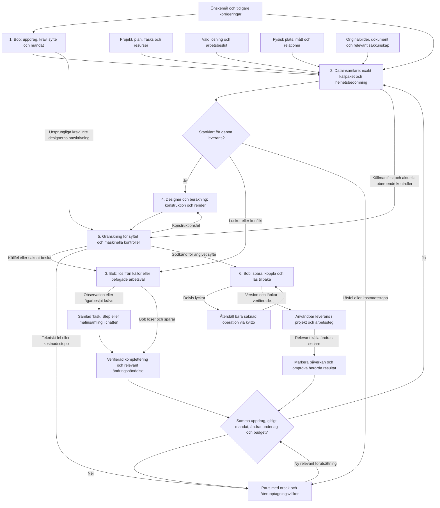

# Bob — från önskemål till användbar leverans

> **Status: specificerat målkontrakt och implementeringsförslag.** Produktmandatet i [user-stories.md](user-stories.md) gäller redan. Designvalen och etapperna här är underlag för implementation, inte bevis på levererad funktion.
>
> **Äger:** sambandet mellan datans väg, ansvar, överlämningar, fortsatt arbete och leveransacceptans. **Äger inte:** en ny ordlista, arbetsstruktur, databasmodell, CAD-motor, verktygskatalog eller V1-roadmap. Befintliga domänägare nedan behålls. Kvarstående arbete finns i [State](#state); daterade kontroller och tidigare överlämning hör till [arkivet](archive/bob-delivery-flow-review-2026-09-29.md).

**Fortsätt här:** [State och nästa handling](#state) · [FORM: hela flödet](#form-flow) · [P0:s arbetspass](#p0) · [Prioriteringar](#plan) · [Acceptansfall](#acceptans).

## 1. Utfallet vi vill ha

**Bob driver ett levande projekt. Chatten är kontaktytan, inte projektets databas eller arbetskö.** Användaren anger mål och mandat samt bidrar med observationer på plats. Bob ansvarar för att nästa meningsfulla resultat blir användbart, eller att ett verkligt hinder får en ansvarig och en bestämd fortsättning.

| Utfall | Observerbart klart-villkor |
|---|---|
| U1. En beställning räcker | Komplett relevant underlag leder till granskad, sparad och tillgänglig leverans utan ytterligare ”fortsätt” eller nytt tillstånd för normala förberedelser. |
| U2. Verklighet och avsikt blandas inte ihop | Användarkrav, uppmätt/rapporterad verklighet, specifikation, vald lösning, Bobs arbetsval, beräkning, uppskattning och okänt går att skilja åt hela vägen. |
| U3. Komplettering blir arbete | Samtliga nödvändiga luckor för nästa leverans samlas, befintlig Task/Step återanvänds och svar återupptar samma uppdrag. Oberoende arbete kan fortsätta. |
| U4. Underlaget går att lita på för sitt angivna syfte | Varje styrande mått, placering och beräkning har spårbart ursprung. Otillgängligt underlag blir inte ”godkänt” bara för att en modell säger det. |
| U5. Resultatet finns där arbetet sker | Rätt Artifact-version nås från projektet och relevanta Steps/Tasks efter omladdning och av en annan behörig deltagare. Privat chatt behövs inte. |
| U6. Ändringar och fel hanteras utan omstartskaos | Ändrade källor påverkar rätt resultat. Tekniska fel, kunskapsluckor, kvalitetsfel och kostnadsstopp har olika fortsättningar. Sparat eller utfört arbete förloras inte. |

Detta konkretiserar främst UC-001, UC-003 och UC-005. Samma ansvarskedja ska stödja UC-002:s byggdagar, människor och material samt UC-004:s manuella underlag. En korrekt ritningsleverans avslutar ritningsuppdraget, inte hela byggprojektet.

## 2. Dokumentationsägare och designval

### Befintliga ägare

| Område | Ägare som ska användas vid implementation |
|---|---|
| Mål, termer och arbetsstruktur | [User stories](user-stories.md), [domain dictionary](domain-dictionary.md), [living project plan](living-project-plan.md). Project → optional Area → Step → Task. Task-instruktioner är inte planens Steps. |
| Fysisk plats och källuppgifter | [Building model](building-model.md), [project facts](project-facts.md), [media and steps](media-and-steps.md). |
| Lösning, konstruktion och leverans | [Solutions](solutions.md), [CAD adapter](cad-adapter.md), [artifacts](artifacts.md), [material assembly use case](material-assembly-use-case.md), [material planning](material-planning.md). |
| Kontext, verktyg och återhämtning | [Context](ask-bob-context.md), [context implementation](ask-bob-context-implementation.md), [tools](ask-bob-tools.md), [writes](ask-bob-writes.md), [conversations](ask-bob-conversations.md), [shared background calls](shared-ai-background.md). Deras statusmarkeringar gäller; en specifikation är inte runtime. |
| Implementation, behörighet och UI | [Database](../db/README.md), [AI seam](../supabase/README.md), [UI index](ui-index.md), [verification](../.claude/skills/verify/SKILL.md). UI använder `src/data/database.ts`. |
| Löpande status och releaseordning | [Function inventory](function-inventory.md), [V1 plan](v1-plan.md). Etapperna här gäller leveransflödet, inte en konkurrerande produktroadmap. |

### Designval

| ID | Val och konsekvens |
|---|---|
| D1 | **Ett gemensamt projekt, separata sorters sanning.** Plats/objekt beskriver verkligheten; projektet beskriver förändringsarbetet; vald lösning beskriver avsikten; Artifact beskriver ett versionerat resultat. En Area är inte ett rum. Ett fristående bygge kräver inte en påhittad byggnad. |
| D2 | **En ansvarig Bob, avgränsade specialister.** Bob äger mål, framdrift och normala arbetsval. Datainsamlare, designer och granskare har kontrakt, inte egna konkurrerande projektminnen. Ett led behöver inte alltid vara ett separat modellanrop. |
| D3 | **Källor parallellt, inte en kedja av sammanfattningar.** Exakta poster, bilder och beslut följer med från respektive ägare. Sammanfattningar hjälper navigering och relevans men ersätter inte styrande källvärden. |
| D4 | **Startklarhet beror på leveransens syfte.** Illustration, konceptlayout och tillverkningsunderlag har olika krav. Ett lägre detalj- eller säkerhetsläge får inte tyst ersätta den beställda leveransen. |
| D5 | **AI tolkar och konstruerar; kontrollerbara funktioner hämtar, räknar och spärrar.** Kända värden används exakt. Styrande ändringar sparas som klassificerade, versionsbundna data; nästa specialist arbetar mot den sparade versionens kvitto. Servern hämtar befintliga identiteter/värden och beräknar beroenden. Val av relevant källa är fortfarande ett semantiskt ansvar som måste gå att granska. |
| D6 | **Båda riktningarna är obligatoriska.** Tillräckligt underlag ska leda vidare; otillräckligt underlag ska inte passera. En spärr utan en tydlig återhämtningsväg är inte färdig design. |
| D7 | **Samma uppdrag över kompletteringar.** Leveransuppdraget är operativt arbetsläge, inte ett extra lager i Project/Area/Step/Task-hierarkin. Nya försök får nya försöks-ID:n men behåller uppdragets identitet. |
| D8 | **Kravstyrd kontext vid behov.** Ett litet projektkort är alltid tillgängligt. Exakta källor, relevanta bilder och versionshanterat arbetskunnande hämtas när nästa handling kräver dem. Budgetar och avkortning syns. |
| D9 | **Mottagaren kontrollerar överlämningen.** Modellens ”klart” är inte ett spar-, gransknings- eller leveranskvitto. Behörighet, fullständighet, källaktualitet och format kontrolleras vid gränsen. |
| D10 | **Versionsspårning, inte ny databas från grunden.** Bygg vidare på befintliga identiteter och revisionsmekanismer. Föreslagen källgraf är ett logiskt kontrakt; valet av tabeller/JSON/relationsindex hör till senare implementation. |

## 3. Gemensamt flöde — datans och arbetets väg

Pilarna från projekt, fysisk plats, lösning och medier är **parallella källflöden**. De måste inte alla passera genom Bobs egen text. Granskningen använder kandidaten och en kontrollerbar koppling tillbaka till originalunderlaget. Vem som granskar och när bestäms av leveransens syfte; FORM:s två användargranskningar nedan konkretiserar denna övergripande ruta. Den är inte ett obligatoriskt nytt AI-anrop efter varje rendering. Kompletteringsslingan är villkorad; diagrammet ger inte tillstånd till oändliga modell- eller renderanrop.

### FORM — användargranskad 2D och 3D före slutleverans, beslut 2026-10-27

**Specificerad fortsättning på den tekniskt installerade första FORM-leveransen.**
FORM betyder *Från Önskemål till Realiserbar Modell*. Den befintliga
[Solution-modellen](solutions.md#early-concept-geometry-form--source-implementation-2026-10-26)
ger redan reviderbar ortogonal konceptgeometri och deterministiska 2D-vyer.
**Beslutet ersätter 2026-10-26-planens två obligatoriska AI-granskningar:**
användaren stämmer av form och funktion med Bob i 2D och i en detaljerad
3D-förhandsvisning. Avstämningen sker i samtalet utan godkännandeknapp;
användaren ansvarar inte för de tekniska detaljerna.
Bob ansvarar för konstruktionsarbetet, kod för beräkningar och maskinella kontroller;
AI-granskning används för konkreta osäkerheter eller avvikelser.
Detta ändrar målflödet. Dagens obligatoriska Rita-granskning är fortfarande
implementerad; ersättningsvägen, förhandsvisningen och dess versionsbundna
användarbeslut återstår att implementera och verifiera innan den kan tas bort.
[Releasebeviset](foundation-verification.md#form-concept-loop--local-synthetic-verification-2026-10-26)
äger installerat nuläge; [State](#form-next) äger nästa arbetspaket.

**Solution äger vad som ska byggas; Construction äger hur det byggs.** En
beskrivning och dess vyer ska uttrycka samma versionsbundna modell. Varje
efterföljande leverans får originalkrav, rättelser och relevanta källor parallellt
med modellen. En serie omskrivna sammanfattningar räcker inte som källkedja.

| Led | Källa och resultat | Ansvar för nästa beslut |
|---|---|---|
| Förstå uppdraget | Originalönskemål, tidigare rättelser, plats, mått, bilder och mandat. Krav, val, uppskattningar och okänt behåller sitt ursprung. | Bob identifierar användning, avgränsning och nödvändiga frågor. Befintliga projekt-/mått-/medieägare behåller sanningen. |
| Tidig 2D och beskrivning | Samma Solution-revision innehåller avsikt, funktioner, val och den lätta modellen. Kod tar fram plan, sida och relevant principsnitt. En kort förklaring gör modellen begriplig. | Bob föreslår och gör riktade ändringar. Användaren granskar layout, mått, placeringar och önskade funktioner före detaljering. Beslutet gäller den visade versionen. |
| Tidig visuell mockup vid behov | Konceptets exakta revision, namngivna vyer och originalreferenser ger underlag för utseende, materialkänsla och sammanhang. | Bilden hjälper användaren välja uttryck. Nya designval återförs till Solution. En AI-genererad illustration är fortfarande ett förslag även om prompten innehåller alla detaljer; den bekräftar inte geometri eller dolda förband. |
| Detaljerad konstruktion och beskrivning | Vald Solution-revision förfinas till Construction med delar, material, fogar, placeringar, parameterursprung och monteringsberoenden. Beskrivningen förklarar denna exakta revision. | Bob gör konstruktionsval; kod räknar och kontrollerar. En konceptdel kan genom den planerade spårbara förfiningen bli flera byggdelar. Detaljering görs före den slutliga 3D-granskningen. |
| Detaljerad visuell 3D-förhandsvisning | **Samma exakta Construction-geometri som slutritningarna** renderas med material/färg, ljus och valbara vyer som gör helhet och relevanta detaljer begripliga. | Användaren granskar den faktiska modellens form, utseende och funktioner. Modellens detaljer visas där de finns; text om en fog skapar inte automatiskt modellerade skruvar. Omodellerade eller olösta detaljer anges. Denna presentation och beslutskoppling återstår att bygga. |
| Avstämd riktning i samtalet | Bob visar modellen och frågar naturligt om den motsvarar önskemålet. Svarets innebörd kopplas till visat underlag, exakta Solution-/target-/Construction-revisioner och berörd avsikt. | Bob tar hand om versionskoppling och fortsatt arbete utan separat godkännandeknapp. Återkopplingen gäller form, användning och uttryck, aldrig teknisk korrekthet. Tidigare uttrycklig delegation används inom sin omfattning och registreras som ett delegerat beslut. |
| Slutliga ritningar, listor och leverans | CAD, detaljbeskrivning/monteringsanvisning och plock-/kapunderlag härleds från **den godkända Construction-revisionen**. Bob sparar, länkar och återläser rätt Artifact-version. | Exporten inför inga nya konstruktionsval. Kod kontrollerar versionslikhet, källaktualitet, geometri och leveranskvitton. Befintliga material-/lager-/produktägare kompletterar listorna; preliminära längder är inte en godkänd kapplan eller inköpslista. |

En dellista saknar delar av placeringarna och förbanden och kan inte ensam vara
3D-källa. Geometrimotorn kan användas redan för förhandsvisningen; **slutlig CAD**
är här export/publicering av accepterad geometri, inte ett nytt designsteg.
Återanvänd giltiga renderresultat där det går. En ny kameravinkel ska inte kräva
ett nytt konstruktionsanrop.

Detaljbeskrivningens versionskoppling, förhandsvisningens presentationsdata och
beslutets exakta lagring behöver preciseras inom [Artifact](artifacts.md),
[Solutions](solutions.md#form-refinement) och [medieägaren](media-and-steps.md#form-visual-preview).
Ingen separat beskrivnings-, list- eller projektminnesdatabas införs av detta flöde.
Den ursprungliga [FORM-referensen](form-design-loop-review-2026-10-26.md) bevaras
som metodunderlag; denna precisering äger relationen mellan leveranserna.

#### Bob planerar och förfinar i delar — specificerat 2026-10-27

Bob skapar själv arbetsplanen, identifierar nödvändigt underlag och väljer
konstruktionslösning inom uppdraget. Användaren behöver ingen byggkunskap.
Planen förändras när nya mått, önskemål eller kontrollresultat kommer in.
Stomme, ribbor, stege, hyllor och lådor är exempel på en möjlig uppdelning av
en säng; varken ordningen, antalet delar eller ett uppskattat antal AI-rundor
ska kodas som arbetsflöde. En enkel låda kan hanteras som en enhet.

[Den levande planen](living-project-plan.md#form-planning) behåller mål, Step,
Tasks, färdigvillkor och ansvar. Solution behåller helhetens form/funktion;
Construction behåller detaljkonstruktionen. Ett arbetsstycke är en avgränsning
av detta befintliga arbete, ingen ny projekthierarki eller parallell sanningskälla.
Varje verktygsanrop behöver inte en egen Task eller en egen godkännanderunda.

Bob skiljer mellan fysiska mått som behöver observeras, konstruktionsmått han
själv får välja och värden som kod kan beräkna. Han läser befintliga uppgifter
först och anger vad ett saknat mått behövs till och hur det kan tas.
En mätfråga aktualiseras när svaret behövs för nästa leverans; oberoende arbete
fortsätter. Ett känt värde efter en tidigare rättelse ska inte efterfrågas igen.

Helhetsmodellen reserverar tidigt utrymme och anslutningar för senare funktioner.
Inför varje arbetsstycke behöver Bob dess mål, berörda krav och delar, gemensamma
mått/anslutningar, exakta källversioner, kvarstående frågor och klart-villkor.
Han sparar en begränsad ändring, läser kontrollresultatet och rättar berörda
delar innan han fortsätter. Upprepade delar använder befintlig repetition.
En sammanhängande möbel kan växa inom samma Construction; separata
Construction-poster används när de har en naturlig självständig livscykel.
Dagens `plan_cad_pieces` köar redan färdiga konstruktionsunderlag och ersätter
inte detta designarbete eller kontrollen av anslutningar mellan delarna.

[Stegvis förfining](solutions.md#form-refinement) måste kunna uttrycka både
realiserade delar och återstående konceptfunktioner. En
[avgränsad kontroll](artifacts.md#form-scoped-checks) får visa att ett delresultat
är konsekvent inom sitt syfte utan att kalla hela konstruktionen färdig.
Delarnas egna kontroller kompletteras av kontroll av helheten och deras
anslutningar. Projekteringsordning, fysisk foggraf och monteringsordning är
olika saker; den ena får inte antas bevisa den andra.

Ändrade styrande uppgifter följs till berörda delar och leveranser. Bevara
övrig geometri och tidigare kvitton; en ny revision kräver fortfarande de
färskhetskontroller och nya versionskopplingar som domänägarna föreskriver.
Bob återupptar från sparade resultat efter avbrott. Vid upprepade fel undersöker
han källa, arbetsavgränsning eller verktygsstöd före ett nytt oförändrat försök.
Inga nya fasta arbets-/anropstak införs. Naturlig återkoppling till användaren
gör framsteg och verkliga hinder begripliga utan att flytta tekniskt ansvar.

#### Avstämning i samtalet — ägarbeslut 2026-10-27

Bob visar förslaget och bjuder in till vanlig återkoppling, exempelvis:

> Här är 2D-modellen. Stämmer den med vad du hade tänkt dig?

Samma princip gäller den detaljerade 3D-förhandsvisningen. Ingen särskild
godkännandeknapp, signering eller text som ”godkänn för att gå vidare” införs
för FORM. Användaren behöver inte känna till faser, versionsnummer eller interna
grindar. Bob beskriver vid behov den avstämda riktningen och fortsätter inom
mandatet. Han förklarar verkliga tekniska hinder och olösta frågor begripligt.

Bob tolkar återkopplingen i sitt vanliga arbete och sparar dess avgränsade
innebörd genom befintliga beslut och kvitton. Ett tydligt svar på den visade
modellen räcker; det kräver ingen andra bekräftelse eller obligatorisk extra
klassificeringsmodell. En korrigering blir en riktad ändring. Ett svar som
”ja, men flytta stegen” får inte registreras som att den oförändrade modellen
är accepterad. Tystnad, enbart visning eller ett oklart svar skapar inget
godkännande. Bob klargör bara en tvetydighet som påverkar nästa arbete;
befintliga beslut och uttrycklig delegation återanvänds.

Den interna spårningen bevarar vad som visades, vilken avsikt svaret avsåg,
vem som svarade och vilka revisioner det gällde. Beslutsunderlaget ska gå att
återläsa inom rätt behörighet; privat chatt kopieras inte till gemensamma
projektdata. Denna samtalskoppling är specificerad, ännu inte implementerad.

#### Vad användaren stämmer av

**Efter 2D:** användaren bedömer om förslaget motsvarar önskemålet. Visa funktioner,
antal, axlar, sida, relativa placeringar, öppningar, fria utrymmen och styrande
mått begripligt. Alla vyer ska beskriva samma modell. Okänt och uttryckligen
uppskjutet visas för konceptets syfte. Bob jämför med originalkrav och rättelser;
kod kontrollerar uttryckbara villkor. En giltig JSON-modell eller ett funktions-ID
bevisar inte att funktionen finns.

**Efter detaljerad 3D:** användaren bedömer den faktiska konstruktionens synliga
form, uttryck och funktioner före slutleverans. Vyer och detaljvyer ska visa det
som behöver bedömas, även på en annan sida eller invändigt. Material, färg och
ljus gör modellen läsbar men får inte förvränga geometrin. En genererad eller
generativt bearbetad inspirationsbild ersätter inte denna modellbundna visning.
Bob ansvarar fortsatt för förfining, tekniska val och olösta frågor. Användaren
behöver inte intyga hållfasthet, dolda förband eller produktlämplighet genom att
godkänna utseendet; sådana kontroller behåller sina befintliga ägare och gränser.

#### Teknisk kontroll på system- och specialistnivå

Bob driver den tekniska kontrollen oberoende av användarens visuella svar.
Användaren bidrar med önskemål, val och nödvändiga observationer på plats;
en nybörjare ska inte behöva avgöra om konstruktionslösningen är korrekt.

| Kontroll | Ansvar |
|---|---|
| Uttryckbara villkor: mått, beroenden, fogkontakt, kollisioner, versioner och källaktualitet inom verifierat stöd | Befintliga deterministiska konstruktions-/CAD-kontroller. Ostödda fall anges som luckor. |
| Kravuppfyllelse och konstruktionsfrågor som behöver tolkning | Bob samlar originalunderlaget och ordnar riktad, separat AI-/specialistbedömning där den behövs. Granskningen ska lämna evidens och konkreta avvikelser, inte bara tilltro till modellen. |
| Fysisk verifiering eller fackmässig bedömning utanför systemets stöd | Rätt sakkunnig eller fysisk kontroll inom befintligt arbetsflöde. Bob anger vad som återstår och driver den del som kan fortsätta; han ber inte användaren godkänna bort en teknisk lucka. |

Varje bindande krav för nästa leverans ska ha spårbar täckning och en relevant
kontroll eller en explicit kvarstående lucka. Ett användarval kan styrka önskad
placering eller färg men kan inte styrka ett tekniskt villkor. Saknad täckning,
motstridiga källor och ostödd förfining måste upptäckas även när Bob uttrycker
säkerhet. Återanvänd krav-, revisions- och kontrollsystemen; täckningskontrollen
innebär inte ett extra modellanrop för varje krav. Blockera bara den leverans
vars nödvändiga tekniska underlag saknas och bevara konceptets ärliga status.

##### Mer kontroll i kod — införandeplan

Utöka befintliga kontroller där samma underlag ger ett entydigt svar. Återanvänd
parameterutvärderaren, K2, CAD-kärnan och domänskrivarnas spärrar; bygg ingen
parallell generell regelmotor. Tabellen skiljer befintlig grund från nästa arbete.

| Område | Befintlig grund | Nästa avgränsade kodkontroll |
|---|---|---|
| Mått och parametrar | Enheter, ursprung, aritmetik, okända värden och parameterberoenden. | För nästa arbetsstycke: vilka styrande värden är kända, valda, beräknade, motstridiga eller saknas? En uppskattning blir inte uppmätt. |
| Koncept → byggdelar | FORM:s exakta koppling av samma box-ID. | Spårbar en-till-flera-förfining, bevarade funktioner/relationer och explicit återstående omfattning. Samma yttermått räcker inte som funktionsbevis. |
| Delar och anslutningar | K2:s begränsade geometri-, material-, kontakt-, fog- och sammanhängandekontroller. | Avgränsad kontroll plus berörda grannar och gemensamma anslutningar; slutlig helhetskontroll. Rörelse/frigång använder verifierat CAD-stöd, annars rapporteras att stöd saknas. |
| Kravtäckning | Solution-funktioner, planens färdigvillkor och CAD-handoffens krav. | Spårning från varje känt bindande krav till berörd modell/egenskap och giltigt kontrollbevis eller öppen lucka. Kontroller får inte bli gröna för att ett krav saknas i granskarens urval. |
| Aktualitet och återförsök | Exakta versioner, källaktualitet, behörighet, kvitton och följdarbete. | Kontrollbevis knyts även till omfattning och kontrollversion; ändrade beroenden gör beviset otillräckligt. Återanvänd giltiga resultat med färsk behörighetskontroll. |
| Leverans | Konstruktionens ritningskoppling, rollstyrda mängder och separat kap-/inköpslogik. | Samma källversion i förhandsvisning, ritningar, beskrivning och listor; alla utlovade filer/länkar återlästa. Preliminära ämnen får inte presenteras som godkänd kapplan. |

Kod kan bevisa att ett **registrerat** krav har behandlats, men inte att alla
önskemål i fri text förståtts korrekt. Originalönskemål och senare rättelser
behöver fortsatt tolkning och jämförelse; självständiga acceptansfall provar
vad Bob missar. Giltig geometri bevisar inte hållfasthet, produktlämplighet eller
fysisk passning. Saknat stöd lämnar en teknisk lucka även efter positiv AI-bedömning.
Kontrollresultatets exakta kontrakt hör hemma hos
[Artifact](artifacts.md#form-scoped-checks).

**Beslut och ändringar:** servern binder beslutet till behörig aktör, syfte,
exakta modell-/källrevisioner och det visade underlaget. Återanvänd Solution-,
Artifact- och kvittosystemen. Vald target eller `alignment` är inte ensamt bevis
på att användaren sett en viss 3D-presentation. En relevant ändring av form,
funktion, material eller styrande källa gör tidigare acceptans otillräcklig för
den berörda delen: visa ändringen, räkna om och inhämta nytt beslut där mandatet
kräver det. En extra vy eller återförsök av samma export kräver inget nytt
designgodkännande. Dessa är två meningsfulla avstämningar i samtalet, inga
formella godkännandesteg eller klartecken per verktyg. Väntande frågor visas ärligt och
pausar endast beroende arbete.

Rätta på den nivå där felet uppstod: ändrad funktion eller övergripande form går
till Solution; ett lokalt konstruktionsfel går till Construction. Räkna om och
granska berörda beroenden. Ett misslyckat sparande eller en saknad länk repareras
med befintliga kvitton utan att generera om geometri. Historik och orelaterade
delar bevaras.

#### Riktad AI-granskning och få anrop

AI används för koncept, konstruktionsval, förklaringar och behövd källtolkning.
Beskrivningar följer respektive designarbete och återanvänds så länge deras
källversion gäller. Hämtning av exakta poster, beroendeuppföljning, matematik,
listor, projektioner, rendering och kvittokontroll är kodarbete. Kodvalidering
behövs även för strukturerad indata och är inget extra AI-anrop.

En separat AI-granskare får en **konkret fråga**, berörda delar/beroenden,
maskinella kontrollresultat och relevanta originalkällor, exempelvis vid
motstridiga krav eller en förfining som kod inte kan verifiera. Den ska kunna
öppna originalen och vid behov utöka omfattningen. Svaret anger krav,
del/egenskap, källa, avvikelse och korrigering. Saknad evidens förblir en lucka;
användarens visuella godkännande kan inte kringgå den. En liten modell kan
slutföra en avgränsad granskning när den räcker; större modell används för
konkret behov. Lägg inte obligatoriskt en billig granskare framför varje annan
granskare. Oförändrat underlag ska inte köpas om för att få ett annat utslag.

**Mål:** ingen rutinmässig full AI-omgranskning efter slutexport av oförändrad,
accepterad modell. Innan dagens Rita-grind ersätts måste den nya vägen verifiera
versionsbundna beslut, käll-/behörighetsspärrar, tekniska kontroller och återhämtning.
Spar-/Step-kvitton förblir ett eget leveransansvar. K2 och kvarstående fysiska
kontroller tas inte bort av detta beslut.

Det planerade [underlagspaketet](ask-bob-context.md#task-source-packet) använder
befintliga läsare och kan minska huvudmodellens upprepade letande. En liten modell
tolkar vid behov text, med kontrollerbara källor och möjlighet att hämta mer.
Den väljer inte bort obligatoriska krav eller fattar användarens beslut. Val av
Nano/Mini avgörs av bibehållna krav och total kostnad/tid per korrekt leverans,
inte enbart priset per enskilt anrop.

**Införandeordning för smartare AI-användning:**

1. Ge huvud-Bob nästa avgränsade uppgift, helhetens bindande krav och relevanta
   originalkällor. Han väljer plan, konstruktion och nästa handling. Ändra minsta
   roll-/verktygsförklaring först när åtkomst, sammanhang och verktygsutfall är
   kontrollerade enligt [promptmetoden](prompt-craft.md).
2. Använd befintliga deterministiska plan-/konstruktionsändringar och gruppera
   sammanhängande deländringar. Små planändringar via `edit_project_plan` behöver
   redan idag ingen kompilator-/granskarmodell. Pröva den befintliga vägen innan
   en ny automatisk planerare eller kollega införs.
3. Lägg till den avgränsade läsaren bara för underlag som behöver tolkas.
   Jämför direkt läsning med ett litet modellstött underlagspaket; även extra
   anrop, missar och återhämtning räknas. Använd befintlig katalog och välj
   tillräcklig modell för uppgiften, utan obligatorisk Nano → Mini → stor-kedja.
4. Skicka konkreta granskningsfrågor tillsammans med kodresultat och relevanta
   original. Saknad kravtäckning, motstridiga underlag och otillräckligt stöd
   utlöser fortsatt utredning oavsett Bobs uttryckta säkerhet. En granskare får
   inte godkänna bort ett kodfel eller en nödvändig fysisk/sakkunnig kontroll.
5. Återanvänd observationer och renderresultat när deras källor, omfattning och
   kontroll-/modellkontrakt fortfarande gäller. Nuvarande resultatläsare är
   delvis bundna till samma tur; återanvändning över nya turer kräver uttrycklig
   lagring, åtkomstprövning och färskhetsregler hos befintliga ägare.

Den [daterade auditen](archive/bob-project-context-audit-2026-10-26.md) visade
att CAD-granskaren redan använde Mini. Lägre modellklass är därför ingen visad
besparing i sig. Huvudmodell, profiler och aktivering ändras först efter
jämförande acceptans och ordinarie releasebeslut. Besparingsmålet är mindre
upprepad tolkning och färre omtag per korrekt slutfört uppdrag, inte en fast
kvot av tillåtna anrop eller samma antal arbetsstycken för varje projekt.

## 4. Kontrakt per led

Fälten nedan är logiska kontrakt. Befintliga verktygsnamn, tillstånd och databastabeller ändras inte av dokumentet.

| Led och ansvarig | Källor och indata | Startvillkor | Utdata och klart-villkor | Nästa åtgärd vid olika utfall |
|---|---|---|---|---|
| **1. Bob formulerar uppdraget** | Aktuellt meddelande, tidigare rättelser, projektkort, aktuell Step och befintliga uppdrag. | Verifierad projektidentitet, användarbehörighet och ett mål att arbeta mot. | Stabilt uppdrags-ID; beställt syfte/detaljnivå; identifierade krav med ursprung; målobjekt, vald lösning och leveransplats hålls isär; mandat och kostnadsram är uttryckliga. Klart när mottagaren kan avgöra vad som ska levereras och vad som räknas som färdigt. | Giltigt uppdrag → 2. Saknat underlag hindrar inte beställning av insamling. Oklart avgörande mål → samlad fråga. Saknad behörighet → stoppa, inte söka runt åtkomstgränsen. |
| **2. Datainsamlaren bedömer hela underlaget** | Uppdraget samt parallella, behöriga källor: projekt/plan/Tasks, vald lösning, mått, fysisk plats/relationer, komponenter, material och bilder. | Giltigt uppdrag och ett avgränsat relevant sökområde. En saknad vald lösning får inte dölja andra luckor. | Exakta källposter/mediereferenser, lästäckning och bedömning av varje krav plus upptäckta nödvändiga beroenden. Klart när allt relevant inom deklarerad omfattning är bedömt eller begränsningen är explicit; inga tysta rest-sidor. | Tillräckligt → 4. Samlade kunskapsluckor/konflikter → 3. Läsfel, avkortning eller åtkomstproblem → särskilt tekniskt utfall med kvarvarande luckor bevarade. Den billiga modellen får inte ensam förklara oläst underlag irrelevant. |
| **3. Bob löser kompletteringar** | Hela lucklistan, befintliga källor och Tasks/Steps, mandat, lösningsalternativ och konflikter. | Uppdraget är aktivt och luckornas innebörd känd. | Befogade beslut och korrigeringar sparas genom rätt domänkommandon. Kvarstående observationer får återanvänd eller ny Task/Step, alternativt strukturerad mätinsamling i chatten. Varje lucka har ansvarig, svarssätt och blockerad leverans. Klart när kvarvarande luckor är samlade och arbetsläget sparat — eller när allt är löst. | Relevanta sparade kompletteringar → 2 i samma uppdrag. Väntan på användaren → parkera med konkret återupptagningsvillkor; fortsätt oberoende arbete. Skrivfel → återställ den skrivningen. Ingen fråga om nytt lov när befintligt mandat räcker. |
| **4. Designer konstruerar och renderar** | Godkänt intag, ursprungliga krav, exakt lösningsversion, källmanifest, relevanta bildpixlar och konstruktionskunskap. | Mottagaren bekräftar intagets giltighet, nödvändiga källor/bindningar, förmåga, behörighet och återstående budget. | Kandidat med konstruktion, beräkningsberoenden, geometri, delar/placeringar, vyer, exporter, hashvärden och öppna kontroller. Klart när kandidaten faktiskt renderats och inga tekniska diagnoser utger sig för att vara leverans. | Kandidat → 5. Upptäckt källlucka/konflikt → 3/2, inte påhittat mått. Konstruktionsfel → avgränsad korrigering. Render-/modellfel eller kostnadsstopp → korrekt pausorsak, inte en ny konstruktion som felsökningsmetod. |
| **5. Granskning för syftet; servern kontrollerar beslut och villkor** | Exakt kandidat, originalkrav, visat underlag, aktuella källkontroller och deterministiska kontrollresultat. | Samma kandidat- och källfingeravtryck; obligatoriska källor lästa; relevanta vyer levererade; rätt beslutsmandat. Vid behövd AI-bedömning krävs också förmåga och budget. | Kravtäckning, konkreta avvikelser och beslut för uttryckligt syfte. I FORM granskar användaren 2D och detaljerad 3D före slutexport; separat AI-bedömning behövs för konkreta frågor enligt FORM-kontraktet. Resultatet binds till kandidat, krav, källor, visat underlag och beslutsaktör. Maskinella villkor gäller oavsett vem som granskar. | Giltiga beslut och kontroller → 6 utan ny full AI-granskning av samma export. Geometri/konstruktion → 4 med specifika ändringar. Källfel/beslutsfel → 2/3. Saknad nödvändig evidens eller beslut → beroende leverans väntar med konkret orsak. |
| **6. Bob sparar, kopplar och levererar** | Godkänd exakt kandidat, käll-/kravfingeravtryck, förväntad Artifact-revision, rätt projekt och Steps samt befintliga kvitton. | Behörighet, mandat och källaktualitet kontrolleras igen vid spargränsen. Inget konkurrerande avslut har redan sparat samma leverans. | Versionskvitto, exakta steglänkar och återläsning från avsedd projektyta. Klart när rätt innehåll och länkar faktiskt är tillgängliga; utfallet anger syfte och återstående fysiska kontroller. | Komplett → levererat. Fil sparad men länk saknas → reparera länken utan ny generering. Skrivkonflikt/ändrad källa → uppdaterad bedömning, aldrig blind överskrivning. Bruten åtkomst → ärlig spärr, inte framgångsmeddelande. |

**Ändringsansvar efter leverans:** Bob ansvarar för konsekvensbedömningen. Domänkommandot publicerar vilken källa/version som ändrats; beroendeuppföljningen identifierar berörda leveranser; respektive domän hanterar omräkning, omgranskning eller ändringsarbete. Arbetets verkliga utförande och inköp skrivs inte om som om de aldrig hänt.

## 5. Källkontraktet — vad som måste följa med

### Identitet, innebörd och tillförlitlighet

Varje källa ska ha stabil typ/namnrymd + ID + revision eller oföränderligt innehållsfingeravtryck. Ett ensamt UUID eller en textetikett räcker inte. Uppgiften ska identifiera sitt objekt, sin egenskap och sin giltiga omfattning: fysisk plats, befintligt objekt eller viss lösningsversion.

Bevara ursprungligt värde, enhet, sanningsklass, uppgiftslämnare/källreferens och relevanta tidpunkter. Mätmetod, referenspunkter och precision/osäkerhet följer med när de är kända; okänt markeras, inte fylls i. `measured` är fortfarande rapporterat uppmätt enligt källan, inte en oberoende inspektion.

Befintliga `TruthState`-värdena i [project-facts.md](project-facts.md) ersätts inte med en ny enum här. **Användarkrav, lösningsval och beräkning är dessutom olika semantiska roller**, inte alternativa sätt att stämpla en fysisk mätning. Ett biblioteksmått eller produktblad är en specifikation; ett valt lådmått är ett arbetsbeslut; ett bildtolkat avstånd är en uppskattning.

### Gemensam överlämningsstruktur

| Del | Obligatoriskt innehåll i målkontraktet |
|---|---|
| Uppdrag | `request_id`, uppdragsrevision, `attempt_id`, projekt, målobjekt/fysiskt scope, valda lösningsreferenser, Step-/Task-destinationer, beställt syfte, krav-ID:n och mandat-/budgetreferens. |
| Källmanifest | Typ, ID, version/hash, exakt post eller återläsbar pin, objekt/egenskap, originalvärde/enhet, sanningsklass, ursprung och hur källan påverkar kravet. Inga fria projektreferenser från modellen utan serverkontroll. |
| Lästäckning | Sökområde, efterfrågade dataset/objekt, lästa sidor, återstående markörer, begränsningar, källor som faktiskt öppnats och status per obligatoriskt beroende. `empty`, `unread`, `unavailable`, `denied`, `truncated` och `conflicting` är olika tillstånd. |
| Bilder | Stabil mediaidentitet, revision/hash, syfte och koppling till objekt/viewpoint. Relevanta pixlar följer med till design/granskning och faktisk leverans till modellen kvitteras. Lagrade signerade URL:er eller privata pixelkopior i arbetsminnet ersätter inte källidentiteten. |
| Parameterursprung | Stabilt parameter-ID/sökväg i konstruktionen; `source`, `decision`, `derived`, `estimate` eller `unknown`; exakta käll-/beslutsreferenser; normaliserat värde/enhet och tillämpad transformationsregel. |
| Beräkning | Versionsbestämd, tillåten formel/operation; operandreferenser och revisioner; enheter, tolerans och avrundningsregel; resultat samt beroenden. Inte exekverbar modellskriven kod eller bara resultatet i fri text. |
| Kandidat och granskning | Geometri-, export- och preview-hash; källversionsvektor; krav-/syftesversion; relevanta kunskaps-/regelversioner; granskningsutfall, kravtäckning och vilka kontroller som återstår. |
| Leverans | Artifact-ID/revision, relationskvitton till rätt Steps/Tasks, idempotensnyckel och verifierad återläsning. Granskningshistorik är spårbarhet, inte permanent certifiering. |

### Bindningar gäller mer än en dels bredd

Alla **styrande** dimensioner, instansplaceringar, öppningar, avstånd och koordinattransformationer ska ha klassificerat ursprung. Direkt källbundet värde hämtas maskinellt från pinnen. Ett konstruerat värde pekar på ett dokumenterat arbetsbeslut. Ett härlett värde pekar på samtliga operander och beräkningsregeln. Godtycklig text i `assumptions` ersätter inte en saknad obligatorisk bindning.

Bevara originalenheten även när geometrin använder mm. Omvandlingen ska vara exakt inom den representerade numeriska precisionen; tolerans och avrundning är uttryckliga. En beräkning kan vara numeriskt exakt men fortfarande baserad på ett uppskattat underlag. Okänt är inte noll.

Exempel, inte projektdata: en fri öppning beräknas som totalbredd minus två sidstyckens tjocklek och ett beslutat spel. Alla fyra ursprung följer med. När tjocklekens källa ändras ska öppning, berörda delar och materialunderlag hittas via beroendena, inte genom textsökning efter samma siffra.

### Koordinater och riktningar

Ett koordinatsystem behöver identitet/version, origo, positiva axlar, längd- och vinkelenhet samt kända transformationer mellan del, konstruktion, rum och ritningsvy. Kamerans vänster är inte rummets väster. Vägg-/objektreferenser, hörn och öppningsriktningar ska vara identifierbara.

En kompassuppgift från användaren knyts till det avsedda objektet eller den avsedda bilden. Okänd transformation är en lucka när den behövs för leveransen. En genererad inspirationsbild får aldrig bestämma fysiska mått eller upphäva en senare rättelse.

### Konflikt och versionsbyte

Senast skrivet vinner inte automatiskt. Först jämförs objekt, egenskap, referenspunkter, användning och lösningsversion. Två aktiva poster kan vara legitima olika mått; V1/V2 i ett namn är inte i sig en revisionsrelation. Verklig ersättning länkas uttryckligt och gammal användning arkiveras/ersätts med historiken bevarad. En befintlig låda, ett nytt designmått och rummets utrymme får inte slås ihop.

Beroendena bildar en riktad acyklisk beräknings-/härledningsgraf. Cykler och saknade operander ska rapporteras. Ändring, arkivering, byte av vald lösning eller förlorad åtkomst kan göra en leverans inaktuell. Kontrollera källversioner vid intag, granskning, sparande och återöppning; relevanta ändringshändelser ger dessutom proaktiv påverkan. En tappad händelse får inte göra återöppningskontrollen överflödig.

Sparandet måste kontrollera samma förväntade revisioner vid den auktoritativa skrivgränsen, inte bara tidigare i AI-samtalet. Historiska leveranser bevaras. Ny källversion ogiltigförklarar inte automatiskt allt i projektet, bara resultaten som beror på den.

### Kvarstående datagränser — kodgranskning 2026-10-10

**Kodgranskade luckor och specificerade nästa gränser, inte nya driftsatta funktioner.** [Verifieringen](foundation-verification.md#data-authority-gap-review--2026-10-10) skiljer kontrollerade motprov från verkliga medlems-/modellfel. [Databasägaren](../db/README.md#construction-data-authority-and-remaining-extensions) skiljer befintliga, kontrollerade versionskopplingar från planerade schema- och flödeskompletteringar. Den redan specificerade [parameterändringen före ritning](artifacts.md#parameter-changes-before-drawing--specified-2026-10-10) återanvänder K1/K2/K3; nedan är ytterligare luckor, inte en parallell databasplan.

| Prioritet / gräns | Verifierat nuläge och risk | Nästa avgränsade ändring och ägare |
|---|---|---|
| 1. Återupptagningsbesked | Det tidigare motprovet accepterade fritt `answer` trots motsägande kvitto. [Konversationsägaren](ask-bob-conversations.md#receipt-owned-drawing-event-replies--2026-10-10) äger den installerade kvittobundna komponeringen och [verifieringen](foundation-verification.md#receipt-owned-drawing-event-replies--2026-10-10) de tekniska bevisen. | Verklig medlemsacceptans återstår i leverans E: rätt status, språk, partiella resultat och fortsättning efter omladdning. Återanvänd installerad rättning; drift- och fixturbevis ersätter inte medlemsprovet. |
| 2. Delens roll | CAD-receptet saknar en typad roll för byggdel, befintlig del och referensobjekt. Listgeneratorn räknar varje använd definition; ett namn som antyder referens utesluter inte delen. | [Artifact](artifacts.md#k1-construction-checkpoints), [CAD](cad-adapter.md) och [material](material-planning.md) behöver samma versionsbundna instansroll och mängdpolicy. Referensgeometri ska synas i ritningen och ha en uttrycklig hantering i behov/kapning. Befintliga delar och inköpta underassemblies får inte dubbelräknas. Bevara äldre recept utan att gissa roller från namn. |
| 3. Följdändringar | Ändrad konstruktion gör gamla behov inaktuella och blockerar fel publicering. Samma behov kan räknas om med sin befintliga identitet, men det kräver ett uttryckligt kommando. En sammanhängande uppdatering av ritning, behov, kapning och plan saknar ännu ett färdigt generellt flöde. | Använd de befintliga käll-/beroendelänkarna för en sparad konsekvenslista och kvittoförd omräkning av bara berörda resultat. [Materialägaren](material-planning.md), Artifact och [livscykeln](#när-får-ett-nytt-försök-starta) behåller sina skrivgränser. Ändrade beställningar, reservationer och utfört arbete hanteras uttryckligt; de skrivs inte om automatiskt. Prova även avbrott och orelaterade delar. |
| 4. Måttets innebörd | [Projektmått](project-facts.md) kan tillhöra en befintlig komponent och har exakt värde/enhet/revision, men `subject` är fri text. Kontroll av numerisk koppling bevisar inte att vald källa beskriver rätt egenskap eller referenspunkter. | Komplettera befintlig mått-/bindningsmodell med typad egenskap och kända referenspunkter där dessa behövs. Mottagaren kontrollerar objekt, egenskap och koordinattransformation före användning. Fritextbeskrivningar och gammal historik bevaras; okänd betydelse blir en synlig lucka, inte ett gissat fält. [Fysisk ägare](building-model.md) och projektmått äger källorna. |
| 5. Produktuppgiftens evidens | [Leverantörsartiklar](material-planning.md#k4-supplier-articles-and-pack-purchases) har versionspins och deklarerad källhänvisning. `supported_fields` deklarerar källstöd; kommandot kräver inte fångat källinnehåll för varje AI-hämtat värde. Förpackningsräkningen är deterministisk men kan fortfarande använda en felaktigt avskriven uppgift. | Material-/kunskapsägarna ska skilja deklarerad specifikation från fångad leverantörsevidens. AI-hämtade artikel-/förpackningsfält behöver exakt öppnad källa/version och återläsbar evidens för fältet. Behåll manuella uppgifter med ärligt ursprung; saknad packstorlek förblir olöst. Återanvänd befintlig packberäkning, inte en ny inköpsmotor. |

Behåll fungerande gränser: serverberäknade parameteruttryck/enheter, källversionslås, kanoniska lösningsfunktioner i CAD-handoff, stabila serverfördelade uppdragskrav, fokuserade planändringar och reproducerbar mängd-/packavrundning. Att en källa lagras gör inte AI:s semantiska val av den automatiskt korrekt. [State](#state) anger nästa arbete; denna granskning körde inga betalda modeller eller ändringar i beställarens projekt.

## 6. Just-in-time intelligence och kostnadsmedvetenhet

| När/vem | Vad som behövs just då |
|---|---|
| Alltid hos Bob | Mål, aktivt uppdrag/Step, mandat, budgetläge, viktiga begränsningar, öppna hinder, senaste ändringar och karta över tillgängliga källor/förmågor. Fem senaste hela meddelanden och äldre arbetsöversikt enligt samtalsägaren; exakta äldre källor går att återhämta. |
| Före nästa leverans | Syftes-/riskprofil med nödvändiga underlag, kontroller och acceptanskriterier. Profilen kombineras av arbetsmoment, material och miljö, inte ett särskilt manus för varje möbel. |
| Datainsamlare | Billig strukturerad listning, exakta ID-läsningar, sidmarkörer, relevanta relationer och bildmetadata. Semantisk sökning används där identiteter inte räcker. Resultaten visar vad som faktiskt lästs. |
| Bob vid lucka | Hela bedömningen, tidigare frågor/Tasks, möjliga alternativa källor, konstruktionsmandat och kostnaden/nyttan av nästa informationssteg. Svåra tolkningskonflikter eskaleras; samma billiga felbedömning upprepas inte blint. |
| Designer | Ett avgränsat men tillräckligt paket: exakta begränsningar, lösning, bildpixlar, konstruktionskunskap och tillåtna verktyg. Möjlighet att hämta mer när ett nytt faktiskt beroende upptäcks. |
| Granskare | Samma ursprungliga krav, exakt kandidat, källursprung, relevanta pixlar och oberoende aktualitets-/täckningskontroll. Inte bara designerns urval eller dess försäkran om att allt är rätt. |
| Sparande och felhantering | Aktuella behörigheter/versioner, kvitton, nästa tillåtna operation och felklass. En känd teknisk status kan levereras utan ett extra dyrt modellanrop för formuleringen. |

Versionshanterade kunskapspaket anger tillämpningsområde, källa, datum, nödvändiga frågor, kontroller och begränsningar. Nya/externt föränderliga sakkrav behöver verifierade källor. Säkerhetskritiska startkrav väljs inte bort bara för att relevansmodellen missade ett paket. Bob behöver både veta **vad verktyget gör** och **om det verkligen är tillgängligt**; [verktygsägaren](ask-bob-tools.md) behåller sitt mandat.

Ingen höjning av modellstorlek, promptlängd eller budget beslutas här. Först används billig hämtning och deterministiska kontroller; kvalificerat resonemang läggs på konstruktion, konfliktlösning och granskning. Kostnad följs per uppdrag/försök/led, inklusive misslyckade anrop. Ett stoppvärde är inte en garanterad faktureringsgräns för ett redan pågående anrop.

## 7. Uppdrag, återupptagning och olika fel

### Operativt arbetsläge, skilt från privat samtalsminne

Målbilden behöver ett beständigt uppdragsläge: mål, status, nästa handling, ansvarig, blockerande beroenden, senaste giltiga underlag, försöksfingeravtryck, kvitton och kvarvarande mandat/budget. Det får inte bara vara en mening i sammanfattningen.

Återanvänd befintlig jobbkörning, versionskontroll och kvittojournal där de passar. Blanda inte ihop projektets minsta nödvändiga uppdragsstatus med privata meddelanden eller specialistsamtal. Projektarbete ska i målbilden kunna fortleva efter en chattåterställning, men privata uppgifter får inte automatiskt publiceras. För den tidigare kontrollen av trådbundna ritningsutkast, se [arkiverad livscykelavgränsning](archive/bob-delivery-flow-review-2026-09-29.md#livscykel). Retention, avbrytande och eventuell behörighetsöverlämning måste regleras i respektive ägarkontrakt före implementation.

Ett svar via chatt, ett ändrat mätfält i UI och en avslutad mät-Task ska använda samma kanoniska domänuppdatering. En relevant händelse väcker det väntande uppdraget; mottagaren hämtar aktuella värden och kontrollerar att luckan verkligen är löst. Att någon klickat ”klar” bevisar inte att det saknade måttet finns.

### När får ett nytt försök starta?

Ett återupptagningsförsök kräver: aktivt uppdrag, giltig behörighet/mandat, rätt förväntad uppdragsrevision, kvarvarande eller uttryckligt nytilldelad budget samt en **meningsfull förändring**. Exempel är relevant ny källversion, löst konflikt, ändrat tillåtet arbetsbeslut, reparerad teknisk förutsättning eller ändrad kandidat efter konkret granskningsfeedback.

Fingeravtrycket bygger på uppdrag/krav, relevanta källversioner, syfte, kandidat och relevanta regel-/motorversioner — inte på nya tidsstämplar, formuleringar eller signerade URL:er. Dubbla händelser och samtidig körning får inte skapa dubbla kostnader eller leveranser. Enbart en ny chattvända är inte skäl att upprepa ett oförändrat misslyckande.

| Utfall | Ansvar och fortsättning |
|---|---|
| Tillräckligt och giltigt | Fortsätt till nästa led inom befintligt mandat. `ready` betyder redo för nästa led, inte sparat eller byggsäkert. |
| Verklig kunskapslucka | Bob söker befintligt underlag först; därefter samlad mät-/observationsuppgift. Återuppta när relevant information ändrats. |
| Källkonflikt | Bob utreder omfattning och ursprung; fysisk kontroll/ägare vid behov. Designer får inte lösa konflikten genom att välja snyggaste värdet. |
| Saknat avgörande ägarbeslut | Samlad beslutsfråga med alternativ och konsekvenser. Vanligt reversibelt konstruktionsval är inte automatiskt ett ägarbeslut. |
| Kvalitetsfel | Granskaren anger exakt krav, källa och korrigering samt ansvarigt led. Ny granskning först när relevant kandidat/underlag faktiskt ändrats. |
| Tillfälligt tekniskt fel | Begränsad återförsökspolicy med väntan/backoff och idempotens där operationen är säker. Reparera felande led; ingen ny konstruktion för att lösa nätfel. En begränsad transportretry är inte ett nytt designförsök. |
| Saknad förmåga eller permanent tekniskt fel | Parkera hos rätt systemansvar, ange vad som måste bli tillgängligt. Kalla det inte en saknad mätning eller ett krav på nytt ägargodkännande. |
| Kostnads-/anropsstopp | Spara läge och kvitton. Ingen automatisk budgetnollställning vid händelse, worker-segment eller nytt försöks-ID. Ny budgettilldelning är skild från nytt arbetsmandat. |
| Delvis lyckat sparande | Återläs kvitton och reparera bara saknad del, exempelvis Step-länk. Rendera inte om en redan sparad fil. |
| Ändrat mål, avbrutet uppdrag eller återkallad behörighet | Avbryt/ersätt enligt explicit status. Sen återkomst från specialist får inte skriva över det nya målet eller fortsätta under indragen åtkomst. |

## 8. UI och ärlig leverans

Projektets startsida visar nästa användbara handling, gällande primärt underlag, vad Bob arbetar med och vad som väntar på användaren. Samma Artifact kan länkas till flera Steps utan duplicerad fil. En Task och dess instruktioner använder rätt länktyp enligt befintliga ägare.

Visa skillnaden mellan skapas, kandidat under granskning, sparad, kopplad, levererad och inaktuell. Visa även varför arbetet står still. ”Nyaste version” är inte automatiskt rätt gällande arbetsversion. Ett äldre underlag kan behöva visas historiskt men får inte framstå som aktuellt.

Luckor blir begripliga handlingar: vilket mått/observation, mellan vilka referenser, med vilken bild och varför det behövs. Samla en relevant mätrunda, inte alla framtida frågor för hela huset. Ändring via UI och chatt påverkar samma projekt. Kompletterings-Task dedupliceras genom uppdrags-/luckidentitet, inte titelmatchning.

Behöriga deltagare ska kunna öppna rätt underlag efter omladdning utan Bobs privata chatt. Projektbehörighet ger inte automatiskt åtkomst till all byggnadsinformation eller andra deltagares privata information. Fysiskt arbete, säkerhetskontroller eller certifiering markeras inte utfört av att Bob producerar en fil.

## 9. Hitta rätt nuläge och underlag

Läs [State](#state) för kvarstående arbete och nästa handling. För vad appen faktiskt stödjer, använd [funktionsinventeringen](function-inventory.md) och respektive domänägare; återkontrollera berörd kod mot aktuell main inför implementation.

Den daterade kod-/datakontrollen och tidigare överlämningen finns i [granskningsarkivet](archive/bob-delivery-flow-review-2026-09-29.md). Arkiveringen flyttar bevis och historik, **inte öppna problem till ”klart”**. Åtgärderna för F3 ligger kvar i P0, F1/F2/F4 i P1 och uppdragslivscykeln i P2. Historiska test-/driftuppgifter får inte räknas som nya resultat.

## 10. Prioriterad implementeringsplan

**Ingen etapp implementeras eller driftsätts av denna dokumentationsändring.** Varje etapp behöver separat diffgranskning, verifiering mot aktuell main och uttryckligt beslut om eventuell datamigration/driftsättning. Den delade databasen får inte ändras tvärs över andra appars schemaägarskap.

| Prioritet | Leverans och designarbete | Ägare/berörda ytor | Klart-villkor |
|---|---|---|---|
| **P0 — stäng godkännandeluckan utan att stoppa giltiga leveranser** | Gör nödvändig källtäckning till ett maskinellt villkor före betald granskning/godkännande. Särskilj irrelevant ofullständig extrainformation från olästa obligatoriska beroenden; relevansen måste styrkas. Bevara alla luckor och returnera rätt teknisk fortsättning. Lägg först regression för ”läsfel + modellpass” och motsvarande komplett lyckat flöde. | CAD/intag/granskning; `cad-assistant.ts`, `drawing-review.ts`, `cad-review.ts`, befintliga tester och spargräns. Ingen generell schemaombyggnad. | Obligatoriskt läsfel kan aldrig ge sparbar godkänd kandidat. Komplett underlag kan fortfarande gå till sparad och kopplad Artifact utan extra ägarfråga. Tidigare giltig leverans bevaras vid fel. |
| **P2 — komplett uppdragslivscykel** | Definiera projektbeständig minimiidentitet kontra privat arbetsminne. Samlade luckor länkas till Task/Step/chat. Väck samma uppdrag av relevanta domänhändelser. Lägg versionslås, deduplicering, avbrytande, retryvillkor och beständig budgettilldelning/kvittoåterhämtning. | Living plan, conversations, writes, shared background calls och CAD request-store. | Både UI- och chattsvar återupptar samma uppdrag utan knuff. Dubbla händelser/återbesök ger inte nya kostnader eller dubbletter. Kostnadsstopp och indragen behörighet kan inte kringgås. |
| **P3 — rätt kontext och rätt projektyta** | Uppdragskort, källkarta, ändringsdelta och tydliga förmåge-/kunskapspaket; relevanta bilder levereras faktiskt. Visa leveransstatus, källstatus och samlade kompletteringar i befintliga UI-ytor. Separera gällande version från senaste förslag. | Context/tools/knowledge samt UI-index/artifacts/media. Vera granskar mobil, åtkomst och ärliga felstatusar. | Bob vet vad som behövs och var det finns; användaren ser varför han väntar och hittar rätt resultat efter reload. Inte ett separat nytt chatt- eller planeringssystem. |
| **P4 — faktisk produktacceptans** | Kör varierade verkliga modellflöden med komplett/ofullständigt underlag och kontrollerade fel, plus deltagar-/mobil-/återbesöksprov. Testa fler konstruktioner och större projekt med samma generella modell. | UC-001–005, verification och berörda domänägare. | Dokumenterade slutresultat och kostnader, inte enbart mocks eller bra svarstext. Endast uppfyllda delutfall markeras klara; hela UC stängs enligt user-stories. |

**Planens första implementationsetapp är P0; aktuell nästa handling finns i [State](#state).** Den utgår från [det daterade fyndet F3](archive/bob-delivery-flow-review-2026-09-29.md#fynd), har en avgränsad granskningsyta och ett tydligt positivt motprov. P1 är nästa strukturella steg; fysisk scope-rättning görs inte genom att gissa kopplingar eller arkivera allt som heter V1.

### 10.1 P0 — kodgranskning, reproduktion, fix och verifiering

**Arbetsmetod för P0.** Arbetssättet är ett avgränsat pass per etapp, med möjlighet att dela större etapper. Varje pass omfattar granskning, reproducerbara prov, avgränsad implementation och verifiering; planen får inte behandlas som bevis för att alla antaganden redan är riktiga. Aktuellt återstående arbete finns i [State](#state); genomförandebevis hör till [implementations-PR #159](https://github.com/EmelieHagander/Bob-the-builder/pull/159), inte en avslutslogg här.

**P0:s mål:** göra godkännandegränsen tillförlitlig utan fler onödiga stopp. Båda riktningarna krävs: obligatoriskt oläst underlag ska stoppa godkännande, och tillräckligt giltigt underlag ska kunna nå sparad och kopplad leverans inom befintligt mandat.

| Del | Arbete | Konkret utfall / bevis som ska lämnas |
|---|---|---|
| **P0.1 — granska hela den berörda kodvägen** | Kontrollera aktuell main, arbetsbranch och pågående ändringar. Följ intag → granskarens källhämtning → modellutslag → kandidatstatus/lagring → faktisk spargräns och steglänk. Sök alternativa verktygsvägar, återlästa kandidater och retryvägar; begränsa inte granskningen till den redan identifierade accepteringsgrenen. Kartlägg var obligatoriska källor bestäms och hur relevant lästäckning kontrolleras. | Kodkarta med exakta filer/funktioner/commit, möjliga kringvägar och föreslagen auktoritativ kontrollpunkt. Redovisa vad som är kodläst, testat respektive ännu okänt. |
| **P0.2 — reproducera före ändring** | Skriv/kör regressionen för obligatoriskt läsfel + modellens `pass` och följ även sparvägen. Lägg positivt motprov med komplett underlag samt ett fall med styrkt irrelevant oläst extrainformation. Kontrollera avkortning/paginering, åtkomstfel och återläst äldre kandidat där kodvägen motiverar det. | Ett test som visar felet före fix och oförändrade acceptanskrav för efterprovet. Exakta testnamn, kommandon, miljö och resultat; utebliven reproduktion rapporteras som sådan, inte som ett redan passerat test. |
| **P0.3 — minsta sammanhängande fix** | Inför maskinella villkor som modellens svar inte kan överrösta. Hantera nödvändig källtäckning före betald granskning och säkerställ att ingen berörd sparväg kan kringgå godkännandet. Bevara korrekta tidigare leveranser. Skilj läsfel från verkliga uppgiftsluckor och återför rätt nästa handling. | Avgränsad kodändring på separat implementationsbranch. Ingen generell databasombyggnad, gissad datarättning, ny agentuppdelning eller budgethöjning. Om någon sådan ändring faktiskt krävs ska beroendet och nytt scope redovisas, inte smygas in. |
| **P0.4 — verifiera båda riktningarna och granska diffen** | Kör regressionerna och relevanta tester/kontroller enligt [verify](../.claude/skills/verify/SKILL.md). Följ både det stoppade flödet och komplett underlag till sparad version, rätt steglänk och återläsning. Granska diff och felvägar separat från själva patchandet; ange vem eller vilket verktyg som faktiskt granskade. | Separat implementations-PR med bevis, kvarstående begränsningar och bedömning inför eventuell driftsättning. Fixture-/integrationstest, verklig modell-/CAD-körning och driftsättning redovisas separat; inget av dem får ersätta de andra i statusen. |

**Obligatoriskt kontra irrelevant:** oläst obligatoriskt underlag stoppar. Styrkt irrelevant extrainformation ska inte stoppa. Osäker relevans behöver utredas och får inte väljas bort enbart av samma modell som vill godkänna kandidaten. Intagets krav, källidentitet och användning måste ge en kontrollerbar grund för avgränsningen; P1:s fulla källgraf förklaras inte färdig av en smal P0-fix.

**P0:s utgångsprov:** [A06](#acceptans) ska förhindra godkänd sparbar kandidat vid nödvändigt läsfel även om modellen svarar `pass`. [A01](#acceptans) är det positiva motprovet hela vägen till tillgänglig leverans utan nytt lov. Berörda delar av A03, A11 och A13 kontrollerar lästäckning, korrekt felklass och bevarad delvis lyckad leverans. Om ett separat fel i ett senare led hindrar A01 ska P0:s spärrfix och den återstående leveransblockeringen rapporteras var för sig — inte sammanfattas som ”hela P0 klart”.

**Utanför P0:** fullständig parameter-/beräkningsspårning och riktad fysisk datarättning hör till P1. Händelsestyrd återupptagning efter ett senare UI-mått eller en Task-uppdatering hör till P2. P0 ska inte skapa nya frågor om redan givet arbetsmandat. P2:s tekniska fortsättningsprov ersätter inte P0:s verkliga användaracceptans.

**Överlämningsgrind:** lägg test-/granskningsbevis i PR/CI eller relevant verifieringsägare, uppdatera berörda domänkontrakt och lämna endast nästa handling och kvarstående hinder i [State](#state). Arkivera avslutade delsteg med bevislänk; kvarstående acceptans-, merge- eller driftsättningsbehov ska fortfarande synas. Ingen automatisk merge, datamigration eller driftsättning ingår; kontrollera diff, målmiljö och uttryckligt mandat före varje sådan åtgärd.

## 11. Acceptansfall

Alla fall bedömer slutläget i data och avsedd UI, inte bara Bobs svar. Använd kontrollerade tester för mekanik och separat verklig modell-/deltagaracceptans för beteende. Exempelobjekten är fixturer, inte produktens tillåtna objektlista.

| ID | Situation | Krävt utfall |
|---|---|---|
| A01 | Komplett underlag och en beställning | Intag → konstruktion → granskning → sparad version → rätt Step-länk → återöppnad leverans. Noll extra knuffar eller nya frågor om normalt mandat. |
| A02 | Flera saknade uppgifter, varav en redan finns i äldre underlag | Befintlig uppgift återfinns. Alla återstående nödvändiga luckor samlas i en begriplig komplettering. Svar återupptar samma uppdrag och avslutar leveransen. |
| A03 | Relevant källa ligger efter första sidan eller äldre chattsammanfattning | Exakt källa hämtas med korrekt version. Avkortad sökning märks ofullständig, inte ”finns inte”. |
| A04 | Känd källa i cm/m och en beräknad dimension | Originalvärde/enhet och beräkningskedja finns kvar. Normaliserad geometri stämmer med deterministisk omräkning; uppskattning blir inte mätning. |
| A05 | Samtidigt aktiva V1/V2-etiketter | Objekt, egenskap och lösningsscope avgör om det är konflikt/ersättning/olika fakta. Ingen automatisk ”senast vinner” eller blind arkivering. |
| A06 | Granskarens obligatoriska källäsning misslyckas men modellen skulle svara pass | Ingen godkänd sparbar kandidat. Tekniskt utfall med källtäckning och rätt återhämtningsväg. Ett irrelevant oläst extraunderlag får däremot inte godtyckligt blockera A01. |
| A07 | Riktning korrigeras; referensbildens vänster skiljer sig från rumssystemet | Explicit koordinatkoppling används, rätt sida kontrolleras i alla berörda vyer och relevanta referenspixlar når granskaren. Okänd nödvändig transform blir en samlad lucka. |
| A08 | Styrande placering eller härledd dimension saknar ursprung | Mottagaren stoppar rätt led med konkret parameter-/källfel. En fri numerisk etikett eller allmän antagandetext räcker inte. |
| A09 | Källa ändras efter render eller samtidigt med save | Gammalt godkännande kan inte spara som om det gällde nya källor. Berörda resultat räknas om/omgranskas inom samma uppdrag. |
| A10 | Granskning hittar konstruktionsfel | Korrigeringen går till rätt led med krav/källa. Verifierade fakta bevaras. Oförändrad kandidat granskas inte mot betalning igen. |
| A11 | Render-/modell-/åtkomstfel | Rätt felklass och nästa handling; ingen teknisk diagnos blir projektleverans och inget nytt mätkrav uppfinns. |
| A12 | Kostnads- eller anropsgräns nås | Kvitton och läge bevaras. Samma ägarmeddelandes loop får ingen påfyllning via nya request-/worker-/försöks-ID. Nästa verkliga meddelande får en full ny budget och kan fortsätta samma sparade uppdrag. |
| A13 | Artifact sparas men steglänk misslyckas | Delvis lyckat visas. Bara saknad koppling repareras; samma Artifact/version återanvänds och kan öppnas efter reload. |
| A14 | Samma komplettering kommer två gånger eller via både UI och chatt | En kanonisk förändring och deduplicerat försök; inga dubbla Tasks, leveranser eller kostnader. |
| A15 | Återbesök nästa dag, chattreset eller målbyte | Målbildens projektuppdrag överlever privat reset utan att exponera privat historik. Avbrutet/ersatt uppdrag kan inte avslutas av en sen specialistrespons. Dagens trådbundna beteende ska inte räknas som detta prov. |
| A16 | Annan behörig deltagare på mobil öppnar arbetsuppgiften | Rätt version, syfte och instruktion kan användas utan privat chatt. Obehörig eller återkallad deltagare nekas vid riktig datagräns. |
| A17 | Användaren ber om tillverkningsunderlag men bara konceptunderlag räcker | Koncept får redovisas som delresultat, men ursprunglig leverans förblir ofullständig. Ingen dold nedgradering eller byggsäkerhetsstämpel. |
| A18 | Källbyte efter leverans; material redan köpt och moment utfört | Berörd leverans märks och ändringsarbete identifieras. Historiskt inköp/utförande bevaras. Orelaterat arbete återöppnas inte. |
| A19 | Fristående hylla, veranda, våningssäng och flerrumsrenovering | Samma begrepp, källkontrakt och generella förmågor fungerar utan nya objektspecifika verktyg; fysisk scope krävs bara när den behövs. |
| A20 | Byggdag med avbokning och materialförsening | Bob omplanerar berörda uppgifter med kompetens/beroenden bevarade. Deltagaren ser aktuellt arbete och underlag; utfört arbete görs inte ogjort. |

Mät minst: andel beställningar som når korrekt leverans utan extra knuff, korrekt samlad komplettering, falska godkännanden, falska stopp, parameterursprungens täckning, kostnad per accepterad leverans, onödiga upprepningar och felaktiga dubbletter. Rapportera testantal och spridning; ett enstaka lyckat modellförsök stänger inte hela användarfallet.

## 12. State — nästa arbete

**Byggt 2026-10-30, inte installerat — prompten i ordning efter hur ofta delarna ändras, och minnet som en trappa (ägarbeslut; [kontrakt](ask-bob-conversations.md#memory-stair)):**
fast start (verktyg, roll, kort), en låst projektbild med planens steg som
checklista, sammanfattningar som skrivs en gång med källa, sedan nya meddelanden
och projekthändelser oförändrade, sist turen och stegen. Verktygens tillgänglighet
skickas sist, äldre steg komprimeras fyra åt gången och cachenyckeln gäller per
projekt. Nästa: ägarens OK att slå ihop, driftsätta `bob-worker` och `ask-bob`
och sedan köra migreringarna `20261030040000` och `20261030050000`.

**Installerat 2026-10-30 — begäran väljer turens verktyg, och grundprompten är fast (ägarbeslut; `bob-worker` v155, `ask-bob` v187, [bevis](foundation-verification.md#tool-picker-install-2026-10-30)):**
en liten modell läser ägarens senaste begäran och verktygskorten vid turens start
och väljer upp till fyra verktyg; fasens fyra är reserv. Grundprompten med Bobs
sex standardverktyg och `use_tool` är alltid densamma; turens övriga verktyg
beskrivs i detalj sist i samtalet. Ägarens kommande live-test av ritverktyget
mäter effekten; #369–#377 ska inte driftsättas igen.

**Tidigare nästa steg — ägarbeslut om stabil verktygslista inom en tur (2026-10-30):**
[lådprovet efter #375 godkändes](foundation-verification.md#box-paid-run4-2026-10-30):
alla tre turer levererade med 28 anrop och USD 1,17 (tidigare 58 anrop, USD 2,28,
avbrutet ritsteg). Kvar är kostnaden när Bob laddar ett verktyg utanför fasens
fyra: alla turer startade med konceptuppsättningen, och de 8 anrop som följde
på en ändrad verktygslista saknade cache (cirka USD 0,33, 28 %). Ägaren väljer
åtgärd innan nästa betalda prov. `bob-worker` v154 och `ask-bob` v186 körs;
#369–#375 ska inte driftsättas igen.

**Installerat 2026-10-30 — storlekar med diameter och granskningens småfel (ägarbeslut; [bevis](foundation-verification.md#material-sizes-diameter-install-2026-10-30)):**
rör kan bli delade storlekar (ytterdiameter och gods), skruv och spik har
diametern i egen kolumn och först i etiketten, C4 och rostfri skruv är skilda
material, hemmalager kan säga "6 st à 3,0 m", sex decimaler, ett index och
oanvända delar borttagna. Två migreringar, ingen driftsättning av funktioner;
`tools.search_material_catalog` v6.

**Installerat — ägarens uppföljningar före lådprovet (2026-10-29; `bob-worker` v154, `ask-bob` v186, [bevis](foundation-verification.md#follow-ups-install-2026-10-29)):**
6 fasta verktyg plus 4 efter projektfas och kort som säger när varje annat
verktyg används; kort kvitto vid checkpoint-sparning; 7 dagars cron-historik;
sökning på hela ord med hemmalager `null` när inget registrerats; utelämnade
egenskaper gör en definition ofullständig. [Ändringar och releaseordning](foundation-verification.md#follow-ups-2026-10-29).
Därefter kör ägaren lådprovet.

**Installerat 2026-10-30 — materialtabellerna och första skrivvägen (uppföljning 1; [bevis](foundation-verification.md#follow-up-1-install-2026-10-30)):**
efter den [fristående granskningen](archive/material-tables-review-2026-10-29.md):
behörighet bara för Bob-projektdeltagare, inget läckage från privata
definitioner, länkar som följer aktuell revision och passar definitionen,
hemmalager med historik, projektlager som pekar på hemmalager utan att lova mer
än som finns, entydiga priser och några småfel. Bobs nya material delas som
ogranskade specifikationer, bara mått och material. [Databas](../db/README.md#material-hardening),
[katalog](material-catalog.md#shared-specs). Bara migreringar, ingen
driftsättning av funktioner. Därefter lådprovet.

**Installerat — normaliserad materialmodell (ägarbeslut 2026-10-29):**
standardmaterial, storlekar, alias, kombination (= Bobs materialdefinition),
hushållslager, delade butiker och priser med historik och en samlad
uppslagning med en rad per inköpsplats. Den godkända startlistan (21 material,
30 storlekar, 45 kombinationer) är inlagd. Att Bobs egna nya material blir
delade och ogranskade är ett föreslaget uppföljningssteg.
[Modell och åtkomst](material-catalog.md#normalized-material-model).

**Installerat 2026-10-29 (#374) — alla egenskaper får utelämnas (ägarbeslut 2026-10-29):**
ett utelämnat mått stoppar inte längre en sparning, men definitionen blir
ofullständig och slås aldrig ihop med en annan. Lösvikt och ballast läggs till,
så att till exempel grus passar. Bara en migrering, ingen driftsättning av
funktioner. [Beslut och konsekvenser](material-catalog.md#optional-dimensions).

Därefter återstår ett nytt separat godkänt prov av skapa → ändra bredd → ritning →
återöppna exakt sparad version. Behåll samma Construction-identitet, kontrollera
mått och resultat och jämför hela kedjans anrop, kostnad och tid med
[det första](foundation-verification.md#construction-work-paid-2026-10-29) och
[det andra underkända provet](foundation-verification.md#construction-work-paid-run3-2026-10-29).
Ingen verklig leverans eller kostnadsminskning är bevisad av de lokala testerna.
Kvarvarande statusluckor måste knytas till exakt källa/urval; godkänd konstruktion
får aldrig nollställa alla `partial`-flaggor. Bobs huvudprompt och modellval är
orörda; Färdigkollens kontrakt ändrades i #372. Läsarmodellen
är fortsatt uppskjuten.

Källavstämning på samma Construction, sex katalogägda kärnverktyg och
GPT-5.4 medium är tekniskt installerade och återlästa och ligger kvar.
[Releasebevis](foundation-verification.md#bob-cost-controls-2026-10-28) skiljer
mekaniken från kvarstående modellbeteende, leveranskvalitet och kostnad.
Den första lådbaslinjen visade [hög anropskostnad, inaktuell källkoppling och en
dubbel konstruktion](foundation-verification.md#form-package5-release-2026-10-28).
Ägaren bad att undersöka kostnaden; de tre återstående betalda proven är pausade.
En ny avgränsad modelljämförelse behöver en egen uttrycklig beställning.

**Förebyggande rättningar ingår i PR #366:** acceptansprovet
stoppar före nästa betalda steg när en kontroll fallerar, begär stopp av sitt
exakta bakgrundsjobb vid avbrott och sparar om stoppet bekräftades. Slutkontrollen
behåller ursprunglig konstruktionsidentitet och rättade mått samt återläser
ritningens källstatus. Konstruktionskontrollens konfliktsvar visar observerade
revisioner och skiljer källändring från ändrat huvud eller arkivering. Se samma
[verifikationspost](foundation-verification.md#form-package5-release-2026-10-28)
för historiska föregångare, tester och avbrottens begränsningar. Den installerade
Solution/Construction-reparationen behåller geometri-/källspärrarna.
Breddändringen har nu ett avgränsat livebevis i posten ovan; generaliserbar
kostnadsminskning och fullständig leverans på samma konstruktion återstår.

Tidigare FORM-delar finns installerade:
paket 2a/2b/2c är mergade och tekniskt driftsatta med
[1 904 gröna tester, browserprov och hosted återläsning](foundation-verification.md#form-hosted-release-2026-10-27).
Även första 4a:s exakta boxmodell och gemensamma återkoppling är tekniskt
installerade med [browser- och hosted bevis](foundation-verification.md#form-construction-preview-2026-10-27).
4b:s UI för återöppnade leveranser är browserverifierad och publicerad med
[Pages #387](foundation-verification.md#form-saved-delivery-ui-2026-10-27).
Paket 3:s [riktade CAD-granskning](cad-adapter.md#targeted-cad-review),
[underlagspaket](ask-bob-context.md#read-task-sources) och
[läsarmodell](ask-bob-context.md#source-reader) är tekniskt installerade men
fortfarande avstängda. Dagens fulla Rita-väg används. Den
[förberedda jämförelsen](foundation-verification.md#form-package5-comparison)
återupptas först efter kostnads-/korrekthetsutredningen; den ersätter inte den
bredare acceptansen i [genomförandeordningen](#form-next).

CI-workflowets fokuserade
manuella läge (`scope=saved-delivery`) kör tre skärmbredder; hela CI-jobbet körs
endast med `scope=full`. 4b:s versionsbundna
[leveransläsning](artifacts.md#construction-delivery-discovery) är tekniskt
installerad med [release- och återhämtningsbevis](foundation-verification.md#form-delivery-release-2026-10-27).
Sammanhängande acceptans återstår enligt [genomförandeordningen](#form-next): samma Construction-revision
för ritning, beskrivning och listor, endast saknad länk/leverans reparerad efter
avbrott och varje utlovat resultat återöppnat efter omladdning.
Preliminära listor och positiv återkoppling på modellen ersätter inte slutleveransens
tekniska gränser. Utöka 4a separat när exakt stöd för andra geometrier behövs.
Behåll kvarvarande kravtolkning och stöd utanför de tre geometriska kontrollerna
som explicita luckor; delkontrollerna öppnar ännu ingen slutleverans. Utöka 2a/2b
när nya delar behöver andra geometrier eller gränssnitt. Behåll kontrollfallen i
paket 0 och plan-/måttkopplingen i paket 1; jämförande modellbaslinje och verklig
sammanhängande produktacceptans återstår.
[Arbete i delar](#form-work-pieces), [kodkontroller](#form-code-checks),
[AI-användning](#form-ai-use) och [samtalsavstämning](#form-dialogue) är
specificerade; den sammanhängande leveranskedjan återstår.
Befintliga acceptanspunkter nedan kvarstår.
Historiska versionsnummer är releasebevis för respektive datum, inte
instruktion att installera om äldre runtime.

**Kvarstående modell-/ritningsacceptans från 2026-10-19:**
[PR #291](https://github.com/EmelieHagander/Bob-the-builder/pull/291) är mergad
och de äldre #285–289-staplarna stängda. **Teknisk driftsättning är nu installerad:**
konstruktionsändringar, riktade vyer, selektiv verktygsladdning och smalare
promptmetod är publicerade i ordnad release. Edge-versioner: `ask-bob` **146**,
`bob-worker` **114**, delad AI-worker/webhook **10/10**. Fem nya
managed migrationer finns i databasen. [Exakt release- och säkerhetsbevis](foundation-verification.md#bob-final-integration--2026-10-19)
äger installerade ID:n, kataloger och källåterläsning. Upprepa **inte**
denna SQL-/Edge-installation utifrån tidigare utkast.

Efter helhetsbeslutet återstår ett **separat godkänt, verkligt medlems-/modellprov** med relevanta
bilder, tre nya konstruktionsdelar, felrättning, kontroll, ritningsgranskning,
sparande och återöppning utan extra användarknuff. Läs samma uppdrags-/källrevision
och avslutade kvitton före nytt betalt försök; återskapa inte den gamla kostsamma
körningen. Mät både användbart resultat och provider-token/cache, anrop, kostnad
och tid. Mergen och driftsättningen innebar ingen ny betald modell-/CAD-körning.

**Beslut A (2026-10-22):** större konstruktionssidor och `prompt_cache_key` är
mergade (PR #317) och driftsatta 2026-10-22 (`ask-bob` v165, `bob-worker` v133).
Nästa: mät lässteg per ritningskörning och cache-andel för `ask-bob` (steg 0 och
senare steg) på vanlig användning, utan nytt betalt prov. [Bevis](foundation-verification.md#construction-view-pages-and-cache-routing--2026-10-22).

**Aktiveringshinder:** tungt kvarhållet modellresonemang kan fortfarande överstiga
kontextutrymmet. Korta verktygssvar bevisar inte att en sådan lång tur ryms.
Behåll fullständig native historik oaktiverad tills arbetsenheter/fortsättning
har verifierats för denna belastning, utan att kasta resonemang eller införa
nya arbets-/kostnadstak. Konstruktionsförmågorna och promptpubliceringen är driftsatta; den
fullständiga native-historikens separata aktivering väntar fortfarande.
Inget nytt betalt långprov ingår. Cirka $1 är ett mjukt mål, ännu inte uppmätt
för ett jämförbart färdigt resultat. CAD:s egen kontextmigrering väntar.

Den tidigare uppmaningen att omedelbart köra ett nytt liveprov är ersatt av denna
ordning. PR1:s tekniska installation och kvarstående beteendeacceptans behålls;
[auditens slututfall](bob-launchpad-migration-audit-2026-10-19.md#pr1-fourth-live-attempt)
äger tidigare driftbevis. Utred fortfarande rapporten om kvarhängande arbetsstatus
efter föregående serverslut.

**Kvarstående ordinär minnes-/modellacceptans:** prova ett nytt
meddelande i samma privata tråd med den aktiverade
[kontextstrategin](ask-bob-conversations.md#context-strategy--2026-10-18).
Bekräfta att Bob fortsätter uppdraget, behåller exakt fem senaste meddelanden och
återfinner en äldre exakt uppgift vid behov. Återställ inte tråden eller starta om
det gamla jobbet; originalhistoriken ska bevaras.
[Releasebeviset för auditens fem rättningar](foundation-verification.md#bob-context-coverage-corrections--2026-10-18)
äger den avslutade tekniska publiceringen och aktiveringen.

Fortsätt sedan med verkliga modellprov över långa samtal: tidiga krav, senare
rättelser, parallella uppgifter, rätt original efter flera sammanfattningar och
bibehållen skillnad mellan förslag, beslut och kvitton. Verifiera användbar fortsatt
leverans efter kontextförnyelse och relevanta kollegöverlämningar. Tekniska fixturer
och det generella gästprovet stänger inte denna semantiska acceptans.

**Mindre UI-polish:** flytta eller ge plats åt den flytande **Latest**-kontrollen
efter inläsning av äldre historik, så att den inte överlappar lång terminal feltext.
Det syns vid 320, 390 och 1280 px; samtliga sex CI-bilder är granskade. Detta är
ingen blockerare för kontextreleasen.

**Nästa CAD-grind (2026-10-17):** kör beställarens vanliga Bob-test på samma
väntande begäran för våningssängen. Bob ska läsa och kontrollera samma konstruktions
aktuella version (senast observerad 5), uttryckligen förnya begärans källversion
och bevara alla krav. Verifiera oberoende granskning, sparad ritning och återläsning
efter omladdning utan dubbla uppdrag eller förlorade resultat. Tekniska fixturer
ersätter inte detta modell-/CAD-prov. [CAD-kontraktet](cad-adapter.md#explicit-source-renewal--2026-10-17)
äger beteendet och [releasebeviset](foundation-verification.md#cad-source-renewal--2026-10-17)
äger den avslutade publiceringen/aktiveringen. Provet ska också använda den
publicerade [atomiska fortsättningen](foundation-verification.md#atomic-drawing-continuation--2026-10-18)
på samma begäran; återställ inte tråden eller skapa ett ersättningsuppdrag.

**Aktivt nästa steg (2026-10-17):** beställaren laddar om appen och återläser
det befintliga samtalet på sin telefon: snabb inläsning, äldre meddelanden,
automatisk synlig arbetsstatus och återförsök enligt
[status- och laddningsreleasen](foundation-verification.md#bob-visible-status-and-loading--2026-10-17).
Fortsatt konstruktionsacceptans ska visa att ett ordinärt format-/uppdelningshinder
leder till fortsatt behörigt arbete, i stället för bara en ny Task och ett avslut.
Pröva att ritningsnotiser speglar exakt begäran och sparat resultat med begripligt
språk; råa interna återhämtningsinstruktioner hör inte hemma i ägarsvaret.
Behovet av en extra ”fortsätt”, uppgifts-/todotextens kvalitet och status ingår
fortfarande i acceptansen. GPT-5.4/high behålls;
modellbyte förblir uppskjutet tills resultatet kan bedömas.
[Konversationsägaren](ask-bob-conversations.md#active-memory-and-continued-work--2026-10-17)
äger fortsatt arbete och den redan aktiverade policygränsen enligt
[den samordnade releasen](foundation-verification.md#bob-continuation-release-2026-10-17).

Städning av det senaste disponibla verifieringsprojektet återstår på grund av
anslutningens godkännandefel. Exakt identitet och kontrollerat innehåll finns i
[releasebeviset](foundation-verification.md#bob-history-replay-release-2026-10-17);
det kräver ingen ny modellkörning eller publicering.

Serverbundna work-record- och planlänkverktyg samt konflikttransporten är nu installerade enligt [releasebeviset](foundation-verification.md#write-conflicts-and-sequential-work--hosted-release-2026-10-17); det tidigare anslutnings-/kataloghindret är inte nästa handling. Kvarvarande serverbindning av planbeslut, evidenslänkar, nästlade förslagsidentiteter, material/inköp, katalog, bild-/ritningskopplingar och geometri ligger kvar hos [skrivägaren](ask-bob-writes.md#server-bound-edits-and-canonical-data-reuse--owner-decision-2026-10-14). Denna PR gör inte alla verktyg ID-fria och stänger inte konstruktionsacceptansen.

**Därefter kvarstår konstruktionsacceptansen:** verifiera den obligatoriska konstruktionsgränsen genom nästa verkliga ägarmeddelande om samma våningssäng. Återanvänd ritningens geometri och identiteter, etablera en sparad konstruktionsversion med verkligt underbyggda materialval och fogar, kontrollera och rätta den innan CAD. Varje ritning och köad del använder sitt exakta konstruktionskvitto. Den fria CAD-designloopen är borttagen; saknat underlag kan inte ersättas med en annan konstruktion i ritsteget. [Artifact-ägaren](artifacts.md#k3--exact-construction-drawing-lineage) och [CAD-ägaren](cad-adapter.md#k3-checked-construction-drawings--2026-10-04) äger kontraktet. Uppdatering av projektbeskrivningen ska fortfarande avslutas med sitt textkvitto.

**Granskarens nästa grind:** prova en ritning av den kontrollerade versionen och återläs resultatet efter omladdning i medlemmens vanliga browser. Mät faktisk jämförelse mot originalmockupen, verktygsanvändning och hela anropskedjans kostnad. Sparade äldre ritningar är historik; deras underlag får inte fyllas med gissade fakta. För stora eller ännu ostödda konstruktioner behöver kvarstående kontroll-/annoteringsgränser hanteras innan leverans. Aktivt äldre arbete inväntas; automatiska fortsättningar får ingen ny budget. Tekniska prov stänger inte denna grind.

**Kvarstående produktacceptans:** verklig medlemsåterläsning, våningssängens resultat mot mockupen och mätningen av hela modellkedjans kostnad ligger kvar i E. [Artifact](artifacts.md#instance-roles-and-affected-outputs--release-d), [CAD](cad-adapter.md), [material](material-planning.md) och [datagränserna](#kvarstående-datagränser--kodgranskning-2026-10-10) äger de driftsatta ändringskontrakten. Tekniska prov stänger inte modell-/mockupacceptansen.

### FORM 1.0 — genomförandeplan för nästa nivå, uppdaterat 2026-10-27

**Plan med avgränsade leveranser; hela flödet återstår.** Första 2a/2b/2c är
[tekniskt driftsatta](foundation-verification.md#form-hosted-release-2026-10-27),
liksom [4a:s boxmodell](foundation-verification.md#form-construction-preview-2026-10-27).
Verklig modellacceptans återstår. Auditens precisering delar PR #349:s paket 2
och 4 i mindre leveranser; målflödet och tidigare acceptanskrav består.
Arbeta i avgränsade PR:ar; paket anger beroenden och granskningsbara resultat,
inte fasta körsteg för Bob eller ett krav på exakt en PR per paket.
Första FORM-leveransen är tekniskt installerad enligt
[releasebeviset](foundation-verification.md#form-concept-loop--local-synthetic-verification-2026-10-26);
dess SQL, frontend och katalog ska inte publiceras om för att denna plan mergas.

| Ordning | Avgränsad leverans och återanvändning | Verifierbart klart-villkor |
|---|---|---|
| 0. Baslinje och kontrollfall | Samla relevanta befintliga körspår, skilj kod-/verktygsfel från modellbeteende och fastställ förväntade resultat för låda, våningssäng och lada. Återanvänd befintliga fixtures/testsviter, auditens reproduktioner och faktisk versions-/kostnadsbokföring. Ingen ny betald modellkörning ingår. | Originalkrav, rättelser, avbrott, tekniska fel och måttluckor har förväntade utfall. Nulägets globala stopp och otillräckliga funktionskontroll är skilda från målutfallet. Saknade mätvärden/ej jämförbara historiska körningar redovisas. De tekniska bevis som krävs för att senare ersätta Rita är namngivna. |
| 1. Självständig plan och nödvändiga mått | Anslut [målmetoden](#form-work-pieces) till befintlig [levande plan](living-project-plan.md#form-planning), mått, informationsbehov, fokus och fortsatt arbete. Bob väljer själv arbetsstycken och ordning. Rätta endast belagda åtkomst-/läs-/skriv-/fortsättningsluckor; lägg ingen ny planerarmodell framför Bob. | Öppet önskemål kan ge en sparad, återläst plan med kvarstående behov, ansvar och nästa möjliga arbete. Kända mått återanvänds; nya fysiska mått förblir okända tills underlag finns. Befintliga planbeslut och delegation respekteras; tekniska val flyttas inte till användaren. Lokal verifiering avser mekaniken, modellbeteendet följs i paket 5. |
| 2a. Sparbart delarbete och förfining | Precisera [avgränsad beredskap och förfining](solutions.md#form-refinement), sedan ändra både serverns beredskapsläsning och Construction-skrivgränserna. Spara realiserad och återstående omfattning i samma revisionsbundna konstruktion. Inför minsta stödda en-till-flera-koppling. | Stommen kan sparas/återläsas med ett oberoende senare lådval öppet; ett styrande mått eller val stoppar fortfarande berört arbete. Vägg → reglar/skivor bevarar identiteter och krav. Saknade delar är uttryckligt återstående arbete. Varken ett delkvitto eller lokal kontroll öppnar slutexport. |
| 2b. Kravbevis, delkontroller och återupptagning | Knyt registrerade krav till kontrollerbara egenskaper och [avgränsade kontrollbevis](artifacts.md#form-scoped-checks), inklusive grannar/anslutningar och slutlig helhetskontroll. Inför beständig återläsning över nya turer hos befintlig ägare. | En lådetikett på sängbotten styrker inte lådfunktionen. Saknad funktion ger avvikelse eller explicit otillräckligt stöd. Två lokalt giltiga delar med fel anslutning faller i helhetskontrollen. Ny tur återläser samma sparade del och bevis; ändrad källa, kontrollversion eller behörighet stoppar otillåten återanvändning. |
| 2c. Gemensamt beslut för visad 2D och 3D | Implementera [samtalskopplingen](solutions.md#form-refinement) med ett gemensamt beslutskontrakt för båda presentationerna. Bind visat underlag, exakt revision, aktör, avsikt och svar genom befintliga beslut/kvitton. Anslut 2D först; 3D använder samma kontrakt i 4a. | ”Ja, men flytta stegen” blir rättelse, inte acceptans av oförändrad modell. Ett svar på äldre visad version accepterar inte en ny head. Beslutet överlever omladdning och privat chattreset utan att privat text publiceras. Delegation skiljs från användarens eget svar; tekniska bevis hålls separata. |
| 3. Relevant underlag och riktad AI | Bygg [underlagspaketet](ask-bob-context.md#task-source-packet) på befintliga läsare. Kod levererar exakta fakta och beroenden; liten modell tolkar bara behövt ostrukturerat underlag. Förbered riktad granskning med konkreta frågor och bevis, utan att ännu stänga dagens Rita-väg. | Original kan återöppnas, obligatoriska krav följer med och lästäckning/konflikter syns. Samma giltiga observation återanvänds inom implementerad livslängd. Läsfel, missat urval och återkallad åtkomst har säkra återhämtningsvägar. Profiler jämförs innan de aktiveras. |
| 4a. Modellbunden 3D och återkoppling | Bygg detaljerad visuell 3D från exakt Construction, med material/färg, ljus och relevanta detaljvyer enligt [medieägaren](media-and-steps.md#form-visual-preview). Återanvänd beslutet från 2c och samma geometrikälla som [CAD-exporten](cad-adapter.md#form-preview-and-export). | Delar, positioner och revision överensstämmer med exportkällan. Omodellerade detaljer syns som luckor. En extra vy kräver ingen ny design. Ändring under eller efter visning ger ingen acceptans av osedd geometri. |
| 4b. Samlad leverans och återlästa länkar | Härled ritningar, beskrivning och listor från samma Construction-revision. Återanvänd [Artifact](artifacts.md), [material](material-planning.md), leveranskvitton och berört följdarbete. Behåll dagens Rita-väg tills paket 5 har verifierat ersättningen. | Alla utlovade resultat har rätt källa, är sparade/länkade och återöppnade efter omladdning. Ett avbrott efter sparande reparerar bara kvarstående länk/leverans. Lokal framgång eller ett positivt användarsvar stänger inte tekniska luckor. Preliminär dellista räknas inte som färdig kap-/inköpsplan. |
| 5. Jämförande acceptans och kontrollerad release | Kör separat godkända verkliga ägar-/modell-/CAD-prov och jämför hela utfallet. Aktivera endast verifierade katalog-/modelländringar. Ersätt obligatorisk full Rita-granskning först när ersättningens kravtäckning, bevis och återhämtning är visade. | Samma generella metod klarar fallen nedan utan en förskriven objektsplan eller extra användarknuffar. Inga kända kritiska krav tappas eller tekniska fel godkänns i acceptansfallen. Kostnad/tid redovisas inklusive misslyckanden. Säkerhets-, medlems-, UI- och manuella releasekrav är uppfyllda; den ersatta vägen tas bort när pågående äldre jobb är omhändertagna. |

**Första sammanhängande kedjan:** använd paket 0 och minsta behövliga stöd i 1,
följ sedan 2a → 2b → 2c → en avgränsad 4a/4b för lådan. Prova en vanlig
beställning, sparat delarbete, avbrott, rättelse, visad modell och återläst
leverans med samma generella verktyg. Originalkrav och exakta källor ska följa
med via befintliga läsare från början; en ny liten läsarmodell i paket 3 är
ingen förutsättning för denna första kedja. Utöka sedan underlagsurvalet och
fallen för våningssäng/lada. Kontrollerade modellsvar bevisar mekaniken;
självständig planering och verklig leveranskvalitet kräver paket 5. Dagens
gransknings- och publiceringsspärrar gäller tills ersättningen är verifierad.

**Kod- och verifieringsägare per paket:**

- **1:** `project-plan.ts`, `plan-assistant.ts`, `plan-edit.ts`,
  `project-work-records.ts` och befintlig fortsättningskod. Utöka relevanta
  `plan-assistant`, `plan-edits`, `project-work-records`, `project-plan-links`
  och `bob-completion-gate`-tester; ingen ny planhierarki.
- **2a:** `solution-concept.ts`, `construction-draft.ts`, `construction-edits.ts`
  och SQL-ägarna för `read_design_readiness` och Construction-skrivning.
  Utöka `solution-concept`/`solution-concept-sql`, `construction-checks`,
  `construction-edits`, `construction-change-work` och `checked-construction-required`.
  Befintliga tester får inte försvagas för att släppa igenom ofärdiga helheter.
- **2b:** samma kontrollägare, `construction-views.ts`,
  `construction-consequences.ts` och befintliga checkpoint-/resultatägare.
  Prova krav → egenskap → bevis/lucka, grannberoenden och helheten; skilj
  återställning inom samma jobb från återläsning i en helt ny tur.
- **2c:** `project-design-intent.ts`, Solution-/target-/Artifact-kommandon,
  befintliga kvitton och 2D-visning via `database.ts`. Prova serverbunden
  aktör/visad revision, samtidiga ändringar, återkallad åtkomst och privat reset.
  Ett modellskrivet `alignment.basis` ersätter inte detta bevis.
- **3:** befintliga projekt-/konstruktions-/privata historikläsare, resultatreferenser
  och AI-katalogen. Prova urval, exakta original, omfattning, cache/åtkomst och
  avbrott med kontrollerade modellresultat före ett godkänt modellprov.
- **4a–5:** `cad-assistant.ts`, `cad-review.ts`, CAD-/medie-/listägarna och UI genom
  `database.ts`. Utöka `checked-construction-drawing`, `cad-review`,
  `construction-lists` och berörda browserprov enligt
  [Vera](../.claude/agents/vera.md) och [verifieringsreglerna](../.claude/skills/verify/SKILL.md).
  Mobil, omladdning, läsfel, nekad åtkomst och gammal visad version ingår.

Exakta nya schemafält, kontrollformat och migrationer beslutas inom respektive
domängräns innan kod ändras. Använd tilläggsmigrationer, befintliga kvitton och
aktuell behörighet. Säkerhetsprov omfattar outsider/annat projekt, återkallad
åtkomst, gammalt versionsunderlag, privat källåteranvändning och idempotenta
återförsök. Vid en godkänd driftsättning läggs kompatibel datagrund först, sedan
berörda runtimes och UI, därefter aktivering. Läs tillbaka det som installerats.
Rollback återställer aktivering först och behåller kompatibilitet för startade
jobb och sparad historik; den öppnar ingen äldre okontrollerad ritväg.

Full svit, CI, hosted ändringar och betalda prov följer fortfarande
`CLAUDE.md`: de startas bara på uttrycklig beställning. Planen startar inga sådana
körningar och ändrar inga profiler eller säkerhetsgränser.

**Gemensamma acceptansfall:**

Alla tre börjar med ett vanligt önskemål och varierande ofullständigt underlag.
Bob får själv skapa planen, välja behövda mått och bestämma uppdelningen.
Kontrollerade testsvar bevisar verktygskedjan; verkliga modellprov måste dessutom
visa denna självständiga bedömning. Antalet arbetsstycken eller anrop är inget
godkännandekriterium i sig.

- **Låda:** ändra bredd; kontrollera samma rättade modell i 2D, beskrivning,
  byggdelar, detaljerad 3D-förhandsvisning, listor och slutritning. Godkänd version
  går till export utan ny full AI-granskning i målflödet. Inga objektspecifika
  specialverktyg eller onödiga genererade inspirationsbilder.
- **Våningssäng:** flytta stegen utan att ändra lådorna. Bevara originalfunktioner,
  visa rätt gavel och upptäck spegling. Testa sen rättelse efter sammanfattat
  samtal och efter 3D-godkännande: tidigare beslut gäller inte den flyttade stegen.
  Avbryt efter ett sparat delresultat och återuppta utan att återskapa det.
  Kontrollera att stegens ändrade anslutningar och eventuellt berörda fria utrymmen
  omprövas, även när lådornas geometri kan bevaras.
- **Lada:** tre rum längs längden, slutna plana tak över djurrum och lodrät stege
  mot angiven vägg. Kontrollera höjdkedjan och att alla vyer uttrycker samma modell.
  Taklutning och andra delar utanför första modellens stöd ska visas som luckor;
  principsnittet är inte en byggteknisk CAD-kapning.

Prova ett redan sparat mått, ett verkligt saknat mått, ett mått Bob kan välja
och ett som kod kan härleda. Bara nödvändig fysisk observation ska bli en
mätfråga. Ett blockerande mått pausar beroende arbete; annat relevant arbete
fortsätter. Öppna helhetskrav får inte försvinna när en del sparas eller kontrolleras.
Ett arbetsstycke som klarar sin avgränsade kontroll får inte låsa upp slutexport
för hela uppdraget. Separat giltiga delar med en felaktig gemensam anslutning
måste ge avvikelse i helhetskontrollen.

**Riktade fall från auditen:** behåll ett öppet färgval för en senare oberoende
del och spara/återläs den aktuella stommen; ändra sedan valet till ett som styr
stommens mått och kontrollera att just det arbetet stoppas. Prova både
verktygsvägen och den direkta SQL-skrivgränsen. Ta bort lådgeometrin men behåll
funktions-ID:t på sängbotten: etiketten får inte räknas som funktionsbevis.
Avbrott provas både inom samma jobb och med en ny tur som saknar den förra
turens resultatkarta. Samma delresultat ska återanvändas, medan historiska bevis
med ändrade källor/kontrollversioner inte får godkänna en aktuell leverans.

Tillför avsiktliga fel i testunderlagen: ändrad enhet, saknad funktion, fel sida,
kollision, utebliven fog, gammalt källmått och utbytt Construction-revision.
Kontrollerna ska hitta rätt fel eller redovisa otillräckligt stöd. Testa även
giltiga ändringar så att falska stopp upptäcks. Krav i originalönskemålet som
utelämnats ur modellens egen kravlista ingår i modellacceptansen.

Prova dessutom att en snygg inspirationsbild inte godkänner annan geometri,
att olösta/omodellerade detaljer och behövda invändiga vyer visas, samt att
godkännandet överlever omladdning och privat chattreset utan att privata uppgifter
publiceras. Obehörig aktör, gammal modellversion eller ändrad styrande källa får
inte ge giltig acceptans. Ett delegerat val får inte visas som användarens eget
godkännande. En extra kameravy och återförsök av samma export ska återanvända
giltigt beslut utan ny designrunda. Användarens visuella godkännande får inte
kringgå ett tekniskt fel eller saknad nödvändig evidens.

Prova samtalsåterkoppling på både 2D och 3D: entydigt medhåll, korrigering,
blandat ”ja, men”, tvetydigt svar, tystnad och svar på en äldre visad version.
Rätt avsikt/revision sparas utan separat knapp, formaliserad godkännandefras
eller upprepad bekräftelse. Användaren får aldrig rollen att intyga teknisk
korrekthet. Ett visuellt positivt svar får inte stänga ett tekniskt fel, ett
saknat krav eller en nödvändig sakkunnig kontroll; rätt ansvarig och fortsatt
oberoende arbete ska framgå.

Prova missad relevant källa, saknat obligatoriskt underlag, läsfel och avbrott
mellan sparande och länkning. Mät krav som tappas,
falska godkännanden/stopp, felaktiga vyer, omtag, AI-/verktygsanrop, kostnad och
hela leveranstiden för jämförbara resultat. [Auditens mätbegränsning](archive/bob-project-context-audit-2026-10-26.md#4-per-model-timing-cannot-currently-support-a-reliable-speed-comparison)
måste hanteras när bakgrundsanrop tidsmäts. Den befintliga K2-/CAD-granskningen
gäller under arbetet tills den specificerade ersättningen är verifierad och
publicerad; K2, käll-/behörighetsspärrar och fysisk osäkerhet kvarstår även därefter.
Övrig medlemsacceptans stängs inte av denna planändring.

**Jämförelsen i paket 5:** frys indata, förväntade utfall och versionsuppgifter
före jämförelsen. Använd flera överenskomna upprepningar och varianter per
grundfall; antal och kostnadsram bestäms i den uttryckliga provbeställningen.
Återanvänd jämförbar historisk baslinje där den finns och märk annars att en
före/efter-slutsats ännu inte går att dra. Kör inte om en gammal dyr kedja
automatiskt. Redovisa minst följande per fall och konfiguration:

| Mått | Vad som jämförs |
|---|---|
| Rätt slutresultat | Kravtäckning mot originalen, tekniska fel/falska godkännanden, användbara och återlästa leveranser. Saknad teknisk evidens får inte räknas som lyckad slutleverans. |
| Användarens arbete | Nödvändiga observationer och meningsfulla designval jämfört med upprepade måttfrågor, tekniska frågor användaren inte kan besvara och onödiga ”fortsätt”. |
| Omtag och kontinuitet | Lokala rättelser, omgenererat oförändrat arbete, avbrott/återupptagning och falska stopp. |
| Resurser | Faktiska AI- och verktygsanrop, token/cache, kostnad inklusive misslyckanden samt tid från bakgrundsanropets start till slut och hela uppdragets leveranstid. |

Ett billigare eller snabbare försök räcker inte om kvaliteten försämras.
Modellklass och borttagning av rutinmässig granskning beslutas utifrån detta
sammanvägda resultat. De första proven ger mätdata, inte ett löfte om ett visst
pris, ett fast antal iterationer eller generell byggteknisk säkerhet.

### PR-plan — sammanhängande uppgiftsarbete och modelluppgradering, 2026-10-17

**Aktuell omfattning: del 1–3, med teknisk verifiering och release.** Beställaren har efter planeringen valt att behålla GPT-5.4/high och själv prova utfallet innan något modellbyte. Del 4 (modell/kostnad) och del 5 (UI) är framtida förslag, inte del av denna implementation. Beställningen är att Bob ska slutföra delegerade ändringar med mindre handpåläggning, hålla uppgifter sammanhängande, hantera status korrekt, kontrollera resultatet och lämna tydlig återkoppling. Planen gäller det befintliga uppgifts-/planeringsflödet. Bobs vanliga databasbehörighet, modellens fria verktygsval och befintliga domänkontroller består.

**PR-titel:** `Make Bob finish delegated task edits with reliable status and clear results`.

#### Beslut om omfattning

- Använd nuvarande turn, worker, journal, budget, versionsbundna källreferenser och kvitton. Ingen ny generell agentkö, uppdragshierarki, intentklassificerare eller obligatoriskt finish-/frågeverktyg.
- En utökad slutkontroll använder den befintliga högst-en-gång-gränsen. Den kontrollerar ursprunglig begäran mot utförda ändringar; den ger inte nya mandat, modellpengar eller en kedja av nya jobb. Kunskapsluckor och budgetstopp ska kunna avsluta ärligt.
- Nuvarande modell, reasoning, rollprofiler och budgetar behålls enligt beställarens senaste beslut. Modellprövningen i del 4 är uppskjuten; skrivformat och avslut rättas nu i sina befintliga kodgränser.
- Ingen automatisk omskrivning av äldre användaruppgifter eller gamla chattmeddelanden vid migration. Bättre textredigering sker när uppgiften ingår i en ny behörig beställning.
- Generell stoppknapp och styrning med nya meddelanden mitt i ett jobb är separat arbete. Vanliga aktiva jobb saknar i dag detta kommando; ritningsavbrott är en annan domängräns. PR:n får inte påstå att detta finns.

#### Ursprunglig sexdelad plan — denna release genomför del 1–3

| Del | Konkret ändring | Primära kodgränser | Klar när |
|---|---|---|---|
| 1. Skrivformat och statusdiagnostik | Inför native typed values i work-record-schema v2. Ge avvisad status en säker, handlingsbar orsak. Behåll den redan installerade konfliktlösningen. | `project-work-records.ts`, `project-write.ts`, `project-tools/bob-tools.ts`, `project-tools/session.ts`, katalogbyggare och nya migrationer. | Radbrytningar sparas i ett försök; statusrundtur och rätt avvisad `done` är bevisade; v1-jobb kan återupptas. |
| 2. Mellanbesked och avslut | Tolka assistant `phase`; välj riktigt slutsvar och fortsätt efter mellanbesked inom samma turn. Utöka den befintliga slutkontrollen till försökt uppgiftsarbete, även lyckade deländringar. | `openai-service.ts`, `project-answer.ts`, `project-turn.ts`, `ask-openai.ts`, journal och versionsbundna Bob-fragment. | Ett mellanbesked avslutar inte jobbet; ett delresultat kontrolleras mot beställningen; en verklig blockerande fråga bevaras. |
| 3. Sammanhängande uppgifter och resultatkontroll | Ange arbetsmetod för full återläsning, integrerad textändring, statusbedömning och kontroll av återstående beställning. Använd befintlig `set /instructions`, färsk `current.ref` och kanoniska domänkommandon. | Versionerna av `bob.contract`, `bob.method`, verktygsmanualer och slut-/budgetfragment; befintlig readback i `project-work-records.ts`. | Motsägande äldre formulering ersätts, relevanta beslut bevaras och fysisk färdigställning påstås inte genom en textändring. |
| 4. Modellkompatibilitet och kostnad | Registrera kandidaten, bevara rollernas gränser och räkna cache writes korrekt genom synkront svar, bakgrundsjobb och budget. | `ai-catalog.ts`, `openai-service.ts`, `ai-background.ts`, `execution-metrics.ts`, den delade SQL-bokföringen och nya katalogversioner. | Båda transportsätten räknar samma kostnad exakt en gång; äldre manifests och andra appar fortsätter fungera. |
| 5. Chattens återkoppling | Tydlig aktivitet för innehåll/status/relation/startklarhet, en länk per uppgift i samma besked och ärligt avslut för klart/delvis/hinder. Artifact-länkar behåller sin exakta revisionsidentitet. | `src/data/bobConversation.ts`, `AskBob.tsx`, `BobWriteReceipts.tsx`, befintliga UI-primitiver och språkfragment. | Mobil, återöppning och reload visar aktuellt resultat; samtliga revisionskvitton finns kvar bakom presentationen. |
| 6. Samlad verifiering och releaseunderlag | Lägg reproduktioner i befintliga testsuiter, jämför modellkonfigurationer med samma uppgifter och dokumentera installation/återställning. | Testägare nedan och `foundation-verification.md`; aktuella kontrakt hos respektive domänägare. | Alla obligatoriska grindar är gröna och modell-/medlemsprovet visar utfallet, inte bara att koden kör. |

Den aktuella PR:n genomför del 1–3 mot GPT-5.4/high och deras relevanta verifierings-/releasegrindar. Del 4–5 införs inte nu. Beställarens prov av det installerade beteendet följer efter teknisk release och avgör om en senare modelljämförelse behövs.

#### 1. Exakt skrivgräns

**Textformat.** Dagens `value_json` är en JSON-sträng inuti verktygsargumentens JSON. Ersätt den i v2 med native `value`. Använd slutna `anyOf`-varianter under `changes.items`: strängfält, uttryckligen nullable strängfält och boolean för `/required`; `append_text` tillåts endast på befintliga textfält. Ogiltig typ, extra fält och otillåten path avvisas innan databasoperationen. Normalisera till samma domänpayload; SQL-skrivarna behöver ingen ny godtycklig patchfunktion.

Den nuvarande change-definitionen delas av `edit_work_record`, `create_work_record` och `change_task_readiness`. Ta med just dessa tre i den explicita v2-övergången så att samma escapingproblem inte flyttas till nästa verktyg. `change_work_state` har redan typad status och behåller sitt schema. Inför inget allmänt kompatibilitetsundantag för andra verktyg.

**Pågående jobb.** V1-parser och v1-schema förblir oförändrade och väljs av jobbets pinnade manifest. V2-policy tillåter uttryckligen både en pinnad v1-handler och en pinnad v2-handler för de tre angivna verktygen; v1-policy tillåter bara v1. Avstängd policy, okänd version eller saknad behörighet nekar båda. Offered-tool-fencen jämför det valda kontraktet. Enbart en tolerant parser räcker inte: dagens session kräver annars likhet mellan policy-, handler- och manifestversion.

**Statusfel.** Mappa kända domänavslag, även inuti `bound_work → task_work`, till allowlistade orsaker, exempelvis saknad obligatorisk kontroll. Använd behörig färsk snapshot för vilka kontroller som återstår. Skicka inte råa databasfel till modellen. Skilj detta från konflikt, åtkomstförlust och okänt skrivresultat. Ett oförändrat blockerat försök ska inte följas av blinda upprepningar. Bevara kontrolltriggern och dess regler; gör inte generell readiness till ett nytt krav för `doing`.

#### 2–3. Arbetsflöde, slutkontroll och textkvalitet

- Bob tolkar det aktuella meddelandet tillsammans med redan delegerat, relevant arbete. Han identifierar nästa avgränsade leverans och stannar vid beställningens gräns. Ett allmänt ”fortsätt” ger inte obegränsat mandat för hela projektet.
- Före en ändring läses hela den aktuella uppgiften. `set /instructions` integrerar ändringen i befintlig struktur; befintliga krav, källklassning och obesvarade frågor bevaras. Inaktuella påståenden ersätts där de står. `append_text` används för ett verkligt tillägg, inte ett nytt daterat lager av samma resonemang. Historik finns i befintliga före-/efterkvitton.
- Status bedöms mot uppgiftens innebörd: faktisk bearbetning av en planeringsuppgift kan motivera `doing`; redigerade bygginstruktioner visar inte att det fysiska arbetet är påbörjat eller klart. `done` kräver att uppgiftens resultat är uppnått och dess kontroller uppfyllda. Status, readiness och Plan Step-färdigvillkor hålls isär.
- Sekventiella ändringar använder den senast returnerade `current.ref`. En konflikt ger omläsning och omprövning mot den samtidiga mänskliga ändringen. Exakt retry återanvänder kvittot; ett okänt skrivresultat stoppar vidare skrivningar tills utfallet är klarlagt.
- Provider-adaptern skiljer `commentary`, `final_answer`, tool calls, refusal och incomplete. Flera assistant-items sammanställs utan att första förtexten väljs som slutresultat. En legacyrespons utan phase behåller kompatibelt beteende. Strikta specialistscheman får inte fyllas med fritt mellanprat.
- Fortsättning använder befintlig `previous_response_id`, journal och deadline. Vid manuell historikrekonstruktion bevaras känd assistant-phase. Ingen rå intern reasoning sparas som ny projekthistorik. Upprepade mellanbesked utan framsteg ska stoppas inom en testad liten gräns och ge ärligt delresultat.
- Den befintliga, högst enda slutkontrollen utökas för genomfört/försökt skrivarbete. Underlaget är ursprunglig begäran, senaste verifierade målposter, kvitton, avslag och otillgängliga läsningar. Bob får slutföra återstående arbete eller förklara hindret. Detta är semantisk kontroll med modellen; servern kan bevisa sparande och lästäckning men inte själv förstå att alla krav är uppfyllda.
- Ny phase-styrd fortsättning, sluttextselektion, slutkontroll och nya promptfragment väljs genom det nya pinnade beteendekontraktet. Äldre pågående jobb får inte en annan modellanropssekvens eller journalfingerprint mitt i replay. Den befintliga en-gångsflaggan måste rekonstrueras rätt efter yield.
- Behåll innehållsfria exekveringshändelser och komplettera med allowlistad valideringsorsak samt faktisk avsluts-/phasekategori. Nästa felsökning ska kunna skilja verktygsformatfel, domänspärr, konflikt och medvetet stopp utan att lagra råa promptar eller SQL-fel i telemetrin.
- Slut-/budgettext säger vad som sparats och vad som återstår. Den lovar inte att fortsätta efter att jobbet är avslutat. En obesvarad fråga anges bara när svaret ändrar nästa tillåtna handling. Vanliga informationsfrågor får inget nytt klassificerings- eller granskningsanrop.

#### 4. Modellval och bokföring

**Förstahandskandidat: `gpt-6.1-sol`, standard mode och `high` reasoning.** Jämför därefter `medium` för att se om samma uppgifter kan lösas snabbare. Baslinjen är dagens `gpt-5.4`/`high`. `gpt-6-astra` blir en senare jämförelse om Sol fortfarande missar viktiga kvalitetsfall; högre modellnamn är inte ett testresultat.

Bob använder redan Responses API. Modellvalet går genom roll → profil → tier → pinnad modell. En ändring av `tier.standard` omfattar **Bob, CAD-designern, statuslokaliseraren och återupptagningsbeskedet**. Testa alla fyra med sina befintliga effort-/outputgränser. Mini-, nano- och bildbindningarna ändras inte. Kandidaten saknas i den granskade modelltabellen; verklig API-åtkomst och korrekt wire-format är därför en aktiveringsgrind, inte bekräftade nu. GPT-6-anrop med reasoning ska inte skicka temperature, top_p eller log-probability-parametrar; katalog- och wire-validering ska kontrollera detta uttryckligen.

[Officiella Sol-specifikationen](https://developers.openai.com/api/docs/models/gpt-6.1-sol), [Responses phase](https://developers.openai.com/api/docs/guides/deployment-checklist) och [cachebokföringen](https://developers.openai.com/api/docs/guides/prompt-caching) granskades 2026-10-17. Sol stöder `high`, bildindata och function calling genom Responses. Standardpriser per miljon token är input USD 2, cache-read 0,10, cache-write 2,50 och output 10. Detta beskriver tokenpris, inte uppmätt kostnad för Bobs arbete.

Cache-write-token och deras pinnade pris behöver följa modellmanifest, providerusage, delad bakgrundsbokföring, Bob-budget och exekveringsmått. Ordinarie input ska inte dubbelräkna cache-read eller cache-write. Bevara äldre manifests och exakt-en-gång-avräkning vid replay, misslyckade fakturerade svar och dubblettcallback. Ta även med det dokumenterade prispåslaget för kontext över 272k token; en större modellkontext får inte ge tyst underskattning. Ändra inte budgettak för att få jämförelsen att passera. Delade tabell-/RPC-ändringar ska vara additiva och provas med andra appers äldre accountingpayloads.

#### Obligatorisk testmatris

| ID | Scenario | Godkänt resultat / testhem |
|---|---|---|
| T1 | Native flerradstext, citattecken, backslash, svenska tecken; v1:s reproducerade fel; bool/null och felaktiga typer. | V2 sparar exakt text i ett försök; felaktiga indata gör ingen skrivning. Alla tre v2-verktyg provas. `project-work-records.test.ts`, katalog-/sessiontester. |
| T2 | Textändring → status → annan uppgift; hela `todo → doing → done → todo → blocked → todo`; identisk retry. | Status återläst, innehåll/ansvariga bevarade och inga dubbla kvitton. `project-work-records.test.ts` och rollback-fixturen. |
| T3 | Obligatorisk kontroll saknas vid `done`. | Ingen ändring, konkret blockeringsorsak och läsbara kvarstående kontroller. Bob bockar inte av fysisk kontroll eller skapar ersättningsuppgift för att kringgå spärren. |
| T4 | Samtidig mänsklig text-/ansvarsändring, återkallad åtkomst, osäkert skrivsvar. | Konflikt/åtkomst/okänt hålls isär; färsk ref krävs; ingen blind överskrivning. `bob-write-recovery.test.ts` och SQL-samtidighetsgrinden. |
| T5 | V1-jobb yieldar, v2 aktiveras, jobbet återupptas; v2 möter v1-policy; verktyget stängs av. | Samma v1-schema och journalfingerprint, v2 nekas på gammal policy, disable nekar båda. `tool-session.test.ts`, `bob-timeout-replay.test.ts`. |
| T6 | Commentary → tools → final; commentary + final i samma svar; flera textdelar, refusal/incomplete och legacy utan phase. | Rätt sluttext; mellanbesked räknas inte som färdigt; strikt specialistresultat behåller sin validering. Provider-wire- och autonomitester. |
| T7 | Tre uppgifter beställda; först sparas bara två. En annan uppgift avvisas. | En slutkontroll synliggör återstående beställning och avslag; den döljs inte av lyckade sparningar. `bob-autonomy-runtime.test.ts`. |
| T8 | Redan fullständigt svar, ren informationsfråga, nödvändig ägarfråga, budgetstopp och upprepade mellanbesked utan framsteg. | Ingen tvångsslinga; verkligt hinder når användaren; inga löften om oschemalagd fortsättning. Budget-/bakgrundstester. |
| T9 | Tillåtna providerparametrar med reasoning; cache-write/read, tröskel för lång kontext, sync/background/replay och äldre manifest/payload. | Samma korrekta kostnad exakt en gång, bibehållna budgetar och kompatibilitet. Modellbudget, shared-background och catalogtester. |
| T10 | Två ändringar på samma uppgift, partial/recovery, reload och navigation på 320/390 px samt desktop. | En relevant länk per mål i samma besked, tydlig aktivitet och verkligt sparad status/innehåll. Bob-/project-work-browserfallen enligt Vera. |
| T11 | Samma realistiska flerdelade beställning med GPT-5.4/high, Sol/high och Sol/medium. | Vald kandidat måste ge alla begärda ändringar efter återläsning, rätt status och inga extra ”fortsätt”. Baslinjens eventuella fel registreras för jämförelsen. Texten konsolideras utan förlorade krav. Tre upprepningar per variant; inga felaktiga klarmarkeringar eller förlorade samtidiga ändringar accepteras. |
| T12 | Övriga tre standardroller med kandidatmanifest; verklig behörig medlemsvy efter reload. | CAD-kontrakt, statusbetydelser och kvittobunden återupptagning behålls; den vanliga projektytan visar samma resultat som kvittona. |

T11 använder disponibla projekt med samma startdata och inkluderar ett legitimt blockeringsfall. Bedöm slutförd beställning först; därefter extra användarknuffar, upprepningar, korrigeringar, väggklocktid, modell-/verktygsanrop, hela kedjans kostnad och budgetstopp. Jämförelsen får inte använda fler mandat eller större budget för kandidaten. Behåll exemplens ursprungliga krav som bedömningsunderlag. Tre upprepningar är en acceptanskontroll, inte ett statistiskt bevis på generell modellkvalitet.

#### Release, återställning och dokumentationsägare

1. Kör riktade regressioner under utveckling; kör full `npm test`, vocabulary, Edge-typer, build, obligatoriska CI-/browsergrindar och PostgreSQL-samtidighetsgrinden på slutlig PR-head. Ingen ny full testslinga krävs för rena plantextändringar.
2. Kör modelljämförelsen isolerat med explicit kandidatmanifest. Modellens tillgänglighet, slutresultat och mätta kostnad är krav före aktivering; om kandidaten underkänns behålls baslinjen och grinden redovisas som öppen.
3. Installera additiv bokföringsmigration först. Deploya båda Bob-endpoints med v1/v2-kompatibilitet och phasehantering; deploya eventuell faktiskt ändrad delad bakgrundskod. Verifiera exakt källhash och behörighet. Gamla jobb behåller pinnade definitioner och budget.
4. Aktivera de granskade oföränderliga katalogversionerna atomiskt med kompatibel verktygspolicy. Dokumentera manifest-ID, modell, effort och tidigare versions-ID:n. Kontrollera att de aktiva definitionerna verkligen når modellen.
5. Gör ett vanligt medlems-/modellprov, följ kvitton och verktygsutfall och återläs i UI efter reload. Godkänn inte releasen bara för att jobbet står som `completed`.
6. Vid regression: stoppa ny kandidataktivering och återaktivera gamla katalogversioner för nya jobb. Behåll både kompatibel runtime och liveverktygspolicy v2 tills pinnade v2-jobb har avslutats; nya v1-manifests fungerar med denna policy genom den explicita bryggan. Först därefter får livepolicyn återgå till v1. Bevara kvitton, avräkning och historiska modellrader. Additiv migration behöver normalt inte backas.

Ägande kontrakt uppdateras först med tydlig implementerad/released-status när bevis finns: [konversation](ask-bob-conversations.md) äger fortsättning/slutkontroll, [skrivningar](ask-bob-writes.md) och [levande plan](living-project-plan.md) äger text-/statusbetydelse, [runtime](../supabase/README.md) äger modell/katalog, [delad bakgrund](shared-ai-background.md) och [databas](../db/README.md) äger bokföring/behörighet, [UI](ui-index.md) äger presentation. [Verifieringsägaren](foundation-verification.md) samlar test- och releasebevis. Denna plan ger genomförandeordningen utan att ersätta dessa ägare.

### Sex utfall i fem leveranser

| Leverans / utfall | Kvarstående implementation och ägare | Krävs för att lämna leveransen |
|---|---|---|
| A — 1. Pålitliga besked; medlemsprov kvar | [Konversationsägaren](ask-bob-conversations.md#receipt-owned-drawing-event-replies--2026-10-10) äger kvittobundet statusbesked och återhämtning. Ingen kvarstående kodinstallation är identifierad för denna leverans. | Prova installerat beteende med beställaren inom E: korrekt språk/status, partiellt resultat och återöppning. Vid nytt fel återöppnas rätt kodgräns med reproduktion; avslutade tekniska prov ligger i [verifieringen](foundation-verification.md#receipt-owned-drawing-event-replies--2026-10-10). |
| B — 2. Måttändring + 3. Exakt rendering; medlemsprov kvar | [Artifact-kontraktet](artifacts.md#parameter-changes-before-drawing--specified-2026-10-10) och [databasägaren](../db/README.md#construction-data-authority-and-remaining-extensions) äger driftsatt implementation. Ingen kvarstående kodinstallation är identifierad; äldre ritningar kräver C. Avslutade releasebevis ligger i [verifieringen](foundation-verification.md#bounded-construction-changes--release-b). | Prova verkligt ändringsuppdrag och medlemsåterläsning inom E; kontrollerade fixtures bevisar inte mockupmatchning eller besparing. Vid nytt fel återöppnas den berörda kodgränsen med reproduktion. |
| C — 4. Äldre ritningar; tekniskt driftsatt | [Artifact-övergången](artifacts.md#legacy-drawing-transition--release-c) är installerad genom [PR #245](https://github.com/EmelieHagander/Bob-the-builder/pull/245). Ingen kvarstående kodinstallation är identifierad. Äldre geometri/delidentiteter och historik bevaras; saknad evidens förblir uttryckliga luckor. | Avslutade prov för ny revision under samma ritnings-ID, behörighet, konkurrerande försök, otillräckligt underlag, återförsök och identitetsbevarande ligger i [verifieringen](foundation-verification.md#legacy-drawing-transition--release-c). Det verkliga sänguppdraget och medlemsåterläsningen provas inom E; ingen historisk ägarritning har konverterats automatiskt. |
| D — 5. Delroller och följdändringar; tekniskt driftsatt | [Artifact](artifacts.md#instance-roles-and-affected-outputs--release-d), [CAD](cad-adapter.md) och [material](material-planning.md) äger versionsbundna delroller och den sparade följdlistan. Ingen kvarstående kodinstallation är identifierad; [releasebeviset](foundation-verification.md#completed-hosted-release--2026-10-11) äger migration/runtime/katalog och återförsöks-/behörighetsprovet. | Prova det verkliga ändringsuppdraget inom E: rätt roll/mängd, återupptagning och återläsning, bevarade köp/reservationer och utfört arbete. Kalkylmodellerna gås igenom enligt nästa handling; tekniska fixtures ersätter inte medlems-/modellacceptans. |
| E — 6. Våningssäng och kostnad | Prova samma verkliga uppdrag med beställaren efter releaserna: begärd ändring mot sparad mockup/designavsikt, synliga mått och resultat efter omladdning. Mät modellkedjans anrop, kontext/cache, kostnad och extra försök mot jämförbart tidigare arbete. [Intake](cad-adapter.md#input-readiness-and-cad-execution--2026-10-10) äger beredskap och [verifieringen](foundation-verification.md) bevisen. | Verklig modell-/mockupacceptans och beställarens återläsning av rätt version. Redovisa mätt kostnad och kvarstående luckor; tekniska fixtures eller ett nytt budgetsaldotak räknas inte som produktacceptans eller bevisad besparing. |

Varje leverans kräver relevanta lokala tester, gällande CI-grindar, direkt granskning mot domänkontrakten, installation av enbart dess granskade migrationer och matchande runtime där sådana ändringar behövs. Readback skiljer installerat från fungerande för beställaren. Tidigare användarmandat för nödvändiga migrationer/driftsättningar gäller; upprepa inte avslutade installationer. Aktiv State behåller nästa handling och återstående grindar; avslutade bevis hör hemma i verifieringen.

Typad **måttsemantik** och fångad **produktkällevidens** är separata efterföljande domänleveranser enligt [datagränserna](#kvarstående-datagränser--kodgranskning-2026-10-10). De ingår inte i de sex utfallen ovan och är ännu inte specificerade ned till varje migrationsfält. Om de behövs för ett steg i B–E måste den beroende delen lösas före dess acceptans; osäkerheten får inte fyllas med gissningar.

**Chattbilder:** prova ett verkligt foto → mockup-flöde med beställaren i den driftsatta appen. [Bildägaren](media-and-steps.md#chat-photos-and-reference-mockups) äger uppladdning, privata referenser och mockupflödet; [PR #241](https://github.com/EmelieHagander/Bob-the-builder/pull/241) äger releasebeviset. Kontrollerade browserfall bevisar inte bildmodellens visuella kvalitet.

**Mobil CAD:** prova den driftsatta linjevyn med en verklig sparad ritning och husdelar på beställarens telefon. [CAD-ägaren](cad-adapter.md#mobile-cad-viewer--2026-10-10) anger laddning, kostnad och gränser; emulerad mobil och software WebGL ersätter inte faktisk telefonprestanda.

**CAD-fortsättning inom E:** använd den installerade [C-övergången](artifacts.md#legacy-drawing-transition--release-c) på den hittills sparade våningssängens v2, som saknar konstruktionspin, innan B:s begränsade måttändringsväg används. C:s tekniska installation och historik-/källprov är avslutade i [verifieringen](foundation-verification.md#legacy-drawing-transition--release-c); upprepa inte installationen. Prova samma verkliga uppdrag med beställaren, jämför nästa sparade revision med mockup och krav och mät hela modellkedjans kostnad, kontext/cache och extra försök. [Intake-ägaren](cad-adapter.md#input-readiness-and-cad-execution--2026-10-10) äger klassificering och beredskap. V2 och tekniska fixtures stänger inte verklig modell- eller mockupacceptans.

**Nästa acceptans:** prova driftsatt Bob med den namngivna beställaren: expertens råd före geometriberoende val, faktisk riktning inom delegation, återbruk av sparade val efter reset, avgränsad formskiss, källfel och mockupens obligatoriska funktioner. [Solution-avsikten](solutions.md#shared-expert-advice-and-design-intent--2026-10-09) och [CAD:s beredskapsgräns](cad-adapter.md#expert-advice-and-design-readiness--2026-10-09) äger beteendet; [releasebeviset](foundation-verification.md#expert-advice-and-design-readiness-release--2026-10-09) stänger den tekniska installationsgrinden. [Bildjämförelsen](foundation-verification.md#mockup-screenshot-comparison--2026-10-09) anger designavsikten. Vanliga detaljer kräver ingen generell godkännandegrind; SQL-rollprov och kontrollerade browserfall ersätter inte medlemsprovet.

**Kvarstående status-/återläsningsacceptans:** den namngivna beställarens vanliga browser behöver visa det sparade projektresultatet efter omladdning och den nya privata konversationens korrekta status utan ett återuppväckt gammalt budgetstopp. [Konversationsägaren](ask-bob-conversations.md#exact-drawing-request-recovery-status--2026-10-09) äger den driftsatta korrigeringen; [verifieringsägaren](foundation-verification.md#drawing-recovery-status-investigation--2026-10-09) äger beviset och gränsen efter användarens konversationsreset. Bevara samma sparade Artifact-revision; det raderade privata ursprungsvarvet kan inte användas som ett nytt liveprov.

**AI-katalogens nästa handling:** städa endast de fyra kvarvarande disponibla gästprojekten med deras bevakade radering; [runtimeägaren](../supabase/README.md#catalog-release-evidence--2026-10-09), [korthetsprovet](../supabase/README.md#concise-communication-follow-up--2026-10-09) och [releasens smoke-prov](foundation-verification.md#drawing-request-loop-budget-release--2026-10-09) anger exakt scope och behållna poster. Tidigare försök stoppades av connectorns request-state-fel. Separat återstår verklig modellacceptans för namngiven medlems privata historik, skrivbehörighet och kollegkedjan samt systematisk bedömning av de omskrivna rolltexternas kvalitet och korthet. Minnesförvaltning och senarelagd schemaladdning ingår nu i den beslutade [kontextstrategin](ask-bob-conversations.md#context-strategy--2026-10-18); mini-först-eskalering förblir ett separat beslut/prov.

**K3:s avgränsade hyllprov är grönt den 5 oktober:** den neutrala rubriken är driftsatt och samma ursprungliga medlem har fått en konceptritning sparad, länkad och återläst från konstruktionsrevision 4. Konstruktionen och dess historik är bevarade. [K3-verifieringen](foundation-verification.md#k3-checked-construction-drawings--2026-10-04) äger release- och livebeviset. Detta stänger hyllans ritningsleverans, inte hela K2–K5 eller produkt-/hållfasthetsacceptansen.

**K4:s kvarstående handling: stäm av produkt-/förpackningskopplingens tekniska release och dess aktuella endpoint-/UI-bevis, därefter positiv produktacceptans.** Databasmigrationen är redan installerad enligt [readback 2026-10-10](foundation-verification.md#data-authority-gap-review--2026-10-10); återapplicera den inte utifrån den äldre kodstatusen. [Kontraktet](material-planning.md#k4-supplier-articles-and-pack-purchases) och [tidigare testbevis](foundation-verification.md#k4-supplier-articles-and-pack-purchases--code-2026-10-07) äger respektive gräns. [Acceptansförberedelsen](material-planning.md#k4-product-and-physical-input-acceptance--preparation) pekar ut källfält, befintliga kodgränser och AC-14:s förpackningsprov. Verkligt projekt/lager och exakt leverantörsartikel behöver anges inför det separata fysiska medlems-/modellprovet; dessa uppgifter finns inte i det behållna hypotetiska provet och får inte hittas på. Återanvänd driftsatt blandad försörjning och samma Shopping-auktoritet. [Releasebeviset](foundation-verification.md#k4-mixed-sheet-supply-hosted-release--2026-10-07) äger den avslutade installationen; upprepa inte migrationen eller det avslutade spar-/modellprovet. Produktbundet fästdonsunderlag och åtkomlig/länkad montering återstår därefter. Bevara den ursprungliga hypotetiska medlemsplanen.

**Separat kvarstående jämförelse:** förbered och kör verklig modelljämförelse för #189:s frivilliga, selektiva/samlade manualhämtning. Den befintliga audit-harnessen jämför skriptad mekanik och kör inga riktiga modeller. Bob ska själv välja om och när detaljer behövs, med samma uppgifter och mätt leverans/kvalitet, hela anropskedjan, provider-token/cache, kostnad och tid. K2/K3/K4-proven aktiverar inte kandidaten; fulla inline-manualer är fortsatt baslinje. [Verifieringsägaren](foundation-verification.md#cad-research-execution-attribution--2026-10-03) äger den genomförda telemetrimigrationen och matchande Edge-release; upprepa dem inte.

**Fortsätt på befintligt arbete:** återanvänd K1-utkastet, K2:s `construction-checks.ts`/`check_construction_draft` och `scripts/check-live-construction.ts`; skapa inte en ny kontrollmotor eller ett parallellt liveprov. Följ den [reviderade K2–K5-planen](material-assembly-use-case.md#assembly-chain-plan); etablerad baslinje och telemetri återanvänds, och teknisk release ersätter inte verklig modellacceptans. Separata öppna [PR #161](https://github.com/EmelieHagander/Bob-the-builder/pull/161) äger Site-adress/AKR-koppling; återskapa inte dess arbete inom K2–K5. K3:s fortsatta acceptans och K4 bygger på dessa gränser; den öppna Site/AKR-PR:en ingår inte.

**Nästa avgränsade kod-/modellprov:** bevara synlig förmåga, användningsområde och exakta anropsscheman. Mät att Bob hittar relevanta manualer, kan agera direkt när beskrivningen räcker och använder hämtade detaljer korrekt. Jämför samma uppgifter, spar-/återlästa resultat, extra användarknuffar, hela anropskedjan, provider-token/cache, kostnad och tid. Följ både lyckad leverans och saknad/felaktig manualanvändning; den mindre första verktygsytan är inget aktiveringskriterium. Scheman är fortsatt en möjlig senare avgränsning, med bevarade körkontrakt och utan den tidigare blockerande discovery/load-kedjan. Hosted-körvägen använder fortsatt fulla inline-manualer; inget produktionsval för kandidaten är kopplat.

**K2:s återstående acceptans:** det namngivna medlemsprovet för hyllans första konstruktion, bredd, tjocklek och historik är grönt. Det bevisar ett avgränsat konceptfall med samma identiteter, inte generell modellkvalitet, live rättning av felaktig geometri eller en annan deltagarvy. Produktanvisningar och produktberoende val saknar verifierad källa/kontroll och får inte godkännas av geometriprovet. K2 förblir öppet för dessa egna återstående utfall. K3:s avgränsade hyllleverans är grön; bredare K3, K4–K5 och övrig modell-/deltagaracceptans återstår enligt [kedjeplanen](material-assembly-use-case.md#assembly-chain-plan).

### Aktiv genomförandeordning — konstruktion till leverans

Detaljkontrakt, informationskällor, modellprov och acceptans ägs av [material-assembly-use-case §14](material-assembly-use-case.md#assembly-chain-plan). Etapperna konkretiserar dess A–D inom P4; de skapar ingen separat produktroadmap.

| Ordning | Kvarstående arbete | Nästa grind |
|---|---|---|
| **K2 — återstående acceptans öppen** | Mätt modellunderlag, avgränsad välja–spara–kontrollera–rätta-loop och kvarstående material-/förbandskällor. | Bob skapar och rättar samma konstruktion själv; relevanta fel/luckor redovisas och övriga uppgifter försämras inte. |
| **K3 — hyllans konceptleverans grön** | Separat kandidatgranskning och spara–länka–återläsa är verifierade för samma hylla; andra konstruktioner, ändringar och deltagarvyer återstår. | Bevara den gröna revisionsgränsen och prova återstående spridning; ritningssteget skapar ingen andra konstruktion. |
| **K4 — blandad försörjning tekniskt driftsatt; produktschema installerat** | Stäm av produkt-/förpackningskopplingens endpoint-/UI-release; därefter verklig medlems-/modellacceptans för bidragen och fysisk lagerkontroll, produktbundet fästdonsunderlag och åtkomlig/länkad montering. | Spårbara mängder, genomförbar kapning och synliga produktluckor; inga dubbla reservationer. |
| K5 | Återhämtning och ändringar över hela kedjan, budget per led och jämförande modellprov. | Rätt steg återupptas utan upprepning av avslutade anrop/leveranser; kvalitet, kostnad och tid är uppmätta. |

**Modellbeslut:** behåll nuvarande roller som provbaslinje, inklusive granskarens godkända 50 000-tokenram. Jämför avgränsat andra modeller/resonemangsnivåer på samma uppgifter när kontrakten är stabila; välj efter korrekt leverans, felupptäckt, kostnad och tid. Deterministisk beräkning och rendering ska inte kräva fler modellroller. Ingen modelländring eller större generell kunskapsimport är beslutad i detta planeringspass.

**Öppna hinder efter hyllprovet:** rubrikrättningen har passerat verklig separat kandidatgranskning och spar-/länkkvitton är verifierade. Återstående fel-/återhämtningsspridning, ritning efter nya konstruktionsändringar och annan deltagarvy måste fortfarande provas. K2:s verkliga fel-/rättningsprov och produkt-/fästdons-/last-/stabilitetsluckor ligger kvar; ritningen är ett koncept. [K3:s release- och livebevis](foundation-verification.md#k3-checked-construction-drawings--2026-10-04) äger resultaten; [granskarens budgetbevis](foundation-verification.md#reviewer-output-ceiling--2026-10-02) gäller fortfarande. Återanvänd samma syntetiska uppdrag, sparat djup 300 mm, lösning och plan; bevara historiken. GitHub-runnerns tidigare-turn-kontroll måste granskas mot aktuell status före ett nytt prov och ska inte förbigås eller återspela det avslutade jobbet.

**Acceptans efter implementation:** kör först hyllan genom hela kedjan, ändra sedan bredd respektive materialtjocklek och prova en annan konstruktion med samma generiska verktyg. Kontrollera ritning, alla listor, versionspåverkan, avbrott, återöppning och annan behörig deltagare. Tekniska kontroller och verklig modell-/deltagaracceptans redovisas separat. P0/P3 och övriga P4-fall nedan kvarstår.

### Aktivt arbete — P4

P4 är produktacceptans enligt [planen](#plan) och [user stories](user-stories.md#product-mandate--2026-09-24). Matrisen visar kvarstående hela utfall efter det första avgränsade passet; lässvar och tekniska delprov stänger inte deras krav. Vanlig medlemssession och avsedda deltagarroller behövs för de fullständiga skriv- och återbesöksflödena. Modellens skillnad mellan koncept-/tillverkningsunderlag ska också provas vid faktisk generering och sparande, utöver det dokumenterade läsomprovet.

| Testgrupp | Befintligt kontrakt | Bevis som ska samlas |
|---|---|---|
| Komplett underlag och olika konstruktioner | UC-001/005; A01/A04/A07/A08/A17/A19. A01:s verkliga användarprov återanvänds från P0-todo. | Spar-/länkkvitton, parameterursprung, korrekt syfte och öppnat resultat. Variera konstruktion och fysisk scope utan nya objektspecifika verktyg. |
| Ofullständigt och äldre underlag | UC-001; A02/A03 | Alla nödvändiga luckor samlade, redan känd uppgift återfunnen, samma uppdrag återupptaget efter komplettering. |
| Versioner och ändrade källor | UC-003/005; A05/A09/A18 | Exakt sparad/vald version, upptäckt samtidig ändring och korrekt påverkan utan att historiskt inköp/utförande skrivs om. |
| Fel, kostnadsstopp och delvis lyckat | UC-005; A06/A10/A11/A12/A13/A14 | Kontrollerad felväg, rätt fortsättning, bevarade kvitton och frånvaro av dubbla betalda försök/leveranser. |
| Privat återhämtning och mobil deltagare | UC-003; A15/A16. P3:s smalare fokus-/historikprov finns i gemensam todo. | Återbesök och rätt behörig deltagarvy utan åtkomst till privat chatt; nekad/återkallad åtkomst vid datagränsen. A15:s bredare reset-/uppdragskrav provas separat. |
| Större bygge över flera dagar | UC-002; A20 | Aktuell deltagarvy och omplanering vid avbokning/materialförsening; färdigt arbete bevaras. |

Dokumentera slutresultat, källor/versioner, testroll, tid, modell-/verktygsanrop och kostnad hos [verifieringsägaren](foundation-verification.md). CI-/SQL-/HTTP-fixturer och faktisk modell-/deltagaracceptans redovisas var för sig. Nya fynd får ansvarig kodgräns, reproduktion och riktad rättning; ett lyckat fall stänger inte ett helt UC.

### Gemensam acceptans-todo — P0 och P3

Båda återstående punkterna är acceptansprov. Den nya konstruktionskedjan och de påvisade hyllfelen ovan är förutsättningar för berörda delar av P0:s leveransprov; P3:s avgränsade medlemsprov behåller sin egen grind. Användaren har valt att behålla proven tillsammans i todo och fortsätta med P4.

| Test | Vad återstår? |
|---|---|
| **P0 — verkligt användarutfall, öppet** | Kör driftsatt Bob med komplett underlag → granskad, sparad och åtkomlig leverans utan ytterligare knuff, inklusive källbundet projekt-/rumsmått och återöppnad detalj. Verifiera faktisk Auth/HTTP-väg och annan behörig deltagare. Tekniskt läsfel och återhämtning provas i avgränsad testmiljö. Rollbackat SQL-prov, CI och deployment stänger inte användarprovet. |
| **P3 — medlemsacceptans, öppet** | Kör `scripts/check-live-p3-member.mjs`: vanlig namngiven Auth-session → bakgrundskörning med bevarat Task-fokus → privat återläsning → idempotent återbesök. Befintlig verifierad medlemssession behövs i säker runner-miljö; `BOB_P3_LIVE_CONFIRM=disposable-fixtures-only` avgränsar provet. Provet skapar inga Auth-användare/tokens och ändrar inga behörigheter. Sessionen ska inte lämnas i chatten. |

Teknisk release och avgränsade livebevis för P3 finns hos [verifieringsägaren](foundation-verification.md#p3-hosted-technical-release--2026-09-30). Större katalog/router/Librarian är fortsatt specificerade hos kontextägaren; flytten av testpunkter till todo gör inte de förmågorna implementerade.

**Arbetsmetod:** håll ett avgränsat kodutfall aktivt åt gången. Följ källägare → faktisk spar-/återläsningsgräns, reproducera relevanta fel med negativa och positiva prov, gör minsta sammanhängande ändring och verifiera. Arkivera avslutade prov i PR/CI. Ange nästa kvarstående grind här, inte en historik över gröna körningar. Nya röda kontroller blir nästa handling.

**Granskningsperspektiv:** följ Archies befintliga prompt för placering, ägarskap och State samt [verify-instruktionen](../.claude/skills/verify/SKILL.md) för verifieringsgrindar. Beskriv faktisk granskningsmetod i PR:n; en manuell promptgenomgång är inte en oberoende subagentkörning. Nya fynd ska ha ansvarig kodgräns, prov och kvarstående åtgärd.

**Datagräns för nästa konstruktion:** använd projektets explicita rumskoppling och aktuella mått efter den riktade rättningen i [#162](https://github.com/EmelieHagander/Bob-the-builder/pull/162). Väggmåttens dokumenterade avvikelse är fortfarande fysisk osäkerhet; arkiverade konstruktionsmått får inte återanvändas som aktuella eller ersättas med påhittade värden. V1/V2-etiketter är fortsatt inga generella ersättningsregler.

**Kvarstående acceptans:** A01:s verkliga användarutfall är öppet. P1:s tekniska prov för A04/A05/A07/A08/A09/A18 och releasebevis samlas i #163; verkliga modell-/deltagarutfall är en separat grind. `partial`-metadata och `legacy_untracked`-ritningar är inte fullständig spårning eller verifierad fysisk geometri.

**Arbetsgräns och ägare:** utgå från aktuell main och håll ett avgränsat P4-fall aktivt åt gången. De parkerade P0/P3-proven återanvänds vid den gemensamma testomgången. [ask-bob-context.md](ask-bob-context.md#implemented-scope-and-remaining-target) äger skärmfokus, [building-knowledge.md](building-knowledge.md) kunskapspaketen och [artifacts.md](artifacts.md#parameter-sources-changes-and-request-complements--p3-deployed) källkarta, versionsstatus och kompletteringar. `Docs/cad-adapter.md` äger CAD-kontraktet, [building-model.md](building-model.md) de fysiska begreppen och `db/README.md` databasgränsen och releaseordningen. Genomförd P1a/P1b-release är inte mandat att gissa datarättningar. Dubbelkontrollera aktuell diff, målmiljö och gällande användarmandat före nästa applicering eller driftsättning.

**Underhåll:** uppdatera nästa handling och öppna hinder enligt [Archies prompt](../.claude/agents/archie.md#forward-looking-state-and-archives). Gällande kontrakt stannar hos sina ägare. Länka körda prov och avslutade fynd från PR/CI eller daterat arkiv; kopiera inte tillbaka dem som en avslutslogg i State.
