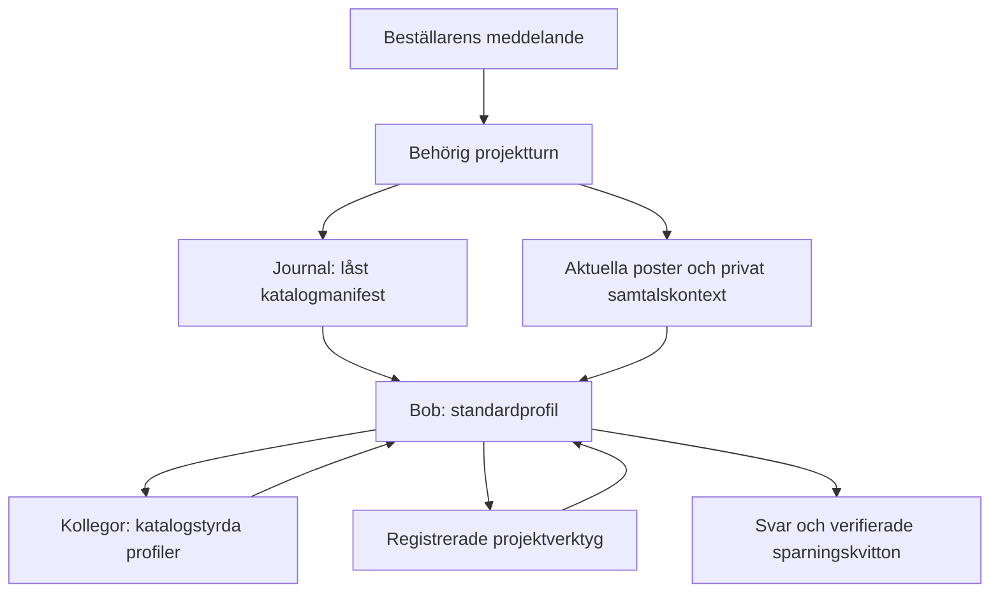

# bob — edge functions (the Ask seam)

> Slice 0 backend and matching frontend deployed on 2026-09-09. See
> [verification and rollout](../Docs/slice-0-verification.md) for evidence and open gates.

**Provider decision (2026-09-09): Bob uses OpenAI directly for all AI work.**
OpenAI is the permanent integration, not a temporary fallback. Later V1 slices
extend this path. Provider configuration and tools are owned here.

Bob answers through `ask-bob` using **direct OpenAI with
bounded caller-authorized project tools and guarded writes**. The browser sends an explicit Bob project id;
the backend authenticates the user and uses their JWT for all project reads.

Launchpad is retired from Bob's architecture. The old `ask-launchpad` endpoint
has only a 410 retirement response for outdated clients; it makes no provider or
database calls, even if old secrets remain configured. Deploy that response as
part of the rollout so the previous live gateway cannot keep accepting requests.

For current working context, five full recent messages, incremental summaries, history search and research-page limits, see [Ask bob conversations](../Docs/ask-bob-conversations.md). This September 2026 extension supersedes the Slice 0 budgets below; [write tools](../Docs/ask-bob-writes.md) own mutation authority. Launchpad remains retired as a runtime dependency; its memory-tier design informs Bob-owned context.

The foundation of the accepted [2026-10-18 context strategy](../Docs/ask-bob-conversations.md#context-strategy--2026-10-18)
is published and activated: editable token-bounded memory, exact/private
hybrid recall, concise [tool and colleague cards](../Docs/ask-bob-tools.md#tool-and-colleague-cards--2026-10-18)
and same-job context checkpoints. It preserves canonical project records, current
authorization and old pinned execution contracts.
[Release evidence](../Docs/foundation-verification.md#bob-context-strategy-release--2026-10-18)
records both installed dependency closures, Deno configuration and exact catalog
activation; [State](../Docs/bob-delivery-flow.md#state) owns remaining ordinary owner
and long-memory model acceptance.

The [coverage audit](../Docs/bob-context-coverage-audit-2026-10-18.md) identified five
implementation gaps. Their published corrections remove dormant CAD roles,
scope specialist lazy instructions, preserve actual tool exchanges and bound the
complete project orientation, alongside the restored shell-plan installation.
[Coverage release evidence](../Docs/foundation-verification.md#bob-context-coverage-corrections--2026-10-18)
records verification and hosted readback. Ordinary owner/model, long-memory and
CAD acceptance remain in [State](../Docs/bob-delivery-flow.md#state).

For historical jobs, the [owner task budget](../Docs/cad-adapter.md#one-budget-per-owner-task--2026-10-12) bounds one real owner message and its review loop. A successful save from the next message starts its fresh period atomically; reads do not move ownership. Request/worker retries retain their period and every historical charge. [Atomic continuation](../db/README.md#atomic-drawing-continuation--2026-10-18) owns the current transition and reservation contract; [verification](../Docs/foundation-verification.md#atomic-drawing-continuation--2026-10-18) records its release status.

New durable Bob jobs using `work_allowance_version: 1` have no application spend,
call, output-token or work quotas. [Continued work](../Docs/ask-bob-conversations.md#active-memory-and-continued-work--2026-10-17)
owns memory/completion semantics. Apply the additive lifecycle, receipt and drawing
accounting migrations, deploy matching `ask-bob` and `bob-worker`, then activate
`20261017102000_bob_continuation_catalog.sql`. Old jobs keep their manifest and
policy. Usage accounting and provider idempotency continue; other applications'
profiles and all model/reasoning choices are unchanged. Roll back new activation
first and retain compatible workers until pinned policy-1 jobs drain. Never roll
back to workers that cannot understand paused/paged jobs while those jobs exist.

## Code ownership

The semantic owner is [domain-dictionary.md](../Docs/domain-dictionary.md), including the 2026-09-24 Area/Step/Task review. `src/domain/vocabulary.ts` owns the generated documentation table and the pre-catalog vocabulary source; CI checks that table. The AI catalog migration imports its compact Bob/planner/CAD bundles as versioned vocabulary definitions, which subsequent catalog-backed calls consume from the database. Migration `20260924135637_unified_project_work.sql` aligns Task Project/primary-Step ownership, optional Areas, parallel Step state and separate focus. Legacy Tasks without a primary Step remain visible as unorganised work.

| File | Responsibility |
| --- | --- |
| `bob-worker/index.ts`, `_shared/bob-background.ts` | Private-capability background worker; see [durable turns](../Docs/ask-bob-conversations.md#durable-background-turns). |
| `ask-bob/index.ts`, `_shared/serve-bob.ts` | Bob's OpenAI endpoint; validate Supabase Auth user. |
| `cad-viewer/index.ts`, `_shared/cad-viewer-request.ts` | Authenticated saved-version CAD edge derivative, service-only lease cache and fresh caller/source checks; [mobile CAD contract](../Docs/cad-adapter.md#mobile-cad-viewer--2026-10-10). |
| `ask-launchpad/index.ts` | Retired URL: HTTP 410, no calls or automatic forwarding. |
| `_shared/bob-request.ts` | HTTP validation; reject unscoped/async actions and browser-supplied history or response ids. |
| `_shared/ask-openai.ts` | Caller-JWT client, membership checks, shared AI service adapter. |
| `_shared/ai-catalog.ts` | Request-pinned definition manifest, role/profile/tier resolution, catalog prompt/tool/output contracts and compatibility checks. |
| `_shared/construction-draft.ts` | K1 shared construction checkpoint tools, using the CAD parameter evaluator and caller-authorised v14 writes; [Artifact contract](../Docs/artifacts.md#k1-construction-checkpoints). |
| `_shared/construction-form.ts` | Versioned concept-to-part mapping, conservative scope dependencies and checkpoint-only readiness; [Solution contract](../Docs/solutions.md#form-refinement). |
| `_shared/construction-evidence.ts` | Source-only scoped geometry/requirement probes and saved-observation reuse assessment; [Artifact contract](../Docs/artifacts.md#form-scoped-checks). |
| `_shared/project-answer.ts` | Briefing and bounded tool loop, server-only continuation, truth rules. |
| `_shared/current-view.ts`, `current-view-guard.ts` | Fixed caller-JWT screen hydration and freshness/verified-own-write checks; [context owner](../Docs/ask-bob-context.md#implemented-scope-and-remaining-target). P3 deployed; named-member acceptance remains open. |
| `_shared/project-lookup.ts` | Fixed tool arguments, budgets, result states and provenance. |
| `bob.search_bob_project_data_v2` | Current static paged research projections under caller RLS; original lookup kept compatible. |
| `_shared/bob-working-context.ts` | Five verbatim messages, incremental older summary and claimed-thread history retrieval. |
| `_shared/openai-service.ts` | Shared Responses service with optional durable transport; see [background calls](../Docs/shared-ai-background.md). |

No browser or model has the service-role key. The shared service uses it for
shared AI configuration, definition manifests, usage/call accounting and
service-only background-job commands, plus the guarded private Bob
conversation/context commands and claim-guarded derived caches (image provider
links and, in the FORM source increment, code-produced check observations).
Domain reads and writes still use the caller JWT; the derived cache grants no
geometry, requirement, decision or delivery authority.
`OPENAI_API_KEY` is read only by the shared service and its background worker.

Catalog-backed Bob calls use the resolved `aiDefinition`; settings prompt text
cannot replace their catalog prompts. The shared provider service exposes this
as a generic opt-in, preserving other apps' existing configuration path.
The dispatcher independently rejects extra/invalid tool arguments before a
database call. The optional background transport also requires the companion
`ai-background.ts`; its activation and rollout prerequisites are owned by
[Shared AI background calls](../Docs/shared-ai-background.md).
Callers may pass `promptCacheKey`, sent as the Responses `prompt_cache_key`
routing hint. Bob's main `ask-bob` requests send a hashed, content-free per-thread
key (per run without a server thread), added after journal, job and drawing-budget
fingerprints so in-flight jobs replay unchanged. It changes no input, authority or
price; other roles and apps omit it. Deployed 2026-10-22 (`ask-bob` v165,
`bob-worker` v133); not yet measured ([conversation owner](../Docs/ask-bob-conversations.md)).

## AI definition catalog and model tiers

**Technical release — 2026-10-09, [PR #233](https://github.com/EmelieHagander/Bob-the-builder/pull/233).**
Bob's code-authored AI definitions and direct-model settings are replaced by
versioned database definitions. The schema, seed and both Bob Edge endpoints
are installed; [release evidence](#catalog-release-evidence--2026-10-09) below
distinguishes actual runtime consumption from remaining persona/colleague
acceptance.

### Canonical sources

All Bob definitions use `app = 'bob'` in the existing prompt catalog. A stable
key identifies a definition; its immutable active version is the runtime truth.

| Database object | Responsibility |
| --- | --- |
| `shared.ai_prompts` | Stable `(app, prompt_key)` identity, definition kind and active-version pointer; first version permanently marks the head `catalog_managed`. Existing content fields are compatibility projections. |
| `shared.ai_prompt_versions` | Immutable content, structured definition, metadata, declared variables and SHA-256 payload hash. |
| `shared.ai_catalog_manifests` | Immutable app configuration snapshot, including exact definition versions and bound model capabilities/prices. No project facts, transcript, credentials or caller authority. |
| `shared.ai_models` | Provider/model identity, prices, output capacity and capabilities, including provider adapter, supported reasoning efforts and function/schema support. |
| `shared.ai_settings` | Existing function/module enable switch, checked live before provider dispatch. Its legacy direct-model and prompt values do not override catalog-backed Bob definitions. |

The catalog stores `role`, `prompt`, `instruction_fragment`, `tool_contract`,
`agent_contract`, `project_method`, `vocabulary`, `execution_profile`,
`tier_binding`, `routing_policy` and `response_schema` definitions. Roles hold
name, title, purpose and references; personas use short second-person text.
Exact technical instructions and schemas have separate definitions. Current
project records, requirement IDs and source references enter as task data;
schema substitutions are limited to declared server bindings.

All roles reference the shared `communication.concise` fragment immediately
after their persona. It describes a busy reader who may only read the last two
sentences and values brief messages with the important point and next step near
the end. This is soft narrative guidance for prose; delivery schemas, required
fields and execution profiles retain their existing contracts.

Catalog data describes a capability. Registered handlers, validation,
authorization, execution limits, revision guards and receipts remain executable
server code. A database definition cannot introduce an executable tool or grant
access to a project.

<a id="construction-work-release"></a>
### Coherent Construction release — installed, 2026-10-28

The owner approved implementation without agent prompt edits and subsequently
requested merge and testing. The [installation evidence](../Docs/foundation-verification.md#construction-work-2026-10-28)
records the merged source, hosted versions, catalog comparison and rollback IDs;
live model/cost acceptance remains open. Installation order: apply
`20261028194859_construction_work_operations.sql`, deploy both complete
`bob-worker` and `ask-bob` closures with their existing authentication, then
activate `20261028200450_ai_construction_work_catalog.sql`. The generated
publication changes only the read/parameter/part/check interfaces and
`bob.tools.operation_followups`; it preserves role content, GPT-5.4 medium,
the six core tools and inactive reader/reviewer policies. Generate/check it
with `scripts/build-ai-construction-work-catalog.ts` and the migration path.

Before activation, read back the new functions and grants plus both runtime
versions. Preserve the prior five catalog heads for rollback. Revert those
heads first if necessary; keep compatible runtime/database support until
already pinned jobs drain. Do not remove committed revisions or receipt
history. Pinned older jobs retain their earlier schemas and journal path.
The [tool owner](../Docs/ask-bob-tools.md#coherent-construction-work) defines
behavior; [verification](../Docs/foundation-verification.md#construction-work-2026-10-28)
separates local evidence from installation and paid acceptance. No model run,
render, CI or deployment is automatically authorized by this implementation.

### Roles and baseline profiles

**Owner-approved cost correction — technically installed, 2026-10-28.**
`profile.ask-bob` advances from high to **medium**, retaining the existing
standard tier binding to **gpt-5.4**. This changes new main-Bob manifests only;
other profiles, model bindings and already pinned jobs stay intact. The same
publication adds the [six catalog-owned core tools](../Docs/ask-bob-tools.md)
and the source-reconciliation schema for `change_construction_parameters`.
Install `20261028174716_construction_parameter_source_refresh.sql`, deploy both
complete Edge closures with their existing authentication, then apply
`20261028174802_ai_bob_cost_controls_catalog.sql`. Rollback restores the three
previous catalog heads first, keeping compatible code/core for pinned jobs.
[Verification](../Docs/foundation-verification.md#bob-cost-controls-2026-10-28)
owns installation receipts and the unmeasured live cost/quality outcome.

This table describes the published coverage correction. Role retirement and
specialist loading are verified in [coverage release evidence](../Docs/foundation-verification.md#bob-context-coverage-corrections--2026-10-18).
Ordinary owner/model and CAD acceptance remain in [State](../Docs/bob-delivery-flow.md#state).

| Role key | Name / title | Purpose | Initial tier / effort |
| --- | --- | --- | --- |
| `role.ask-bob` | Bob — byggexpert och projektkollega | Drives the owner's delegated project work. | standard / high |
| `role.cad-reviewer` | Rita — ritningsgranskare | Independently reviews the exact candidate and current evidence. | mini / high |
| `role.plan-compiler` | Plantus — planskrivare | Represents Bob's intent as a validated project plan. | mini / low |
| `role.plan-reviewer` | Vera — plangranskare | Gives advisory plan feedback; no save veto. | nano / low |
| `role.context-summary` | Samtalsminnet — konversationssammanfattare | Folds private older conversation into a brief and exact-history pointers. | mini / low |
| `role.work-router` | Statusspråk — statuslokaliserare | Localises server-owned status meanings. | standard / low |
| `role.drawing-resume-reply` | Ritningsbesked — återupptagningsbesked | Explains the actual resumed drawing outcome from its receipt. | standard / low |
| `role.project-image` | Illustratören — bildgenerator | Produces an illustration from a bounded image brief. | image / none |

Daisy (`cad-designer`) and Kjell (`cad-research`) are removed by the coverage
correction: no dispatch, active role/profile/tool definitions or role settings.
Immutable versions/manifests and historical accounting remain. CAD is compiled
from checked construction and reviewed by Rita. Catalog retirement excludes an
explicitly retired head from new snapshots while retaining its immutable versions
for historical manifests; active references to a retired definition are rejected.

The seed preserves the existing model family: nano → `gpt-5.4-nano`, mini →
`gpt-5.4-mini`, standard → `gpt-5.4`, image → the existing image model setting.
Historical bounded profiles preserve output capacity, including the plan compiler's
24,000-token request and Rita's approved 50,000-token frame. The provider applies
the profile/model limit and any stricter server call limit for those jobs. New
`work_allowance_version: 1` jobs omit application output allotments while retaining
provider capacity limits. Usage pricing comes
from the pinned model row; a warm legacy model cache cannot choose another price.

Model selection is `role → routing/default profile → tier → model`.
`tier.nano`, `tier.mini`, `tier.standard` and `tier.image` are versioned **Bob app
bindings**. Upgrading `tier.mini` changes the model for all Bob mini profiles in
new manifests without rewriting their prompts. Shared global
`is_current_for_type`/default flags remain the legacy path for other apps; a
Bob-only upgrade does not mutate them. Provider adapters and capability checks
must match the replacement; an API-incompatible model needs an adapter change.

The initial routing policy preserves today's tiers. Mini-first classification
and automatic standard escalation remain a separate model-quality/cost
experiment; this migration does not enable them.

### One turn, one configuration snapshot

`shared.resolve_ai_catalog(p_app, p_manifest_id default null)` is service-only.
Without an ID it resolves all active app definitions and bound models from one
SQL snapshot, stores/deduplicates the immutable manifest and returns it. With an
ID it reads that stored payload after checking app scope.

`createAiCatalogSession(sharedClient, { app, manifest?, manifestId? })` loads
once. Its `role`, `text`, `tool` and `schema` methods resolve only from that
manifest. Missing/invalid definitions, ambiguous tiers or incompatible models
stop the call; normal Bob execution has no code-prompt, direct-model or global
default fallback. Explicit test fixtures are not a production fallback.

The turn journal pins the manifest before model work. Worker continuation and
retry reuse its exact versions, model, effort and prices, even if an operator
activates a new catalog revision meanwhile. Current membership, tool policy,
record freshness, `ai_settings.is_enabled` and the bound model's current
`ai_models.is_active` remain live checks. Retiring that exact model stops new
dispatches even for an older manifest; activating a different tier binding does
not rewrite it. A saved configuration snapshot never preserves permission or
disables the kill switch.



### Authoring, activation and release

1. Insert a new `shared.ai_prompt_versions` row for each changed definition;
   never edit an old version. Bind a tier to a registered model with suitable
   capabilities and pricing before activation.
2. Activate the complete change with service-only
   `shared.activate_ai_catalog(p_app, p_versions)`, where `p_versions` maps exact
   prompt keys to version UUIDs. Validation checks references, app/kind scope,
   profiles and model capabilities before atomically moving pointers. App
   activation is serialised. Invalid changes leave the previous graph active.
3. Revert by activating the previous version UUIDs through the same operation.
   Existing pinned jobs remain on their original manifest; new turns use the
   reverted active configuration.
4. Apply reviewed `20261009144206_ai_definition_catalog.sql` and generated
   `20261009150000_seed_bob_ai_catalog.sql` before
   deploying both `ask-bob` and `bob-worker` from the same immutable source.
   Preserve their existing JWT/custom authentication modes. Verify active
   definitions, a resolved manifest, service-only access and actual consumed
   runtime source before calling the release installed.

`scripts/build-ai-catalog-seed.ts` is a one-time migration builder. It extracts
exact baseline schemas/instructions from pinned Git revision
`e0d5fcd4f212cb42743309ee0c0b5e8e37756d6d` and imports the approved personas.
Generated migration payloads retain that provenance. Runtime never imports the
builder or former source strings; later definition edits are new database
versions. Source extraction is not a second active prompt catalog.

To inspect a reconstructed baseline without changing a committed migration:

```bash
node --import tsx scripts/build-ai-catalog-seed.ts --check
node --import tsx scripts/build-ai-catalog-seed.ts --output /tmp/bob-ai-catalog-baseline.sql
```

The builder accepts `--ref` for the pinned source. Approved personas and method
are bundled in `scripts/fixtures/bob-ai-personas-v1.json`, so a clean checkout
reproduces the seed without an external proposal. `--proposal` is an explicit
alternative import input. A regenerated historical baseline is for review;
active catalog edits still require a new version and activation.

This historical catalog release changed definition ownership and names, preserving the existing
domain workflow. `role.memory-agent` is an explicitly disabled proposal; the
existing private `context-summary` fold does not implement an autonomous
save/recall/archive memory manager. Project phase transitions keep their
existing commands and rules. The whole permitted toolbox and inline manuals
remain that release's baseline; deferred schema loading/JIT tool discovery was
not introduced by it. The [2026-10-18 strategy](../Docs/ask-bob-conversations.md#context-strategy--2026-10-18)
is the activated successor without enabling the separate proposed role. [Tools](../Docs/ask-bob-tools.md) and
[conversation state](../Docs/ask-bob-conversations.md) own those behaviors.

### Catalog release evidence — 2026-10-09

[PR #233](https://github.com/EmelieHagander/Bob-the-builder/pull/233) merged as
`21aeeada860cc1d50692f7c27255dd28b200e816`, with reviewed tree
`8525d7ff544254ab662c7e7abc0048896924585f`. All three PR workflows passed,
including 1,063 tests, production build, normal-import Edge type checks and
browser gates. Local vocabulary, reproducible-seed and focused
catalog/metrics/tool checks also passed; independent agents reviewed SQL and
runtime boundaries.

| Installed item | Readback |
| --- | --- |
| Schema migration | Hosted ledger `20261009153433`, `ai_definition_catalog`; source `20261009144206_ai_definition_catalog.sql`. |
| Seed migration | Hosted ledger `20261009153435`, `seed_bob_ai_catalog`; source `20261009150000_seed_bob_ai_catalog.sql`. |
| Initial catalog | 264 definitions, 77 tool contracts, 11 roles (10 enabled), 11 profiles and four tiers. |
| `ask-bob` | Version 92, JWT verification enabled; bundle SHA-256 `47b5d9b80d708f1bd754f00fe38b55760773ff3e4b98963166d875318eeef218`. |
| `bob-worker` | Version 60, JWT verification disabled with existing custom job authentication; bundle SHA-256 `72687b4cbe8a2163f67427662c41169df1d2d774ca297c3432327ffadb069322`. |

Every returned deployed source file matched its uploaded content: 83 for
`ask-bob`, 81 for `bob-worker`. Supabase omits type-only `provenance.ts` from both
readbacks and `bob-request.ts` from the worker. Hosted ACL/RLS and service-only
invoker RPC checks passed. The hosted transactional activation,
manifest replay and restoration check passed with 264 definitions, 11 roles,
11 profiles and four tiers; rollback preserved the original configuration.
Four independent attempts to update/delete immutable versions and manifests
were rejected. Advisors remained at seven security and four performance
findings, with no new finding from this release.

The [actual-model smoke run](https://github.com/EmelieHagander/Bob-the-builder/actions/runs/37952736442)
passed project-scoped material retrieval (37), red-image pixel inspection,
`timber.moisture` bundle `2026-09-30.1`, foreign-project denial (403) and retired
endpoint rejection (410). Metrics recorded five successful API calls using
`gpt-5.4`, standard tier, pinned manifest
`a01b3555-4ac5-4640-8cae-89bbf44c0970` and exact catalog role/profile versions.
These calls consumed the database catalog rather than the legacy runtime path.

The separate [idea-advice run](https://github.com/EmelieHagander/Bob-the-builder/actions/runs/37955046605)
passed on test-only main commit `6c5cd177f1296a3e17bdf97be0d28b0d38c667c7`,
job `113903315051`. Turn `3a3ec6e9-c873-49c5-81b4-046225cb8a63` made exactly
one successful `role.ask-bob` / `profile.ask-bob` call: `gpt-5.4`, high reasoning,
standard tier and the same pinned manifest above. It returned no tools and
called no colleague. The project and 16 scoped table fingerprints were
unchanged, with zero write receipts.

Bob's 209-word Swedish answer began with place and intended use, asked the
owner to measure/inspect on site, explored backrest, maintenance and budget,
labelled dimensions provisional and gave four concrete site inputs for the
next step. This one observation supports role awareness and a useful next
action; the answer was longer than the requested short advice. It is not a
systematic persona evaluation. Both live probes use the shared guest, which has
no writer; unchanged records do not prove restraint under named-member write
authority. Named-member private history, writes and colleague acceptance remain
separate from this completed technical release and initial Bob probe.

Image storage objects and metadata were cleaned from both disposable fixtures.
Project deletion remains blocked: three SQL cleanup requests returned connector
`Invalid/expired requestState`, and neither project was deleted. The remaining
projects are `p_6fc92672ce9942c4817a5871fa1bc08a` and
`p_e9529c812a874d7e9a75900dfef12bbb`; each retains one guest membership, one task
and one material, with no images, storage objects, private conversation history
or active jobs. Their scoped
cleanup, systematic persona/colleague acceptance and the separate mini-first,
managed-memory and JIT-tool work remain in
[State](../Docs/bob-delivery-flow.md#state).

### Concise communication follow-up — 2026-10-09

Source `20261009171521_ai_concise_communication.sql`, commit
`005d57252f3d90fc70cd67a7829ead42d54d2bb6`, is installed as hosted ledger
`20261009171859 / ai_concise_communication`. One shared narrative fragment and
11 role revisions bring the active catalog to 265 definitions. All role
references select it exactly once after the persona. The proposed memory role
stays disabled. Existing models, profiles, schemas, tool contracts and saved
manifests are unchanged. Independent local activation/replay and actual runtime
prompt composition checks passed, as did 22 catalog/DB tests and historical
seed reproducibility. Hosted role/reference and previous-manifest checks passed.

The existing [live release probe, attempt 2](https://github.com/EmelieHagander/Bob-the-builder/actions/runs/37955046605/attempts/2)
passed, including material/image/knowledge checks. Idea turn
`af6a5117-975c-49c0-968a-010055facf8c` made one successful standard-tier
`gpt-5.4` call with role version 2 and manifest
`08d9acbb-17b5-4178-bd95-de7c78fcbb89`, containing the shared guidance. Bob's
184-word answer placed concrete next actions in its last two sentences.
The earlier probe had 209 words; this is one observation, not a length target
or evidence of a consistent improvement. The guest fixture remained unchanged
and its image objects/metadata were removed. Guarded project deletion again
returned `Invalid or expired requestState`; the additional disposable project
`p_661d492be7d345f4b56d8a1c288824de` remains with one guest membership, one task
and one material, with no images, stored objects, private history or active jobs.

## Project lookup contract — Slice 0

> **Status:** deployed; the verification record distinguishes live checks from local/CI fixtures.
> **Owns:** Ask bob's bounded project lookup, allowed datasets/fields and result
> semantics. `db/README.md` owns the membership/RLS implementation; the release
> ordering remains in `Docs/v1-plan.md`.

Bob should be able to look up relevant persisted project data when answering a
question, in addition to receiving a short briefing. For example, "Which
materials are still missing for the porch?" should trigger a scoped materials
lookup rather than assume that the capped briefing contains every item.

### Request and authority

The browser supplies the explicit active `projectId` through `database.ts` to
the Ask edge function. The server authenticates the caller, validates their
membership in that project and binds the request/run to that user and project.
The identifier is the Bob project row id, not the shared Supabase project ref.

The model may call a typed `search_project_data` tool with a dataset and approved
filters. It does not choose the project, schema, table, columns or SQL. A
server-owned dispatcher maps the dataset to fixed queries, binds the validated
project id and reads using the caller's JWT. Unknown arguments, datasets and
operations are rejected; this tool exposes no write operation or arbitrary RPC.

Every lookup rechecks project access. Missing/invalid project context or failed
authorization ends the lookup before any project data reaches a provider.
There is no fallback to another project or to privileged project reads.

Membership must be trustworthy before this tool is enabled: project creation,
invitations and guest/volunteer joining must establish explicit project access,
and ordinary content edits must not let a caller grant themselves membership.
The legacy first-project join and globally unique person/auth link did not
provide that multi-project contract. This branch replaces them with membership-aware
RLS for the exposed parent/child tables, now applied to the shared database.
A request filter alone does not close public API paths. See [Supabase's RLS guide](https://supabase.com/docs/guides/database/postgres/row-level-security).

### Initial allowlist

All sources below belong to schema `bob`. The lookup exposes only the
listed projections, subject to project membership; supporting joins are not independent
model-selectable datasets. Server-generated source ids/timestamps are described
under result semantics.

| Dataset | Source tables | Allowed project information |
| --- | --- | --- |
| `project` | `projects` | `id`, `slug`, `name`, `description`, `location`, `type`, `start_label`, `start_date`, `end_date`; only the bound project |
| `areas` | `areas` | `id`, `slug`, `name`, `description`, `lead_id`; filter by `project_id` |
| `tasks` | `tasks`, `areas`, `task_assignees`, `people` | Task `id`, `area_id`, `name`, `skill`, `hours`, `status`, `materials`; area name and assignee ids/names; scope tasks through their area |
| `materials` | `materials` | `id`, `name`, `qty`, `area_label`, `supplier`, `status`, `cost`, `category`; filter by `project_id` |
| `crew` | `people`, `person_skills` | Person `id`, `name`, `role`; skill `name` and `level`; scope skills through their person |
| `events` | `events`, `event_attendees`, `people` | Event `id`, `slug`, `title`, `day`, `time`, `place`, `spots`, `status`; attendee ids/names; scope attendees through their event |
| `announcements` | `announcements`, `people` | `id`, `text`, `pinned`, `time_label`; author id/name; filter by `project_id` |

Linked people and both ends of an assignment/attendance relation must belong to
the bound project. A foreign area/task/person id cannot widen the lookup.
Materials currently use `area_label`, not an area foreign key; filtering by
area must resolve that label inside the bound project and must not invent a
task-material relation. Role/skill labels are recorded project data, not proof
of backend authority or professional qualification.

Everything outside this allowlist is excluded from the new construction lookup
and its briefing projection: `person_emails`, `people.auth_user_id`, dietary/allergy
fields, food tables, account settings/notes, other apps' schemas, Auth records,
secrets, raw storage paths and AI configuration/usage records. Internal provider
configuration and usage bookkeeping remain server concerns, never tool results.
Media, measurements and selected solutions can extend this owner in their later
slices once their data/access contracts exist. The legacy briefing included
dietary text; the construction briefing and lookup now exclude those fields.
Any retained AI food/diet workflow needs its own purpose-specific projection and
the same project authority checks. The existing Food surfaces keep their contract.

### Bounded lookup and honest results

- Start with fixed exact-id/status filters and text matching on the allowed
  name/title/description/text fields. The dispatcher owns each dataset's filter
  schema; it parameterizes values and rejects raw filter expressions. An area
  filter must also be scoped. No unrestricted SQL, table browsing or generated
  query language is accepted.
- Initial budgets: at most 200 search-text characters, 25 parent records and 25
  joined records per lookup, 16 KiB serialized output and three lookups per user
  question. Enforce a 10-second lookup timeout. Truncated rows, joined data or
  text must be marked explicitly; the model cannot claim an exhaustive list
  from partial results. Broader searches require a narrower follow-up question.
- Results include the bound `projectId`, dataset, stable record ids, retrieval
  time and truncation/partial flags. Preserve source `updated_at` where present;
  retrieval time is not the time a physical condition was observed. Answers
  should reference the relevant existing project/area/task record where possible.
- Distinguish successful no-match, invalid request, denied access and unavailable
  data. A database error is not an empty project or "nothing missing". Return
  no project details on denial and do not expose raw database errors to the model.
- Stored text is evidence to interpret, not instructions for tool execution.
  It cannot change the dataset allowlist, project binding or authority rules.
- Reading a row does not promote it to a verified fact. Authored quantities,
  costs, dates and task readiness strings retain their current limitations;
  assumptions, estimates and unknowns stay labelled. New numeric/provenance
  models arrive in their owning V1 slices.

### Integration and implementation proof

Use one dispatcher and projection for the construction briefing and subsequent
lookups. Keep UI access through `database.ts`; extend the existing Ask backend
instead of giving a browser/model a separate database connection.

OpenAI builds the briefing and executes tools through the shared service. Its
actual tool integration must be verified before live lookup support is claimed.
Legacy task/status/reply and artifact handles are not accepted by the new API.
Project switching must isolate conversation/history, in-flight results and any
cache by user/project; an old answer must not appear as the new project's truth.

The following remain the acceptance contract. Local evidence and outstanding live gates are recorded in [slice-0-verification.md](../Docs/slice-0-verification.md):

1. A member can search the explicitly active project and retrieve a matching
   item omitted from the initial capped briefing; sources identify that project.
2. A member of two projects gets separate correct results after switching;
   requests/results/history from the previous project cannot leak into the new one.
3. A non-member, signed-out caller, forged project id, foreign child id or
   unrelated async run/artifact is denied at the applicable backend boundary.
   Exercise permitted and denied membership with ordinary JWT/API/RLS paths.
4. Forbidden fields/datasets, arbitrary SQL, writes and self-granted membership
   fail; successful reads contain only the allowlisted projection, including joins.
5. Empty results, timeouts, revoked access and row/byte/lookup limits preserve
   distinct honest states. Stored prompt-like text cannot alter tool permissions.
6. The OpenAI path proves its actual lookup and project-binding behavior before
   being labelled live; no mock result counts as live proof. The retired endpoint
   rejects old requests without contacting a provider.

## P3 screen context — deployed

The strict send request accepts optional `screen` ids/revisions only; no browser labels, viewer identity or fact blobs. Current View is hydrated under the same caller JWT and explicit project as other reads. Durable original capture crosses normal/background/retry paths through service-only turn commands, while domain hydration remains caller-authorized. Replay keeps the original model input; fresh authority/context checks are never memoized. See [the context owner](../Docs/ask-bob-context.md#implemented-scope-and-remaining-target) for supported surfaces, freshness stops and the remaining wider target.

The additive P3 migration is applied; its initial `ask-bob` v68 / `bob-worker` v36 release bundled immutable reviewed `58ee8c6185858f33018a9400393ebe08d770b536`, followed by matching Pages. The historical P4 runtime was `ask-bob` v71 / `bob-worker` v39; [its release evidence](../Docs/foundation-verification.md#p4-replay-and-event-delivery--2026-10-02) records the reviewed source, migration and acceptance limits. [Verification](../Docs/foundation-verification.md#p3-hosted-technical-release--2026-09-30) records actual caller/model/pixel/knowledge consumption and hosted role/RPC permissions. The shared guest has local-only history; ordinary named-member background/private readback remains open. Database migration ownership and release details are in [db/README.md](../db/README.md#p3-screen-context-and-source-changes--applied). Existing AI models/settings and shared background transport are reused; no new cheap-router settings or shared-app configuration are introduced. Current K2 runtime: `ask-bob` v76 / `bob-worker` v44, pinned to `72be4a2a4bb6a2232fe02585f5fdc20620e12ea5`; [telemetry release evidence](../Docs/foundation-verification.md#cad-research-execution-attribution--2026-10-03) records the applied role migration, source/authentication readback and open model acceptance. [K2 construction evidence](../Docs/foundation-verification.md#k2-construction-checks) retains its registration and earlier release proof. The earlier [K1 release evidence](../Docs/foundation-verification.md#k1-construction-checkpoints--2026-10-02) owns construction-checkpoint technical acceptance. [K0 evidence](../Docs/foundation-verification.md#k0-construction-boundaries--2026-10-02) retains budget diagnostics and the candidate-stage contract. Full live-model acceptance remains open.


## Actions

`POST` with a signed-in Bearer token:

| Request | Result |
| --- | --- |
| `{ action: 'send', projectId, message }` | `{ ok: true, backend: 'openai', status: 'completed', projectId, summary, evidence }` |
| Missing/invalid project id or message; supplied history/response id/schema | HTTP 400 |
| Invalid session | HTTP 401 |
| No membership in the requested project | HTTP 403 |
| `status`, `reply`, `artifact` (including legacy handles) | HTTP 409; no provider request |
| Database/model/configuration failure | HTTP 503, safe error code, no invented answer |

`evidence` marks the answer as an **AI assessment** and lists consulted record ids,
project, retrieval time, source update time when available, and unknown legacy
verification. The list records what Bob consulted; it is not a guarantee that
every generated claim follows from those sources. Conversation and drafts are
cleared when project/auth context changes. A generation guard also rejects late
A → B → A responses. Failure messages never substitute another project's feed.

## Deployment

### Name-only volunteer image access (prepared source)

`volunteer-media` is separate from Bob AI. It accepts only a volunteer session
capability, task ID and image ID, resolves the allowed object through the guarded
Bob RPC and checks access again before streaming private original bytes. It does
not create an Auth user or invoke AI. `verify_jwt = false` is intentional because
these participants have no Auth JWT; the capability is mandatory. No service key
or public/signed Storage URL is returned to the browser.

Its required server configuration is the existing `SUPABASE_URL` and
`SUPABASE_SERVICE_ROLE_KEY`. Deploy after
`20260914052752_volunteer_project_links.sql` and before the volunteer frontend.
No global anonymous-Auth setting needs changing. The
[volunteer contract](../db/README.md#name-only-volunteer-access) and
[verification record](../Docs/foundation-verification.md) own rollout status.

### Existing Bob AI endpoints

First follow the reviewed membership migration and coordinated rollout in
[db/README.md](../db/README.md). Then deploy the edge function and frontend together.
Merging frontend code alone triggers Pages but does **not** migrate Supabase or
deploy the edge function; future authority/API changes also require coordinated releases.

```bash
supabase functions deploy ask-bob --project-ref <ref>
supabase functions deploy ask-launchpad --project-ref <ref>
```

The second command retires the old deployment. Older clients must reload to use
`ask-bob`; unbound legacy requests are never forwarded automatically.

Required existing server configuration: `SUPABASE_URL`, `SUPABASE_ANON_KEY`,
`SUPABASE_SERVICE_ROLE_KEY`, `OPENAI_API_KEY`, and Bob's enabled settings/model in
the shared AI catalogue. Frontend configuration remains
`VITE_SUPABASE_URL` / `VITE_SUPABASE_ANON_KEY`.

### K2 construction check tool

The construction save tool owns a requested construction concept with parts, pinned materials and typed joints. Bob saves, checks and corrects that exact draft before any downstream drawing; `design_project_cad` owns requested CAD drawing intake and cannot substitute for the construction or repair a failed catalog save. This distinction is offered in the existing code tool descriptions, without forced tool choice, new orchestration, schema changes or a catalog migration. Catalog correction guidance is owned by [Material catalog](../Docs/material-catalog.md#search--read--ensurerevise). [Named-member acceptance](../Docs/foundation-verification.md#k2-live-construction-acceptance--2026-10-04) verifies one three-turn concept case; broader model and product readiness remain open.

`check_construction_draft` is registered beside the K1 read/save tools. `ask-openai.ts` supplies caller-scoped `catalog_read` and `read_construction_draft`; the check re-reads the current head and access before reporting. The deterministic implementation in `construction-checks.ts` creates no writes, no approval and no model calls. Schema version 1 registration and the updated save-tool guide are in `20261002231320_construction_checks.sql`. Supported operations and `concept_ready` versus `fabrication_ready` are owned by [Artifacts](../Docs/artifacts.md#k2--construction-concept-checks); [verification](../Docs/foundation-verification.md#k2-construction-checks) owns deployment/model evidence. The permanent system prompt and configured model/budget ceilings are unchanged.


Parameter bindings use exact slash-separated recipe paths with stable definition/instance IDs. A missing binding returns `invalid` plus canonical `unbound` paths so Bob can correct the same parameter plan. It is not a source-read outage: genuine failed lookups still return `unavailable`, without private diagnostics. The compiler still requires every controlling numeric field and computes the complete snapshot server-side; no missing values or provenance are inferred. [Live recovery evidence](../Docs/foundation-verification.md#k2-live-binding-recovery--2026-10-04) owns the real-model gate.

Completed CAD work reconstructs only its exact durable steps during a background replay. A fresh `saved` lifecycle check closes that CAD scope to all new dispatches; missing checkpoints stop with `continuation_incomplete`, changed inputs retain `continuation_changed`, and cancellation/reset/access checks stay live. Normal completion still prevents fresh design work. Catalog source-quote rejection returns specific exact-substring guidance; it does not replace provenance or infer quotes. [Historical post-replay outcome](../Docs/foundation-verification.md#k2-live-post-replay-outcome--2026-10-04) verifies that recovery through a completed member job; the later [construction acceptance](../Docs/foundation-verification.md#k2-live-construction-acceptance--2026-10-04) supersedes its failed three-turn gate.

### Live K2 acceptance runner

[Live K2 construction acceptance](https://github.com/EmelieHagander/Bob-the-builder/actions/workflows/live-construction.yml) is a manual-only wrapper around `scripts/check-live-construction.ts`. It runs only from `main`, checks out the requested immutable commit and uses the existing `github-pages` environment. It has no push/PR/scheduled trigger and does not create Auth users, mint tokens, grant access or change production model/manual settings.

1. In the repository's **Settings → Environments → github-pages**, set `BOB_TEST_MEMBER_ID` and `BOB_TEST_MEMBER_ACCESS_TOKEN` as environment secrets from an existing, verified ordinary test member's normal Auth session. Use the matching member ID and a fresh token with at least 40 minutes remaining. Keep it out of chat, source, shell command arguments and logs. The existing publishable `VITE_SUPABASE_URL` / `VITE_SUPABASE_ANON_KEY` configuration is reused.
2. In **Actions → Live K2 construction acceptance → Run workflow**, select `main` and `disposable-fixtures-only`. This submits three new real-model turns in one new disposable project: initial construction, width change and thickness change. The probe validates the actual Auth user before any fixture write; guest/service credentials are rejected.
3. Read `BOB_K2_SMOKE_PROJECT_ID` and the `live-k2-construction-<run>-<attempt>` artifact, retained for seven days. Only the existing synthetic `live-construction.json` report is uploaded. On failure, inspect the same durable jobs/fixture before starting another paid attempt; the workflow does not retry or delete the fixture automatically. Arrange scoped cleanup for the printed disposable project after inspection; never delete a real project.

Dependencies install before member secrets are exposed to the probe step. Missing/mismatched/short-lived session configuration stops before project creation. Ordinary member authority still comes from Auth/RLS, not from the local expiry/identity checks. This proves the deployed baseline construction path when run; it does not implement an on-demand-manual live comparison, fabrication approval, annotated drawings or participant acceptance. [Verification](../Docs/foundation-verification.md#k2-manual-runner--2026-10-04) owns run evidence and remaining gates.

### K3 exact construction drawing path

`ask-openai.ts` supplies the CAD assistant with the same construction reader/checker and fresh non-journalled source/catalog reads at rendering/review boundaries. Pass a current construction Artifact as `design_project_cad.artifact_id`; this bypasses new geometry design, preserves its exact parameter graph and routes defects back to the owning checkpoint/renderer. `20261004112211_checked_construction_drawings.sql` guards publication and exposes safe source-pin metadata through the existing caller CAD reader. [Artifacts](../Docs/artifacts.md#k3--exact-construction-drawing-lineage) and [CAD](../Docs/cad-adapter.md#k3-checked-construction-drawings--2026-10-04) own the contract; [verification](../Docs/foundation-verification.md#k3-checked-construction-drawings--2026-10-04) owns release status.

`scripts/check-live-construction-drawing.ts` uses the existing verified named-member configuration and explicit `BOB_K3_LIVE_CONFIRM=disposable-fixtures-only`, `BOB_K3_PROJECT_ID` and optional `BOB_K3_REPORT`. Only a caller-accessible `Verification` project whose name begins `K2 model acceptance ` is allowed. It requests a drawing through normal Bob, waits for that same job, and verifies exact saved source, geometry/export hashes, current work link, drawing-request receipt and readback without modifying the construction. No Auth changes or privileged acceptance writes are introduced. The full inline manual and governed model/budget settings remain the baseline.

### K3 password acceptance runner

`Live K3 construction drawing acceptance` uses `BOB_USER_EMAIL` and `BOB_USER_PASSWORD` from the existing `github-pages` environment secrets. Set these to the **original K2/K3 test member**, not another account that lacks the retained fixture. Existing publishable Supabase configuration is reused. Secrets are exposed only after dependency installation, and the runner keeps its ordinary session in process memory, passes it to the unchanged K3 probe, and signs out only that session with `scope: local`.

The reviewed workflow installation on `main` starts the requested recovery probe; it is also available through **Actions → Live K3 construction drawing acceptance → Run workflow**, with `main` and `disposable-fixtures-only`. It pins the retained project, member and last inspected conversation turn. A different member, missing access, changed/pending conversation, active/unknown job, existing drawing or workflow rerun stops before a new model request. After a submitted turn, inspect that same durable job/report; the changed conversation checkpoint prevents an automatic paid repetition. A new checkpoint requires an explicit reviewed source update after diagnosis. No project/account creation, grants, tokens minted with administrative authority, construction seeding or history reset is performed.

Only `k3-preflight.json`, the existing synthetic `live-construction-drawing.json` and annotated SVG views are retained for seven days. SDK/provider exception bodies and credentials are never printed or uploaded. A successful password preflight is not K3 acceptance; the original probe must independently pass save/link/reopen and exact source/hash checks. Operational reports stay out of repository evidence.

### K4 construction blank acceptance

The first K4 outcome adds checked `derive_construction_lists` to the existing construction tools and extends the existing `derive_cad_material_requirement` to save exact construction blank needs. Both Bob functions need the same immutable reviewed source after the additive migration. It changes no model/manual baseline and performs no automatic stock reservation or Shopping publication. [Material owner](../Docs/material-planning.md#k4-construction-blank-needs--2026-10-05) defines the explicit concept/fit boundaries.

`check_construction_cut_fit` adds a governed read tool on the existing Materials shelf. `20261006080834_construction_cut_fit_tool.sql` activates only that catalog row; the matching offline seed and shared handler retain normal caller authority and budgets. Both Bob endpoints require the same reviewed source. The tool derives every blank from the checkpoint, returns a concrete candidate-sheet guillotine layout with kerf/trim/grain, and cannot save a plan, reserve stock or publish Shopping. [Material planning](../Docs/material-planning.md#k4-candidate-sheet-fit--2026-10-06) owns its scope and limits. Existing completed K4 recovery runners must not be replayed as new cut-fit acceptance; a reviewed current conversation/checkpoint is required for another real model turn.

`Live K4 cut fit acceptance` / `scripts/run-live-construction-cut-fit.mjs` reuse that same ordinary password-session helper and `github-pages` secrets. The reviewed checkpoint pins the completed recovery turn, both original need revisions/history, current construction 4 and drawing 1. Reruns, changed/missing/extra needs and conversation/job uncertainty stop before a new model request. The probe requests two hypothetical formats in natural language, polls only the same durable job and compares all needs/history, construction, drawing, stock and Shopping afterward. It retains the synthetic answer/report for seven days with `modelSemanticsReviewRequired=true`; a preservation/workflow pass is not proof of correct model reasoning. Inspect tool-use evidence and the complete answer before declaring model acceptance. The initial workflow installation is manual-only; activation of its own workflow path follows CI/review and fresh deployed/checkpoint readback. No new production environment, account, catalog product, stock or requirement is created.

`Live K4 construction blank acceptance` reuses the K3 password/session helper, original named member, GitHub `github-pages` secrets and retained K2/K3 project. It pins the successfully completed K3 turn and saved drawing; any changed conversation, missing/mismatched drawing, existing material need or rerun stops before a new model request. The workflow is initially manual-only so merging code cannot start acceptance before migration and Edge release. Once release is read back, a reviewed activation of its own workflow path can start the user's requested one-time probe. The probe supplies a natural-language request, no parts or tool calls, verifies saved caller-readable quantities/provenance/answer receipts and checks that construction, drawing, stock and Shopping are unchanged. Reports contain only synthetic acceptance metadata and stay out of Git. Wider K4 remains open.

### D role and affected-output release

Both Bob functions must carry the matching instance-policy/continuation modules and exact shared receipt validator. Install the two [D core migrations](../db/README.md#instance-policy-and-change-work--release-d), verify the unchanged existing data/commitments and deploy both closures before publishing `20261011093016_ai_construction_consequences_catalog.sql`. The publication adds three tools and only the affected manuals/schema; it preserves pinned manifests, unrelated definitions and all model/role settings/prices. Fresh role/queue preparation reads current caller state. Existing turn/write/cost budgets remain unchanged; resumable saved work is not a budget reset. [Tool routing](../Docs/ask-bob-tools.md#construction-roles-and-continued-changes--release-d) and [installed readback](../Docs/foundation-verification.md#construction-instance-roles-and-consequences--release-d) own the remaining details.

### K4 saved-plan acceptance

After the reviewed additive `construction_cut_plans` migration, both Bob endpoints must use the same immutable source containing caller-JWT `bob_project_write_v15`, `save_construction_cut_plan`, exact source/need pins and `read_project_work(cut_plan)`. Format/capacity preview uses existing stock revisions and preserves the current reservation/Shopping guards. The Materials tool catalog and offline seed agree; model settings and optional manual-loading baseline are unchanged.

`Live K4 saved cut plan acceptance` / `scripts/run-live-construction-cut-plan.mjs` reuse the existing ordinary-password helper, original member/project and `github-pages` secrets. They pin completed cut-fit turn `58d32191-8ac0-4847-8df7-8083f96c75e3`, both exact need revisions/history, construction 4, drawing 1 and zero prior saved plans. Unknown, changed, pending or replayed state stops before any paid request. One natural-language request asks Bob to save and reopen the explicitly hypothetical tested format; no placements, stock, product, construction, drawing or tool calls are injected. Poll only the same durable job. Require one plan/revision, both original need links, a matching normal write receipt, deterministic layout and unchanged protected records. Retain the synthetic report for seven days and review actual tool use and the complete answer before semantic acceptance. Install the workflow manual-only; activate its own path only after CI/review and fresh migration/Edge/checkpoint readback.

The completed save/reopen model turn is pinned for read-only repair verification by `BOB_K4_VERIFY_ONLY=saved-plan` in the same protected password helper. It validates the original member, completed turn, exact existing plan and both retained needs, repeats ordinary saved-plan HTTP readback and verifies the existing answer/receipt/layout. That branch never calls `ask-bob` or enqueues a new model job. Install the repair workflow manual-only, then activate read-only verification after the bounded-read migration is reviewed and applied. Existing matching Edge source is unchanged by this SQL-only repair.

The bounded-read repair is now applied and the existing workflow is named `Live K4 saved cut plan readback`, with `BOB_K4_VERIFY_ONLY=saved-plan` hardcoded. Its first ordinary-password run passed three exact reads of the original completed model plan; no new model job was submitted. Preserve these fixed-turn guards when continuing K4. [Verification](../Docs/foundation-verification.md#k4-saved-plan-readback-acceptance--2026-10-06-1103z) owns release, exact read timings and manual semantic acceptance; reservation/Shopping and physical/product/access acceptance remain separate.

### K4 reservation tool boundary — deployed technical boundary

The existing Materials shelf/`manage_project_material` handler adds cut_plan reserve/release with exact plan and reservation CAS. The normal caller-JWT writer uses v16, preserving older delegates and the existing claim/receipt/32-write budget. Both Bob endpoints need the same immutable reviewed source after the additive reservation migration. Offline/deployed manual text remains equal. The existing strictly read-only saved-plan runner must retain the original completed turn/plan and should reopen reservation_revision=0 with no allocations for its hypothetical sheet; do not replay the paid save or invent live stock. Positive physical-stock/member/model acceptance remains separate from isolated SQL and concurrent PostgreSQL tests. [Material planning](../Docs/material-planning.md#k4-shared-whole-sheet-reservation--2026-10-06) owns the scope; [verification](../Docs/foundation-verification.md) owns actual release and acceptance.

Both active endpoints now pin reviewed #213 merge `d596a1db90d02014467e39575672848b5a503687`: ask-bob 85 with JWT enabled and bob-worker 53 with its existing custom authentication/JWT disabled. The protected existing workflow passed three read-only ordinary-member reads with reservation revision 0/null and unchanged original records; no model turn was submitted. [Hosted release evidence](../Docs/foundation-verification.md#k4-shared-sheet-reservation-hosted-release--2026-10-06) owns hashes, run/report identifiers and rollback-role results. Positive physical-stock/member/model reservation acceptance remains separate.


### K4 catalog-sheet Shopping — deployed technical boundary

The existing Materials tool adds cut_plan publish/withdraw through the unchanged caller-JWT v16 endpoint; migration and matching shared tool source must precede capability claims. Normal claims, quote/replay checks and write limits remain. Both Edge functions must be deployed from the same reviewed source with ask-bob JWT true and worker JWT false/custom authentication. No model/manual baseline change or new model trial is included. [Material planning](../Docs/material-planning.md#k4-catalog-sheet-shopping-contributions--2026-10-06) owns the catalog-only boundary and honest Shopping provenance.

The matching immutable #214 merge `2f9e395d3d8ca397f94a516b2b1b2a111ac1f4eb` is deployed as ask-bob 86 / JWT true and bob-worker 54 / JWT false with unchanged custom authentication. [Release evidence](../Docs/foundation-verification.md#k4-catalog-sheet-shopping-release--2026-10-06) distinguishes hosted SQL-role checks from actual model/product acceptance.


### K4 mixed sheet supply — deployed

The existing `manage_project_material` reserve/release and publish/withdraw inputs and v16 writer remain unchanged. Tool schema guidance, failure recovery and offline/hosted manuals now describe each portion of a mixed plan and honest partial success. The reviewed SQL and both matching Bob endpoints are deployed from #215 merge `38d52577`: ask-bob v87 retains JWT true and worker v55 retains JWT false/existing capability authentication. [Release evidence](../Docs/foundation-verification.md#k4-mixed-sheet-supply-hosted-release--2026-10-07) owns installation, rollback and member readback verification. [Material planning](../Docs/material-planning.md#k4-mixed-stockcatalog-supply--deployed) owns the contract; no model or manual-loading experiment is activated.


### Calculator and structured specialists — 2026-10-12

[Common calculator v1](../Docs/ask-bob-tools.md#common-calculator-v1--implementation-2026-10-12)
uses the existing handler/policy/catalog boundary. **The following installation
record is historical:** CAD research/designer then received it in their tool
loops, and CAD reviewer and Plan compiler/reviewer received an eager calculation
phase before their pinned structured response. The coverage correction removes
the research/designer paths and gives the three active specialists lazy calculator
instructions; [the tool owner](../Docs/ask-bob-tools.md#tool-and-colleague-cards--2026-10-18)
defines current discovery and renewal. Usage accounting and authorization remain;
old jobs retain their pinned limits and policy-1 work has no application quotas.
Models, tiers and earlier immutable manifests remain unchanged.
The SQL reader/math helper, compatible **ask-bob 105 / bob-worker 73**, and
catalog manifest `6482763a-214b-4022-9e32-92b42e9dac71` are installed in that
order. [Verification](../Docs/foundation-verification.md#common-calculator--2026-10-12)
records exact source/authentication readback, preserved revisions/settings and
an actual Bob-selected graph preview. Specialist/member/mockup acceptance and
the remaining method boundaries stay explicit; do not repeat this installation.

### Drawing continuation errors — 2026-10-18

Both Bob closures use `drawing-errors.ts` to preserve exact allowlisted drawing
faults across the request/budget RPC and background-worker boundary. Unexpected
database/provider messages stay sanitized. In particular, a contradictory
continuation is recorded as `drawing_continuation_mismatch`, rather than losing
its cause as `drawing_request_unavailable` / `background_failed`. The database
[atomic transition](../db/README.md#atomic-drawing-continuation--2026-10-18) owns
state, authority and historical accounting. No prompt, catalog or model changes
are required. Deploy both matching closures after the migration and retain their
existing authentication modes; [verification](../Docs/foundation-verification.md#atomic-drawing-continuation--2026-10-18)
tracks actual installation separately from the code contract.

### Bob building scope — source 2026-10-25

**Deployed 2026-10-25** (`ask-bob` v168, `bob-worker` v136; [evidence](../Docs/foundation-verification.md#building-and-room-links--2026-10-25)). `ask-openai.ts` routes kind
`bound_building_scope` to `bob_project_write_v21` and reads through
`read_bob_building_scope_context`; every other kind keeps its RPC. The
[write contract](../Docs/ask-bob-writes.md#fifth-implementation-building-and-room-scope--source-2026-10-25)
owns behaviour. Each step needs the owner's explicit OK, in this order:

1. Apply `20261025133000_project_room_scope.sql`.
2. Apply `20261025150000_bob_building_scope.sql`.
3. Deploy `ask-bob` and `bob-worker` from the same source, keeping their
   existing authentication modes.
4. Apply the generated `20261025150500_ai_building_scope_catalog.sql`
   (`node --import tsx scripts/build-ai-building-scope-catalog.ts supabase/migrations/20261025150500_ai_building_scope_catalog.sql --check`
   confirms it matches the executable tools).

Rollback: reactivate the previous catalog for new jobs first. A runtime from
before this change cannot restore a turn checkpoint that used these tools, so
let such jobs finish before rolling either runtime back.

### Exact lookup and controlled completion — source 2026-10-29

**Prepared, not deployed.** New jobs pin `exactLookupVersion: 1` in
`ask-openai.ts`: lookups read `search_bob_project_data_v10` through
`lookup-rpc.ts`, and a statement timeout (57014) is retried once inside the same
journaled read (26 s allowance). Journals without the pin keep v8/v9 and one
attempt. New manifests with `work_completion_version: 3` replace the full review
after saved work with server facts, the small completion gate and at most one
targeted note ([conversation owner](../Docs/ask-bob-conversations.md#controlled-completion)).
[Database contract](../db/README.md#room-dimensions--2026-10-26) lists v10.
Each step needs the owner's explicit OK, in this order:

1. Apply `20261029115500_bob_exact_lookup.sql` (adds v10 only).
2. Deploy `bob-worker`, then `ask-bob`, from the same merge commit.
3. Apply `20261029120000_bob_controlled_completion_catalog.sql` and the other
   catalog publications of the same release.

### Room dimensions — source 2026-10-26

**Deployed 2026-10-26** (`bob-worker` v139, `ask-bob` v171; [evidence](../Docs/foundation-verification.md#room-dimensions-and-human-text--2026-10-26)). New jobs pin
`roomDimensionsVersion: 1` in `ask-openai.ts` and read through
`search_bob_project_data_v9` (adds `room_dimensions`); journals without the pin
keep v8. `project-lookup.ts` accepts the dataset. Bob's writers are unchanged.
[Database contract](../db/README.md#room-dimensions--2026-10-26). Each step needs
the owner's explicit OK, in this order:

1. Apply `20261026130000_room_dimensions.sql` (the app's room size and the Facts
   classification work once it is applied; no Edge change is needed for them).
2. Deploy `ask-bob` and `bob-worker` from the same source, keeping their
   existing authentication modes.
3. Apply the generated `20261026130500_ai_room_dimensions_catalog.sql`
   (`node --import tsx scripts/build-ai-room-dimensions-catalog.ts supabase/migrations/20261026130500_ai_room_dimensions_catalog.sql --check`).
4. Run `scripts/classify-barnrum-measurements.sql` (owner-approved data, one
   transaction, aborts on any mismatch, prints a summary).

Rollback: reactivate the previous catalog for new jobs first; a runtime from
before this change cannot replay a v9 read, so let pinned jobs finish before
rolling either runtime back.

<a id="form-concept-release--source-only-2026-10-26"></a>
<a id="form-checkpoint-release"></a>
## FORM checkpoint release — installed, 2026-10-27

The [Solution refinement contract](../Docs/solutions.md#form-refinement) and
[Artifact evidence contract](../Docs/artifacts.md#form-scoped-checks) own this
checkpoint slice and the next scoped-evidence slice. Local evidence for
[checkpoints](../Docs/foundation-verification.md#form-checkpoints-2026-10-27) and
[observations](../Docs/foundation-verification.md#form-evidence-2026-10-27) does not
establish hosted deployment or model acceptance. The later
[combined hosted release](../Docs/foundation-verification.md#form-hosted-release-2026-10-27)
records installation of both slices; real-model acceptance remains separate.

The required sequence is: apply core
`20261027090942_construction_form_refinement.sql`, deploy `ask-bob` and
`bob-worker` from the same reviewed source, then apply
`20261027091553_ai_form_refinement_catalog.sql`. The catalog publication adds
only `form_refinement` and its tool documentation, preserving model/settings and
older pinned manifests. Its `form_refinement_version=1` activates the compatible
save/readiness path. The shared reader/checker still recognizes saved refinements
regardless of the caller's pinned authoring schema.

Core adds subordinate immutable revision rows with project RLS and no direct
member writes; source-scoped readiness runs inside the existing project lock,
claim, receipt and media-lock boundary. Older writes and precise edits inherit
the prior mapping. SQL also rejects unverified refinements as CAD or manufacturing
sources, so a forged check packet cannot activate delivery. No existing records
are backfilled or rewritten. To suspend authoring, reactivate the prior save-tool
catalog version; retain compatible runtime/core readers and guards for already
saved refinements. Do not drop their history or roll back those guards.

The evidence increment also requires core
`20261027101807_construction_observations.sql`, compatible **both** `ask-bob` and
`bob-worker`, then `20261027101808_ai_construction_evidence_catalog.sql`.
When releasing both source slices together, install both cores before the runtime
and activate both catalogs afterward. The evidence publication patches only the
existing check/read tool schemas/descriptions; `construction_evidence_version=1`
opts pinned jobs into probes and persistence. Previous manifests keep their
schemas and journal paths. No model/settings or frontend release is required.

The private cache writer is service-only and checks current project membership,
the active caller claim, exact canonical source binding and current source state.
Members cannot supply verdicts or write/read its table directly. The caller RPC
rechecks membership and source state before handing exact saved output to the
bounded runtime reader. Chat reset deletes neither construction nor evidence.
To suspend new evidence checks, reactivate the previous check/read definitions
together; keep compatible readers, history and fresh delivery guards. No cached
check replaces Rita or permits an unverified refinement through CAD/quantity SQL.

<a id="form-feedback-release"></a>
## FORM shown-model feedback release — installed, 2026-10-27

Packages 2a/2b/2c are installed from main `670bc96169db35c8cc3fc5d995de5fac9efe36ed`:
ask-bob v176, bob-worker v144 and the matching Pages frontend. The
[release evidence](../Docs/foundation-verification.md#form-hosted-release-2026-10-27)
owns managed migration versions, source/catalog readback, caller-role probes,
browser/full-CI results and remaining acceptance limits. The order below remains
the release/rollback contract; earlier source-only notes are superseded.

Package 2c extends [Solution decisions](../Docs/solutions.md#form-shown-feedback)
and the existing private turn screen/receipt machinery. Install
`20261027115811_solution_model_feedback.sql`, deploy compatible **both** `ask-bob`
and `bob-worker`, activate `20261027115812_ai_model_feedback_catalog.sql`, then
release the matching frontend. The new client pointer requires the updated server
screen validator and both runtimes. When combining 2a/2b/2c, install all cores
before deploying the runtimes and activating their catalogs. Existing catalogs,
models/settings and paid-work policy remain unchanged outside these additive
contracts and the on-demand FORM method. Older pinned manifests have no new tools
or extra read operations; old screen omission remains valid.

The new presentation command and feedback read/write RPCs use ordinary caller
JWTs. Only the existing internal capture creates a private turn pointer. The
feedback writer requires that claim, the actual presenter and fresh exact source;
service-role direct mutation is not granted. A normal private write receipt keeps
the request quote; shared metadata contains no chat text. The source timestamp was
recorded in UTC because the installed local Supabase CLI aborted before
`migration new`; the managed hosted ledger mapping is in the release evidence.

Rollback is to reactivate the prior `bob.tools`/`bob.workflows` manifests (and, if
needed, the prior frontend), preserving compatible core/readers, existing history
and freshness guards. Do not drop decisions or treat older `alignment.basis` as
visual acceptance. Detailed 3D production/consumption and CAD-review replacement
are not activated here. [Verification](../Docs/foundation-verification.md#form-feedback-2026-10-27)
records the missing local browser, pending hosted/model acceptance and exact
focused checks. No migration, runtime, catalog or frontend deployment ran.

<a id="form-construction-preview-release"></a>
## FORM construction preview — technically installed, 2026-10-27

After the 2a–2c core/runtime/catalog release,
`20261027133050_construction_presentations.sql` was applied as managed version
`20261027155944` before its matching frontend. This adds the caller-JWT `record_construction_presentation` producer
and extends the existing presentation reader, claimed-turn feedback writer and
source guards. No model/settings/catalog or Edge release is needed for 4a.
The exact Construction FK and server-derived component snapshot prevent a
partial view from accepting missing parts. History cursors cannot cross source
Artifacts/revisions. Current negative feedback remains a readiness gap; positive
3D feedback does not grant concept or technical approval. The actual renderer
registers evidence only after WebGL draws and the viewport is visible.

Rollback may restore the earlier frontend while keeping compatible readers and
history. Do not delete decisions or relax source guards. [Verification](../Docs/foundation-verification.md#form-construction-preview-2026-10-27)
records full CI, browser, hosted and Pages evidence; final delivery and real-model acceptance remain open.

## FORM concept release — technically installed, 2026-10-26

Technical installation and remaining acceptance: [release evidence](../Docs/foundation-verification.md#form-concept-loop--local-synthetic-verification-2026-10-26).

Domain owner: [Solutions](../Docs/solutions.md#early-concept-geometry-form--source-implementation-2026-10-26).
Core, both backend functions, matching frontend and catalog are installed.
Real owner/model acceptance remains separate. For a release under the owner's
mandate, verify the project is
`yuobtgoidmmmwfqenkau` and the exact reviewed commit before each step:

1. Run the requested manual CI/browser checks on that commit, including foundations
   at 320/390 px and desktop. Resolve failures before release.
2. Apply `20261026210000_solution_concept_model.sql` and check permissions and exact
   Solution/readiness/Construction readback with an ordinary authorized caller.
3. Deploy matching `ask-bob` and `bob-worker` plus the frontend from the same commit.
4. Apply `20261026210100_ai_form_concept_catalog.sql` last. It versions only the
   existing edit tool manual and on-demand workflow catalog, preserving other
   customizations and older pinned manifests. Verify activated versions.
5. Exercise real owner correction → saved Solution → selected revision → checked
   Construction → CAD/review → save/Step link/readback. Record actual outcomes and
   cost separately from synthetic fixtures.

Rollback activates the previous two catalog versions first; retain readers and
validators capable of reading already saved concept revisions and paused jobs.
Do not delete saved models or weaken construction validation to roll back UI.
`build-ai-form-concept-catalog.ts --check` verifies publication against source.

<a id="form-package3-switch"></a>
## FORM package 3 switch — operator scripts, 2026-10-28

**Hosted status:** both runtimes and all three inert publications are installed.
Both roles and policies remain off; the first baseline was interrupted for
cost investigation and the remaining comparison runs are paused. See the
[release and cost evidence](../Docs/foundation-verification.md#form-package5-release-2026-10-28)
before operating the switch.

`scripts/form-package3-enable.sql` switches on three inert publications for all
users: `role.cad-targeted-reviewer`, `role.source-reader`, and the
`read_task_sources` and `read_source_findings` policies.
`scripts/form-package3-rollback.sql` switches them off. Both scripts create new
catalog versions and update `bob.tool_catalog`. Both are idempotent, and both
leave pinned in-flight jobs on their manifest. They are deliberately not
migrations, so the [baseline comparison](../Docs/foundation-verification.md#form-package5-comparison)
can run first. Run them only after the runtimes from main are deployed and the
three publications are applied. Enabling changes the CAD runtime identity, which
is intended.

<a id="source-reader-publication"></a>
## Small source reader — inert publication, 2026-10-28

`20261028140000_ai_source_reader_catalog.sql` is generated by
`scripts/build-ai-source-reader-catalog.ts` and checked with `--check`. It adds:

- `role.source-reader` (Läsaren), **`enabled: false`**, using the existing
  `profile.context-summary` (mini/low)
- its persona and contract
- `agent-contract.source-reader`
- `schema.bob_source_findings`, which equals the runtime schema
- `tools.read_source_findings`, with an **`active: false`** policy on the
  *Project records and memory* shelf
- a `source-reader` settings row whose enabled flag is copied from `ask-bob`,
  following the completion-gate pattern

Applying the migration starts no model call and offers no tool. The keys are
outside the CAD runtime identity. Enabling the role and the policy is a separate,
owner-approved change after the profile comparison in
[package 5](../Docs/bob-delivery-flow.md#form-next). The
[context owner](../Docs/ask-bob-context.md#source-reader) owns the contract.

<a id="task-sources-publication"></a>
## Task source packet reader — inert publication, 2026-10-28

`20261028120000_ai_task_sources_catalog.sql` is generated by
`scripts/build-ai-task-sources-catalog.ts` and checked with `--check`. It adds
`tools.read_task_sources` from the `read_construction_changes` template. It also
adds the policy to `bob.tool_catalog` and `bob.tools` on the *Project records and
memory* shelf, with **`active: false`**. Inactive policies are never offered,
preloaded, described or executed. Applying the migration therefore changes no
Bob behaviour. The handler registers only where the pinned manifest carries the
contract.

Enable it later by changing the policy in a separate, owner-approved change after
the [comparative acceptance](../Docs/bob-delivery-flow.md#form-next). Deploy
`ask-bob` and `bob-worker` with the handler first. It is not yet applied to the
hosted project. The [context owner](../Docs/ask-bob-context.md#read-task-sources)
owns the contract.

<a id="targeted-cad-review-publication"></a>
## Targeted CAD review catalog — inert publication, 2026-10-28

`20261028080000_ai_targeted_cad_review_catalog.sql` adds five definitions:

- `role.cad-targeted-reviewer` (Rita in targeted mode), published with **`enabled: false`**
- its persona and contract
- `agent-contract.targeted-cad-review`
- `schema.bob_cad_targeted_review`, the runtime `CAD_TARGETED_REVIEW_SCHEMA` with dynamic requirement keys

The role reuses Rita's mini/high profile, routing, calculator tools and the
`cad-reviewer` function settings. There are no new settings, models or tools.

**Applying it changes no behaviour.** Current runtimes use the targeted path,
and include it in the CAD runtime identity, only when the pinned role is
enabled. The keys avoid the `cad-` prefix, so older runtimes also keep an
identical CAD runtime fingerprint. No running review, request or paid retry
restarts. No Edge deploy is required for this publication. It is not yet
applied to the hosted project.

Enabling the role is a separate, owner-approved publication after the
[comparative acceptance](../Docs/bob-delivery-flow.md#form-next). The
[CAD owner](../Docs/cad-adapter.md#targeted-cad-review) owns the contract. To
withdraw the inert definitions, retire them in a new activation; immutable
versions stay readable.

<a id="form-delivery-readback-release"></a>
## Construction delivery reader — installed release, 2026-10-27

Release order: `20261027162750_construction_delivery_readback.sql`, matching
`ask-bob` and `bob-worker`, then
`20261027162751_ai_construction_delivery_catalog.sql`. This release is installed;
do not reapply it from this ordering note. The publication adds only
`tools.read_construction_delivery` and its entry in `bob.tools`; prior manifests,
other definitions, model choices and shared settings are preserved. Old jobs
keep their previous toolbox and journal sequence. The caller-JWT `readRpc`
performs the new read only when that tool exists in the job's pinned manifest.

The [release evidence](../Docs/foundation-verification.md#form-delivery-release-2026-10-27)
records exact deployed source/SQL, ordinary-caller recovery/denial and managed
migration/catalog readback. Both runtimes retain old pinned manifests. If the
new tool must be disabled, revert catalog activation for new jobs and retain
compatible runtime/policy for jobs already pinned to it; preserve saved outputs.
The [Artifact owner](../Docs/artifacts.md#construction-delivery-discovery) owns
scope; [local evidence](../Docs/foundation-verification.md#form-delivery-readback-2026-10-27)
distinguishes fixture recovery from real model/CAD and browser acceptance.
